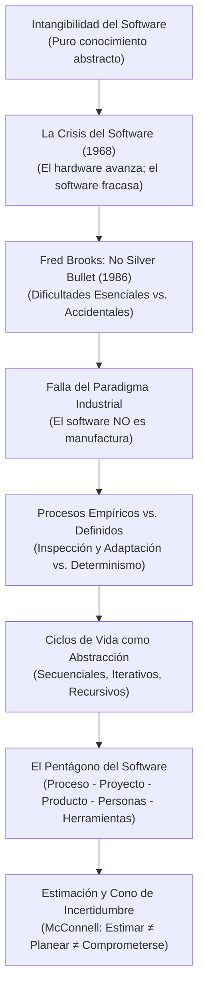
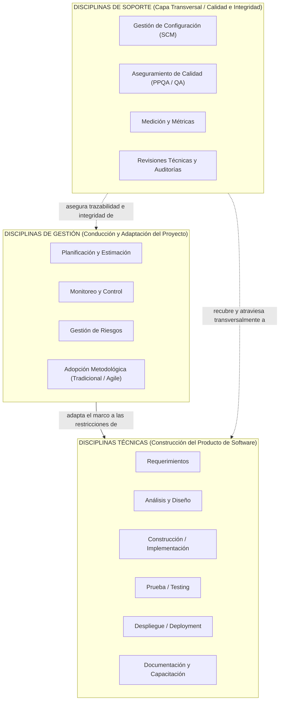
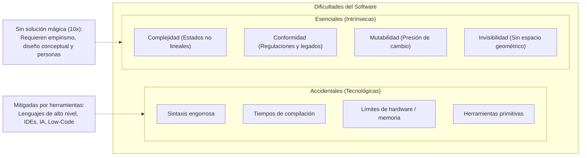
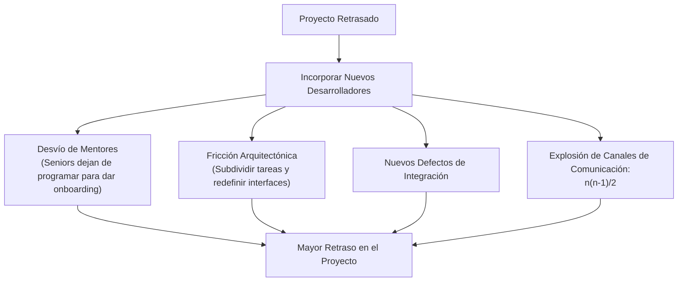
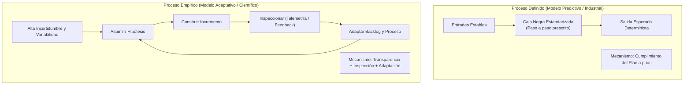
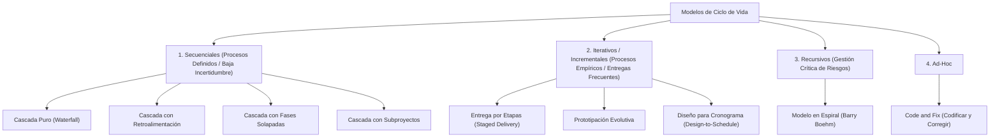
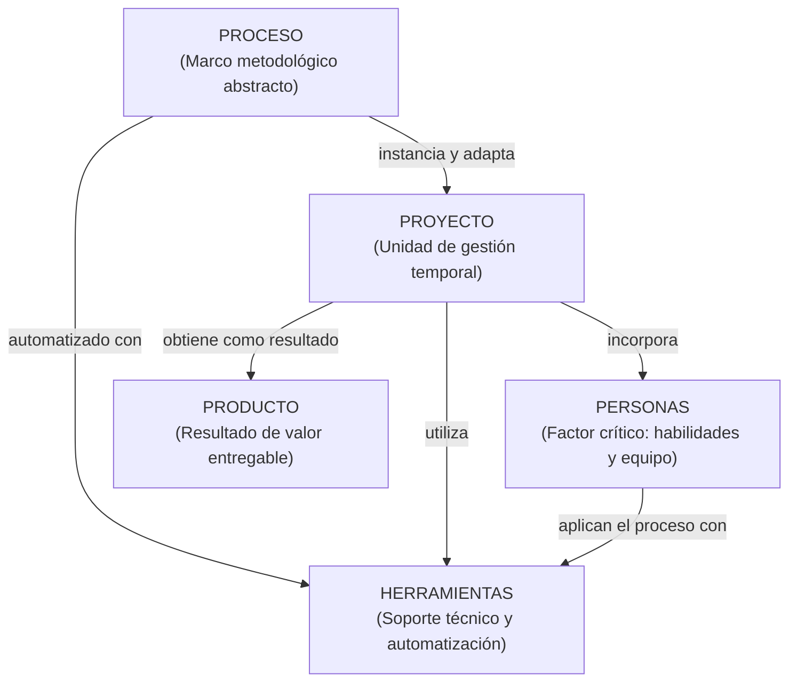
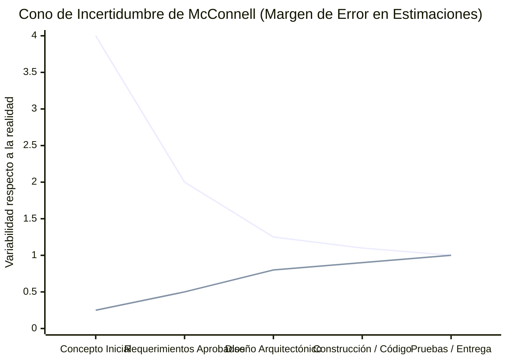

# Resumen Unidad 1: Fundamentos de la Ingeniería de Software, Procesos y Ciclos de Vida

> **Materia:** Ingeniería y Calidad de Software (UTN-FRC 4K2)  
> **Cátedra:** Ing. Laura Covara – Ing. Judith Meles  
> **Propósito:** Lectura consciente, retención y comprensión profunda de los modelos mentales de la Unidad 1 para responder preguntas de desarrollo con criterio de ingeniero y lenguaje técnico propio.

---

## 1. El Hilo Conductor: La Epistemología de la Unidad 1

Para comprender la Unidad 1 sin memorizar listas aisladas, hay que entender la historia como una cadena lógica de causas y consecuencias:



---

## 2. La Naturaleza del Software y la Crisis Histórica

### A. ¿Qué es realmente el Software?
En la cátedra de Judith Meles, el software **no es simplemente código fuente**. 
* **Definición de Software:** Es una configuración compleja compuesta por los **programas ejecutables**, las **estructuras de datos** que manipulan, y **toda la documentación asociada** (especificaciones de requisitos, modelos arquitectónicos, manuales operativos, casos de prueba, scripts de automatización) y las herramientas utilizadas para su construcción.
* **Definición Integradora (Slide 10):**
  > *"El software es conocimiento representado en distintos niveles de abstracción."*  
  Va desde el nivel más abstracto (la necesidad de negocio del cliente expresada en lenguaje natural) hasta el nivel más concreto y detallado (instrucciones de código máquina ejecutables en el procesador).

### B. Definición Formal de Ingeniería de Software (ISW)
* **Ian Sommerville:** Disciplina de la ingeniería que comprende todos los aspectos de la producción de software, desde las etapas tempranas de especificación hasta el mantenimiento posterior al despliegue.
* **IEEE 610.12:** Aplicación de un enfoque sistemático, disciplinado y cuantificable al desarrollo, operación y mantenimiento del software; es decir, la aplicación de principios de ingeniería al software.
* **David Parnas:** *"Construcción multipersona de software multiversión"*. Esta definición sintetiza los dos grandes problemas de la disciplina: la coordinación de personas y la gestión de la evolución en el tiempo.

### C. Las 5 Razones Ontológicas: Por qué el Software NO es Manufactura Industrial
Pregunta recurrente de parcial para evaluar comprensión propia: *"¿Por qué fracasa la gestión tradicional al intentar tratar al software como una línea de producción en serie?"*

1. **Es menos predecible:** En una línea de montaje (fábrica de autos), repetir los mismos pasos garantiza piezas idénticas. En software, factores cognitivos, ambigüedades del lenguaje humano y variaciones de entorno hacen que el resultado varíe.
2. **No hay producción en masa:** Casi ningún producto de software es igual a otro. La manufactura fabrica millones de copias de un mismo diseño; en software, el diseño **es** la construcción, y duplicar el producto final cuesta cero recursos (copiar bits).
3. **No todas las fallas son errores mecánicos:** El origen de los defectos en software es puramente conceptual y lógico (fallas de comprensión, diseño o validación), no degradación física de piezas.
4. **El software no se gasta (no sufre desgaste físico):** Una máquina se desgasta por fricción y se reemplaza por un repuesto idéntico. El software no se gasta: **muta**. Se degrada por la acumulación de cambios sucesivos, deuda técnica y obsolescencia frente a un entorno cambiante.
5. **No está gobernado por las leyes de la física:** Es una entidad abstracta e intangible, libre de limitaciones gravitacionales o de resistencia de materiales, pero restringida por los límites de la mente humana para dominar la complejidad.

---

### D. La Crisis del Software (OTAN 1968)
* **El Origen:** En octubre de 1968, la Conferencia de la OTAN en Garmisch (Alemania), liderada por **Friedrich Bauer**, formalizó el término *Crisis del Software*. Científicos como **Edsger Dijkstra** evidenciaron que los proyectos eran sistemáticamente incapaces de entregar software libre de defectos, dentro del costo previsto y en el plazo acordado.
* **Causa Raíz:** La invención de los circuitos integrados provocó una explosión en la capacidad del hardware (Ley de Moore). Las computadoras podían ejecutar sistemas enormemente más complejos, pero las técnicas de desarrollo de software seguían siendo artesanales. Se produjo una brecha tecnológica insalvable entre una máquina veloz y un proceso de desarrollo humano, desorganizado e intuitivo.
* **Manifestaciones Actuales de la Crisis:**
  - *Demandas crecientes:* Los usuarios exigen inmediatez, disponibilidad 24/7 y aplicaciones distribuidas masivas. Los métodos burocráticos tradicionales tardan meses en autorizar un cambio, volviéndose obsoletos antes de entregar.
  - *Bajas expectativas y falta de ingeniería:* La industria se acostumbró a convivir con software defectuoso ("se cayó el sistema"). Muchas organizaciones se conforman con que el sistema "funcione", sin aplicar estándares de mantenibilidad, seguridad ni verificación técnica.

### E. Las Estadísticas del Fracaso: The Standish Group (Chaos Report)
Datos cuantitativos que sustentan la justificación teórica:
* 13.1% Requerimientos incompletos.
* 12.4% Falta de involucramiento activo del usuario.
* 10.6% Falta de recursos suficientes.
* 9.3% Expectativas irreales de la gerencia.
* 8.7% Falta de soporte ejecutivo.
* 8.1% Requerimientos cambiantes y volátiles.
* **Conclusión de Cátedra:** El **80% de los fracasos de proyectos de software** se originan en fallas durante la toma, formalización y gestión de los requerimientos.

---

## 3. Disciplinas que Conforman la Ingeniería de Software

La cátedra clasifica las disciplinas en tres grandes grupos estructurados (Slide 33 de la Presentación 01, SWEBOK v3.0 de la IEEE y notas de clase):



### A. Los Tres Grupos de Disciplinas

1. **Disciplinas Técnicas (Orientadas a la Construcción del Producto):**
   Comprenden las actividades operativas directas que transforman las necesidades del negocio en software ejecutable:
   - **Ingeniería de Requerimientos:** Elicitación, análisis, especificación (ERS / User Stories) y validación de necesidades.
   - **Análisis y Diseño:** Modelado conceptual, arquitectura de software, interfaces y esquemas de datos.
   - **Construcción / Implementación:** Codificación, refactorización, depuración y pruebas unitarias.
   - **Prueba / Testing:** Verificación y validación funcional y no funcional (integración, regresión, pruebas de caja negra y pruebas de aceptación de usuario UAT).
   - **Despliegue (Deployment):** Empaquetado, distribución, migración de datos, instalación en infraestructura y puesta en producción.
   - **Documentación y Capacitación:** Manuales técnicos, guías operativas y entrenamiento a usuarios finales.

2. **Disciplinas de Gestión (Orientadas a la Conducción del Proyecto):**
   Comprenden las actividades de liderazgo, organización, monitoreo y control del esfuerzo temporal:
   - **Planificación y Estimación:** Determinación cuantitativa de esfuerzo, costos y plazos, armando cronogramas o sprints.
   - **Monitoreo y Control:** Seguimiento del progreso real contra el plan previsto (burndowns, hitos) y aplicación de acciones correctivas.
   - **Gestión de Riesgos:** Identificación, análisis de impacto y probabilidad, planes de contingencia y seguimiento continuo.
   - **Adopción y Adaptación Metodológica (*Tailoring*):** Ajuste de marcos tradicionales o ágiles a las restricciones concretas del proyecto.

3. **Disciplinas de Soporte (Transversales de Calidad e Integridad):**
   Son independientes de la tecnología y **atraviesan transversalmente todo el proceso** garantizando la integridad del producto:
   - **Gestión de Configuración del Software (SCM):** Identificación de ítems de configuración (SCI), control de versiones, líneas base (*baselines*), comités de control de cambios (CCB) y contabilidad de estado.
   - **Aseguramiento de Calidad de Proceso y Producto (PPQA / QA):** Evaluación objetiva e independiente para verificar el cumplimiento de procesos, estándares y procedimientos.
   - **Medición y Métricas de Software:** Recolección objetiva de datos (esfuerzo, defectos, cobertura, velocidad) para la toma de decisiones informada.
   - **Revisiones Técnicas Formales y Auditorías:** Inspecciones cruzadas de código/diseño y auditorías de configuración física (PCA) y funcional (FCA).

---

### B. Cómo se Articulan las Disciplinas con el Proceso de Desarrollo (Pregunta Clave de Judith Meles)

Pregunta típica de parcial: *"¿Cómo interactúan las disciplinas de gestión y de soporte con las disciplinas técnicas dentro del ciclo de vida?"*

* **La Gestión ADAPTA el marco:** Las disciplinas de gestión toman el marco conceptual abstracto y lo adaptan (*tailoring*) al contexto particular del proyecto (tamaño del equipo, experiencia, cultura organizacional, criticidad y restricciones de tiempo).
* **El Soporte RECUBRE y ATRAVIESA transversalmente:** Las disciplinas de soporte son **independientes del modelo de ciclo de vida elegido**. Se aplican tanto en Cascada como en RUP o Scrum. Recubren a todas las disciplinas técnicas desde el primer día de requerimientos hasta el mantenimiento post-entrega, asegurando que los cambios no destruyan la integridad del producto ni degraden su calidad.

---

## 4. Fred Brooks: Anatomía de la Dificultad (*No Silver Bullet*)

En 1986, Frederick Brooks escribió el paper definitivo de la disciplina: *No Silver Bullet - Essence and Accidents of Software Engineering*.



### A. Dificultades Accidentales vs. Dificultades Esenciales

> [!NOTE]
> **Dificultades Accidentales:** Aquellas inherentes a las limitaciones de la tecnología disponible en un momento histórico dado, pero que **no forman parte de la naturaleza misma del software**.  
> *Ejemplos superados:* Restricciones de memoria RAM, sintaxis binaria o assembler, tiempos de compilación de horas, procesamiento por lotes (batch). Hoy, herramientas como la IA generativa, frameworks modernos y plataformas Low-Code continúan reduciendo el trabajo accidental (escribir boilerplate, autocompletar código).

> [!IMPORTANT]
> **Dificultades Esenciales:** Propiedades inherentes e inevitables del software. Son 4 y no pueden eliminarse mediante ninguna herramienta tecnológica:
> 1. **Complejidad:** El software es más complejo para su tamaño que cualquier construcción humana, porque no existen dos partes idénticas (a diferencia de un edificio con miles de ladrillos iguales). La cantidad de estados posibles crece de forma combinatoria exponencial, haciendo imposible probar o prever mentalmente todas las interacciones.
> 2. **Conformidad:** El software no responde a leyes físicas universales (como la gravedad en ingeniería civil). Debe amoldarse arbitrariamente a instituciones humanas, leyes fiscales, regulaciones burocráticas y sistemas legados preexistentes, los cuales cambian sin lógica técnica.
> 3. **Mutabilidad:** Al carecer de materia física, el software está sometido a una presión social constante para ser modificado. Cuando un sistema tiene éxito, los usuarios descubren nuevos usos y exigen cambios que la arquitectura original no contemplaba.
> 4. **Invisibilidad:** El software es geométricamente invisible. No posee dimensiones espaciales. Si intentamos representarlo mediante diagramas (flujo de control, estructura de datos, llamadas de funciones), cada gráfico captura una sola dimensión desconectada del resto, ocultando la totalidad del sistema.

### B. El Mito del Hombre-Mes y la Ley de Brooks
En su libro *The Mythical Man-Month* (1975), Brooks ataca la falacia de estimar proyectos multiplicando personas por tiempo:
* **El hombre y el mes son recursos intercambiables solo en tareas divisibles sin comunicación entre trabajadores** (como cosechar trigo).
* Cuando una tarea tiene dependencias secuenciales intrínsecas, el esfuerzo no acorta el tiempo: *"Gestar un bebé toma nueve meses, sin importar cuántas mujeres se asignen a la tarea"*.



> [!CAUTION]
> **Ley de Brooks (Cita textual obligatoria de examen):**  
> *"Añadir personal a un proyecto de software que ya está retrasado, lo retrasará aún más."*
>
> **Las 4 Causas Obligatorias de Justificación:**
> 1. **Desvío de mentores productivos:** Los desarrolladores experimentados deben abandonar su trabajo técnico para capacitar a los nuevos integrantes (*onboarding*).
> 2. **Fricción por repartición del trabajo:** Subdividir módulos en curso obliga a rediseñar componentes y genera retrabajo.
> 3. **Aparición de defectos de interfaz:** Al aumentar el número de desarrolladores, aumenta la superficie de contacto entre módulos, disparando los errores de integración.
> 4. **Crecimiento combinatorio de canales de comunicación:**
>    $$\text{Canales} = \frac{n(n - 1)}{2}$$
>    - Para 4 personas: 6 canales.
>    - Para 8 personas: 28 canales.
>    - Para 12 personas: 66 canales.  
>    El esfuerzo requerido para mantener sincronizado al equipo supera ampliamente la capacidad productiva de los nuevos integrantes.

### C. Integridad Conceptual y Equipo Quirúrgico
* **Integridad Conceptual:** Es el criterio rector de la calidad arquitectónica. Un sistema debe transmitir una única filosofía de diseño, como si hubiera surgido de la mente de un solo arquitecto.
* **El Equipo Quirúrgico:** Brooks propone estructurar los equipos en torno a un **Cirujano (Arquitecto líder)** que toma las decisiones y escribe el código central, rodeado de un copiloto, un administrador (que gestiona burocracia y recursos), editores de documentación y especialistas técnicos, reduciendo al mínimo los canales cruzados de comunicación.
* **Efecto del Segundo Sistema (*Second-System Effect*):** Es el sistema más peligroso que diseña un ingeniero. Habiendo contenido su ambición en el primer sistema por falta de tiempo o experiencia, el arquitecto vuelca en el segundo todas las características secundarias, complejidades barrocas y adornos que tenía postergados, haciéndolo colapsar por sobre-ingeniería.

---

## 5. Paradigmas de Proceso: ¿Manufactura o Investigación?



### Cuadro Comparativo Exhaustivo (Evaluado en Parciales)

| Dimensión | Proceso Definido | Proceso Empírico |
| :--- | :--- | :--- |
| **Inspiración conceptual** | Líneas de ensamblaje industrial y manufactura en masa. | Método científico, investigación y procesos creativos complejos. |
| **Premisa operativa** | Repetir el mismo proceso bajo condiciones idénticas produce **siempre el mismo resultado**. | Operamos con variables humanas y tecnológicas cambiantes; repetir el proceso genera **resultados diferentes**. |
| **Mecanismo de control** | Estandarización y planificación detallada *a priori* (control predictivo). | **Inspección frecuente y adaptación continua** (control empírico). |
| **Los 3 Pilares** | Planificación, Asignación de tareas, Control de desvíos. | **Transparencia, Inspección y Adaptación**. |
| **Gestión del cambio** | El cambio se percibe como una desviación indeseable que debe ser reprimida por control de cambios formal. | El cambio se percibe como aprendizaje emergente y ventaja competitiva. |
| **Ciclo del conocimiento** | Lineal y unidireccional: *Planear $\to$ Ejecutar $\to$ Verificar*. | Circular y continuo: *Asumir $\to$ Construir $\to$ Retroalimentar $\to$ Revisar $\to$ Adaptar*. |

> [!WARNING]
> **La Trampa de Examen de Laura Covara (Corrección 2024 / 2025):**
> *"Si elegimos un ciclo iterativo e incremental, ¿cuál es la diferencia entre plantear una iteración en un proceso empírico vs. uno definido?"*
> 
> * **Respuesta Errónea (calificada con 5/10 por Covara):** *"En el proceso definido una iteración es una fase como análisis o diseño, y en el empírico es el producto entero"*. **Falso.** Eso confunde Cascada con Iterativo.
> * **Respuesta Perfecta (10/10):**
>   - En un **proceso definido iterativo** (ej. RUP formal cerrado), el alcance, objetivo y arquitectura de **todas las iteraciones se planifican de manera predictiva al inicio del proyecto**; cada iteración ejecuta un plan prescrito esperando resultados determinados y el alcance total no se altera sin comités burocráticos.
>   - En un **proceso empírico iterativo** (ej. Scrum), cada iteración (Sprint) parte de una hipótesis de valor. Al finalizar, **se inspecciona el incremento real funcionando** ante los usuarios reales y **se adaptan el backlog y las iteraciones futuras** en función del aprendizaje obtenido. El plan evoluciona con el software.

---

## 6. El Universo de los Ciclos de Vida (Steve McConnell - *Rapid Development*)

### A. Jerarquía Conceptual
Pregunta obligatoria de múltiple opción y desarrollo:
* **Ciclo de Vida:** Es una **representación simplificada y abstracta de un proceso**. Grafica la secuencia de etapas, sus transiciones y los criterios de entrada y salida entre fases.
* **Proceso de Desarrollo:** Es la **implementación concreta** del ciclo de vida; define las actividades técnicas detalladas, métodos, prácticas, roles y artefactos de trabajo.
* **Proyecto:** Es la **instanciación y adaptación** del proceso a un contexto específico con recursos y fechas determinadas.

```text
[Ciclo de Vida: Abstracción de etapas]
       │
       ▼ se implementa mediante
[Proceso de Desarrollo: Actividades, métodos, roles, artefactos]
       │
       ▼ se instancia y adapta en
[Proyecto: Esfuerzo temporario particular con Personas y Restricciones]
```

### B. Ciclo de Vida del Producto vs. Ciclo de Vida del Proyecto
* **Ciclo de Vida del Proyecto:** Es temporario. Nace con un objetivo específico (ej. construir la versión 1.0 o el MVP) y termina formalmente con la entrega y aceptación del entregable.
* **Ciclo de Vida del Producto:** Es estratégico y de largo plazo. Comienza con la concepción de la idea y atraviesa las etapas de *Introducción $\to$ Crecimiento $\to$ Madurez (operación y mantenimiento continuo) $\to$ Retiro definitivo del mercado*.
* **Axioma:** **A lo largo de la vida de un mismo producto de software se ejecutan múltiples proyectos sucesivos.**

---

### C. Catálogo Completo de Modelos de Ciclo de Vida



#### 1. Code and Fix (Codificar y Corregir)
* **Mecánica:** Se programa directamente sin requisitos ni diseño previo. Se codifica y se parcha hasta que el cliente no encuentra más fallas inmediatas.
* **Ventajas:** Cero tiempo invertido en planificación, estimación o documentación; arranque instantáneo.
* **Desventajas:** Mantenimiento peligrosamente caro; código sin arquitectura ("espagueti"); imposible de testear de forma repetible; falla catastróficamente al superar las mil líneas de código.
* **Uso exclusivo:** Proyectos personales descartables (*throwaway*) o pruebas de concepto de una sola tarde.

#### 2. Modelo en Cascada Puro (Waterfall)
* **Mecánica:** Secuencia lineal y ordenada: *Requisitos $\to$ Análisis $\to$ Diseño $\to$ Codificación $\to$ Pruebas $\to$ Despliegue*. Cada fase debe completarse al 100% y firmarse documentalmente antes de pasar a la siguiente. No hay solapamiento.
* **Ventajas:** Excelente control documental; encuentra defectos conceptuales temprano si los requisitos son perfectos; ideal para equipos inexpertos o con alta rotación de personal (la documentación define exactamente qué hacer).
* **Desventajas:** Inflexible ante cambios; no produce software ejecutable hasta el final del cronograma; descubrir un error de requisitos en la fase de pruebas genera un costo de retrabajo exponencial.
* **Cuándo usarlo:** Requisitos completamente estables, conocidos y congelados desde el primer día; dominios técnicos totalmente dominados; proyectos donde la calidad formal prima sobre el plazo.

#### 3. Cascada con Retroalimentación
* **Mecánica:** Similar a la cascada pura, pero permite retroceder a la fase inmediata anterior al detectar defectos o inconsistencias técnicas.
* **Ventajas:** Reconoce que la ingeniería de requisitos no es perfecta.
* **Desventajas:** Retrabajo costoso; dificulta la gestión del cronograma cuando los retornos son frecuentes.

#### 4. Cascada con Fases Solapadas
* **Mecánica:** Permite iniciar la fase siguiente (ej. comenzar el diseño de la base de datos) antes de que la fase previa (especificación de requerimientos) haya cerrado formalmente.
* **Ventajas:** Reduce el tiempo total de entrega al mercado (*Time-to-Market*).
* **Desventajas:** Aumenta el riesgo de desperdicio: si los requerimientos que aún no cerraron modifican aspectos ya diseñados, hay que rehacer trabajo.

#### 5. Cascada con Subproyectos
* **Mecánica:** Secuencial hasta completar el diseño arquitectónico global; a partir de allí, el sistema se descompone en subsistemas independientes que avanzan en cascadas paralelas coordinadas.
* **Ventajas:** Permite paralelizar el trabajo con múltiples equipos técnicos.
* **Desventajas:** Riesgo crítico en la etapa de integración final si las interfaces entre subsistemas no fueron especificadas rigurosamente.

#### 6. Entrega por Etapas (Staged Delivery)
* **Mecánica:** Realiza la especificación, el análisis y el diseño de la **totalidad del sistema al inicio**, pero descompone la implementación y entrega en **sucesivas etapas funcionales** que se liberan al cliente de forma incremental.
* **Ventajas:** El cliente obtiene funcionalidad utilizable en etapas tempranas; permite obtener retroalimentación operativa antes de finalizar todo el proyecto.
* **Desventajas:** Requiere una arquitectura inicial sumamente robusta para soportar entregas modulares; los requisitos no deben sufrir cambios radicales.

#### 7. Modelo en Espiral (Barry Boehm)
* **Mecánica:** Ciclo recursivo guiado por el análisis de riesgos. Cada vuelta de la espiral recorre 4 cuadrantes:
  1. *Determinar objetivos, alternativas y restricciones.*
  2. ***Identificar y resolver riesgos*** (mediante análisis detallado, simulación o prototipos).
  3. *Desarrollar y verificar el producto del nivel actual.*
  4. *Planificar la siguiente fase.*
* **Ventajas:** El foco primordial es la **mitigación proactiva del riesgo**; a medida que aumenta el costo acumulado, el riesgo residual disminuye; adecuado para proyectos de ciclo largo y misión crítica.
* **Desventajas:** Exige especialistas senior en evaluación de riesgos; la gestión del riesgo puede resultar más costosa que el propio desarrollo; no permite entregas funcionales tempranas al usuario final; difícil de auditar por hitos contractuales estándar.
* **Cuándo usarlo:** Proyectos gigantescos, complejos, con alta incertidumbre técnica o contractual donde el fracaso implique pérdidas millonarias o vidas humanas.

#### 8. Prototipación Evolutiva
* **Mecánica:** Se construye rápidamente un prototipo funcional rudimentario centrado en las funciones que el usuario necesita. El usuario interactúa con él, provee feedback y el prototipo se refina en ciclos sucesivos hasta convertirse en el sistema final desplegable.
* **Ventajas:** Elimina la ambigüedad en los requerimientos; el cliente ve resultados de inmediato; excelente para investigar interfaces complejas e innovadoras.
* **Desventajas:** Riesgo de degradación de la arquitectura por parches sucesivos; el cliente puede confundir un prototipo visual rápido con un sistema robusto y exigir que se ponga en producción antes de estar listo.
* **Cuándo usarlo:** Requerimientos altamente volátiles o desconocidos; clientes que no logran verbalizar lo que necesitan; tecnologías nuevas donde se desconoce la mejor solución técnica.

#### 9. Diseño para Cronograma (Design-to-Schedule)
* **Mecánica:** La fecha de entrega final y el presupuesto son innegociables. Las funcionalidades se priorizan de forma estricta. Si el tiempo se agota, **se descartan las funcionalidades secundarias**, garantizando la entrega en fecha con la funcionalidad núcleo.
* **Ventajas:** Cumplimiento garantizado del cronograma; evita horas extras y agotamiento del equipo.
* **Desventajas:** El alcance final entregado es variable.
* **Cuándo usarlo:** Proyectos condicionados por fechas regulatorias o eventos comerciales fijos (ej. software para los Juegos Olímpicos o liquidación impositiva anual).

---

### D. Matriz de Decisión para Justificación en Examen

Para responder con nota máxima a una pregunta de selección de ciclo de vida, se deben contrastar las características del dominio contra estas 6 variables:

| Factor de Evaluación | Cascada Puro | Entrega por Etapas | Prototipación Evolutiva | Espiral (Boehm) |
| :--- | :--- | :--- | :--- | :--- |
| **Claridad de Requisitos** | Claros, completos y congelados al inicio. | Claros globalmente; implementados en bloques. | Desconocidos, ambiguos o emergentes. | Complejos con incertidumbre en viabilidad técnica. |
| **Nivel de Riesgo** | Bajo o dominado técnicamente. | Medio; dependencias controladas. | Medio; enfocado en la interfaz/adopción. | **Crítico o catastrófico**. |
| **Madurez del Equipo** | Novatos o alta rotación (guiados por documentos). | Madurez técnica media/alta en arquitectura. | Desarrolladores rápidos y adaptables. | **Expertos senior en gestión de riesgos**. |
| **Urgencia del Cliente** | Puede esperar al final del proyecto. | Necesita entregas intermedias para operar. | Necesita ver resultados visuales ya. | Ciclo largo; prima la seguridad sobre el apuro. |
| **Entregas Parciales** | No admite entregas parciales. | **Admite entregas parciales planificadas**. | El software crece iterativamente. | Entregas internas de mitigación de riesgo. |

---

## 7. Componentes del Proyecto y el Pentágono Sistémico

### A. Definición de Proyecto
Un proyecto es un **esfuerzo temporario** que se lleva a cabo para crear un producto, servicio o resultado **único**.
* Posee una fecha de inicio y una fecha de finalización determinadas.
* No es una operación continua ni repetitiva.

### B. Distinción Clave: Alcance de Producto vs. Alcance de Proyecto
* **Alcance del Producto:** Todas las características, funcionalidades y requisitos técnicos que deben estar presentes en el software terminado.  
  *¿Contra qué se valida su cumplimiento?:* Contra la **Especificación de Requerimientos** (ERS o User Stories del Backlog).
* **Alcance del Proyecto:** Todo el trabajo (y *únicamente* el trabajo) necesario para construir y entregar el producto con la calidad acordada.  
  *¿Contra qué se controla su cumplimiento?:* Contra el **Plan de Proyecto** (cronograma, asignación de tareas, WBS).

---

### C. El Pentágono Sistémico del Software (Slide 35 de Presentación 06)



#### Dinámica de los 5 Vértices:
1. **PROCESO:** La definición metodológica (actividades, roles, métodos y artefactos).
2. **PROYECTO:** La unidad de gestión temporaria donde el Proceso se **instancia y adapta** (*tailoring*) al contexto particular del negocio.
3. **PERSONAS:** El factor crítico primordial; aportan habilidades cognitivas, motivación y trabajo colaborativo. Sin personas competentes, ningún proceso funciona.
4. **HERRAMIENTAS:** Dan soporte operativo y **automatizan** las tareas del proceso (IDEs, Git, CI/CD, linters).
5. **PRODUCTO:** El resultado tangible entregado (código ejecutable, arquitectura, documentación) que soluciona la necesidad del cliente.

---

## 8. Estimaciones Tradicionales y Cono de Incertidumbre (Steve McConnell)

### A. Estimar $\neq$ Planear $\neq$ Comprometerse
* **Estimación:** Una predicción probabilística e inherentemente inexacta basada en datos históricos y supuestos técnicos.
* **Plan:** Cómo se pretende organizar las tareas y los recursos para alcanzar los objetivos.
* **Compromiso:** Un acuerdo vinculante con fecha de entrega, presupuesto y alcance pactados ante los stakeholders.

### B. El Cono de Incertidumbre (*Cone of Uncertainty*)



* Al inicio del proyecto (fase de concepto/especificación inicial), el margen de variabilidad de la estimación oscila entre **$0.25\times$ y $4.0\times$** respecto a la realidad final (un factor de $16\times$ de diferencia entre el optimista y el pesimista).
* Conforme se avanza en el proyecto, se toman decisiones de diseño y se completa código, el cono converge hacia $1.0\times$.
* **Causa primaria del fracaso de la gestión tradicional:** Forzar al equipo a firmar **compromisos de costo y plazo fijos** en la parte más ancha del cono de incertidumbre.

### C. Métodos Tradicionales de Estimación
* **Juicio de Experto:** Estimación intuitiva realizada por un profesional senior. Su gran riesgo es la dependencia crítica de esa persona.
* **Estimación a Tres Puntos (Distribución Beta / PERT):**
  $$\text{Esfuerzo} = \frac{O + 4H + P}{6}$$
  Donde $O$ es el escenario Optimista, $H$ el Habitual (más probable) y $P$ el Pesimista.
* **Wideband Delphi (Juicio de Experto Grupal):**
  - Técnica estructurada para lograr consenso grupal evitando sesgos.
  - **Pregunta de parcial:** *¿Por qué las estimaciones intermedias de Wideband Delphi deben ser secretas y anónimas?*  
    *Respuesta:* Para eliminar el **efecto de anclaje**, la presión jerárquica y el condicionamiento de los perfiles más extrovertidos o de mayor jerarquía sobre los integrantes más jóvenes.
* **Causa principal de desvío en estimaciones:** La **omisión sistemática de actividades complementarias** por optimismo de los desarrolladores (pruebas unitarias, armado de datasets, refactorización, revisiones de código, reuniones de coordinación, licencias y contingencias).

---

## 9. Síntesis Mental: Las 10 Respuestas de Oro para Judith Meles

1. **¿Qué es software?:** Es conocimiento representado en distintos niveles de abstracción; comprende programas ejecutables, documentación asociada y estructuras de datos.
2. **¿Por qué el software no es manufactura?:** Porque es intangible, no se desgasta físicamente (muta), no se fabrica en serie, es cognitivo y menos predecible.
3. **¿Cuál fue la causa de la Crisis del Software?:** El desacoplamiento entre el crecimiento exponencial del hardware y la naturaleza artesanal/humana del desarrollo de software.
4. **¿Qué demostró Brooks con "No Silver Bullet"?:** Que ninguna herramienta tecnológica puede lograr por sí misma un salto de $10\times$ en una década, porque las herramientas mitigan dificultades *accidentales*, mientras que las dificultades *esenciales* (complejidad, conformidad, mutabilidad, invisibilidad) son inherentes e incurables.
5. **¿Qué dice la Ley de Brooks y por qué?:** Añadir personal a un proyecto retrasado lo retrasa más, debido al desvío de mentores en onboarding, fricción por repartición del trabajo, nuevos errores de interfaz y la explosión de canales de comunicación según $n(n-1)/2$.
6. **¿Por qué el desarrollo de software es un proceso empírico?:** Porque opera en entornos complejos con variables cambiantes e incertidumbre; su control no se logra estandarizando a priori, sino mediante **transparencia, inspección frecuente y adaptación continua**.
7. **¿Cuál es la relación entre ciclo de vida y proceso de desarrollo?:** El ciclo de vida es una **representación abstracta y simplificada de un proceso**; el proceso es la implementación metodológica concreta; el proyecto es su instanciación y adaptación.
8. **¿Qué diferencia el ciclo de vida del proyecto del ciclo de vida del producto?:** El proyecto es temporario y acotado a un entregable; el producto es de largo plazo y contiene múltiples proyectos a lo largo de su existencia.
9. **¿Cuándo se elige el modelo en Cascada y cuándo el Espiral?:** Cascada cuando los requisitos son claros, completos y estables, con baja incertidumbre técnica. Espiral cuando el proyecto es gigantesco, de ciclo largo y existen riesgos críticos o catastróficos que deben mitigarse antes de construir.
10. **¿Qué representa el Pentágono del Software?:** El Proceso se instancia y adapta en el Proyecto, que es automatizado con Herramientas, incorpora Personas con habilidades y obtiene como resultado el Producto.
