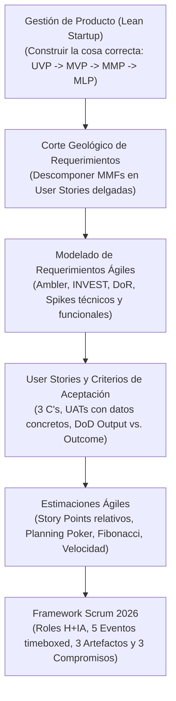
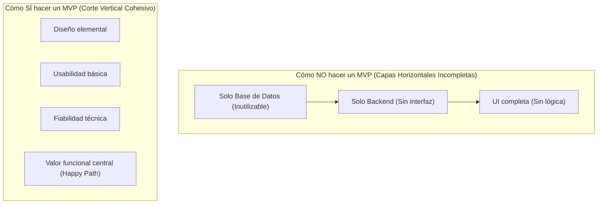
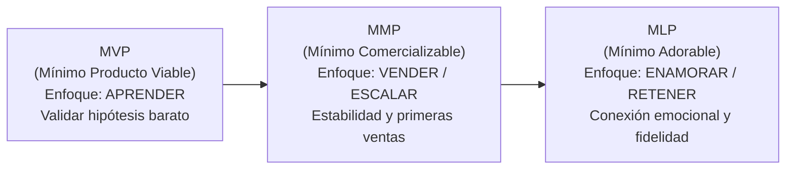
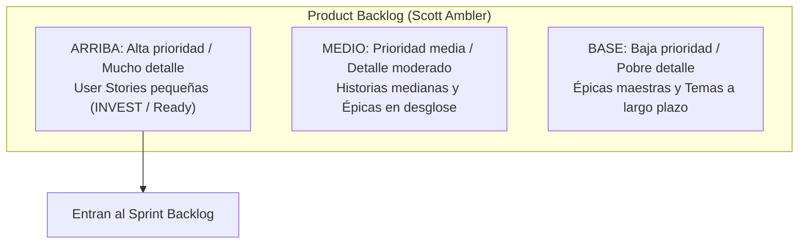
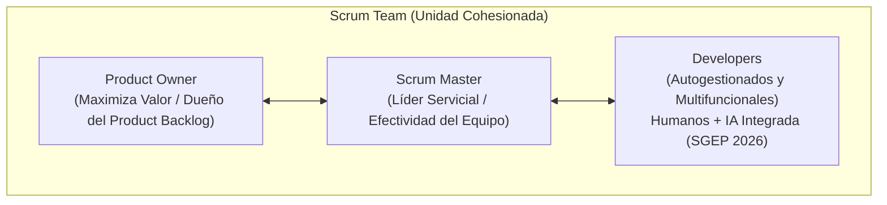

# Resumen Unidad 2: Gestión Lean-Ágil de Productos, Requerimientos, User Stories, Estimaciones y Scrum

> **Materia:** Ingeniería y Calidad de Software (UTN-FRC 4K2)  
> **Cátedra:** Ing. Laura Covara – Ing. Judith Meles  
> **Propósito:** Guía de lectura consciente, retención y comprensión profunda de la Unidad 2. Desarrolla la totalidad de los conceptos teóricos, modelos mentales, filminas oficiales y trampas de examen para el 1er Parcial.

---

## 1. El Hilo Conductor: La Epistemología de la Unidad 2

En la Unidad 1 comprendimos que el software es intangible y complejo (Brooks), y que por ende no puede gestionarse como una línea de producción en serie (proceso definido), requiriendo un **proceso empírico** basado en inspección y adaptación.

La Unidad 2 materializa este empirismo en la práctica ingenieril a través de 5 pilares articulados:



---

## 2. Gestión de Producto: De la Viabilidad Técnica a la Creación de Valor

### A. La Filosofía Lean y la Paradoja del Valor (Slide 3 y 4 de Presentación 05)
* **Axioma de Eric Ries (*The Lean Startup*):**
  > *"El mayor riesgo en el desarrollo de software no es fallar técnicamente, sino construir a la perfección algo que nadie quiere."*
* **Creación de Valor vs. Desperdicio (*Waste*):** El pensamiento Lean define la creación de valor como **proveer beneficios reales, perceptibles y medibles a los clientes**. Cualquier actividad, documento o línea de código que no contribuya directamente a resolver el problema del cliente es desperdicio puro.
* **La Paradoja de Construir Más para Entregar Menos (Datos de la Industria):**
  - **45% de las funcionalidades desarrolladas en un sistema típico NUNCA se utilizan.**
  - 19% se utilizan raramente.
  - 16% se utilizan a veces.
  - 13% se utilizan a menudo.
  - **Solo el 7% se utilizan siempre.**
* **Conclusión de Cátedra:** Escribir código no es sinónimo de crear valor. La productividad de un equipo de ingeniería no se mide por la cantidad de funcionalidades entregadas, sino por la **adopción real y el retorno de inversión del cliente**.

### B. La Brecha Evolutiva del Ingeniero de Software
Para Judith Meles, el desafío más difícil de cruzar en la formación del ingeniero es la transición entre dos mentalidades:
* **Focalizado en Tareas (Mentalidad de Desarrollador Artesanal):** Piensa en entidades de base de datos, tablas, algoritmos, pantallas y características técnicas aisladas. Pregunta: *"¿Qué tengo que programar?"*
* **Focalizado en Experiencias (Mentalidad de Ingeniero de Producto):** Diseña **contextos de uso y valor humano**. Entiende el flujo de vida del usuario, reduce la fricción operativa y mide si el software resuelve una necesidad real. Pregunta: *"¿Qué problema de negocio estamos resolviendo y cómo medimos su éxito?"*

### C. La Trampa de "La Audacia del Cero" y el Ciclo Lean Startup
* **La Audacia del Cero (*The Audacity of Zero*):** Es el incentivo perverso que tienen los equipos tradicionales de retrasar el lanzamiento del producto buscando la "perfección". Mientras el producto no sale a la luz, el número de clientes es cero y los ingresos son cero, lo cual permite que los inversores y la gerencia sigan viviendo en una fantasía de potencial infinito.
* **El Costo del Retraso (*Cost of Delay*):** Cada semana que se pospone el lanzamiento para agregar features secundarias aumenta el esfuerzo desperdiciado, pierde retroalimentación temprana del mercado y maximiza el riesgo de construir un fracaso masivo.
* **El Antídoto Empírico:** Diseñar un experimento mínimo para confrontar la realidad lo antes posible:
  $$	ext{Construir (Producto / MVP)} \longrightarrow 	ext{Medir (Telemetría / Datos reales)} \longrightarrow 	ext{Aprender (Validar Hipótesis / Pivotar)}$$

### D. Casos de Estudio Reales Analizados por la Cátedra (Slide 8, 9 y 10)
1. **Dropbox (Prueba de Humo / *Smoke Test*):**
   - *El Reto Técnico:* Integración compleja a nivel de kernel de múltiples sistemas operativos (Windows, Mac, Linux) y almacenamiento distribuido masivo en la nube. Construir la arquitectura completa sin saber si los usuarios la entenderían era un riesgo de millones de dólares.
   - *El Experimento (MVP):* Drew Houston grabó un **video banal de 3 minutos** narrando la experiencia de arrastrar un archivo a una carpeta y ver cómo se sincronizaba. **¡No había producto real construido!** Era una simulación visual.
   - *Resultado:* La lista de espera beta pasó de 5.000 a **75.000 personas de la noche a la mañana**, validando la demanda con costo casi nulo antes de escribir el código complejo de red.
2. **Facebook (Validación Temprana en Dos Vías - 2004):**
   - Con ingresos casi nulos y solo 150.000 usuarios en universidades, levantó \$500.000 de capital de riesgo. ¿Por qué? Porque validó dos hipótesis de comportamiento humano:
   - **Track 1 - Hipótesis de Valor:** ¿El producto entrega valor al usarlo? Métrica: *Tasa de retención diaria*. Más del **50% de los usuarios registrados volvían al sitio todos los días**, pasando horas dentro de la plataforma.
   - **Track 2 - Hipótesis de Crecimiento:** ¿Cómo descubren el producto nuevos usuarios? Métrica: *Viralidad orgánica*. En un solo mes, el **75% del campus de Harvard lo utilizaba con \$0 invertidos en publicidad**.

---

### E. La Anatomía del Producto Mínimo Viable (MVP)
* **¿Qué es un MVP?:** Es la versión más pequeña y económica de un producto que permite a un equipo recolectar la **máxima cantidad de aprendizaje validado sobre los clientes con el menor esfuerzo posible**.
* **Cómo NO hacer un MVP (El error del producto fragmentado):** Construir solo la base de datos o solo la interfaz gráfica. Si no funciona de punta a punta, no es viable.
* **Cómo SÍ hacer un MVP (El corte vertical cohesivo):** Proveer una experiencia básica pero completa que abarque funcionalmente las cuatro capas: **Diseño básico + Usabilidad elemental + Fiabilidad técnica + Valor funcional real**. Debe resolver el problema central del *Happy Path*.



### F. Señales de Mercado y el Pivote (Slide 12 y 13)
* **UVP (Propuesta de Valor Única):** La hipótesis principal; lo que hace único al producto frente a alternativas existentes.
* **Fase A (La Señal Dispersa):** El equipo lanza el MVP y los usuarios dicen: *"Es genial, pero le falta la función X"*, y cada usuario pide una función X totalmente distinta. **Diagnóstico:** Aún no se ha encontrado un mercado ni un perfil de cliente unificado.
* **Fase B (La Señal Clara):** Todos los usuarios coinciden en demandar la misma carencia fundamental o usan el producto para un fin inesperado. **Acción:** El equipo realiza un **Pivote** (cambio estructurado de estrategia manteniendo la visión) y construye el **MVP 2**.

### G. Matriz de Priorización para el Alcance del MVP (Slide 14)
Cuadrante fundamental para justificar exclusiones en el parcial:
1. **HACER (Urgente e Importante):** Incluir en el MVP. Componentes críticos de la Propuesta de Valor Única indispensables para el flujo básico.
2. **PLANEAR (Importante pero No Urgente):** Funcionalidades de maduración y optimización para el lanzamiento comercial Beta o releases futuros.
3. **DELEGAR (Urgente pero No Importante):** Integraciones con plataformas de terceros o APIs existentes (ej. MercadoPago, autenticación con Google, servicios de envío tercerizados) en lugar de desarrollarlas desde cero.
4. **ELIMINAR (Ni Urgente ni Importante):** Desperdicio puro. Remover del Roadmap del producto.

---

### H. El Espectro de los Productos Mínimos: MVP vs. MMP vs. MLP



#### Cuadro Comparativo Diagnóstico (Slide 24 y 25 de Presentación 05)

| Dimensión | MVP (Viable) | MMP (Comercializable) | MLP (Adorable / *Lovable*) |
| :--- | :--- | :--- | :--- |
| **Objetivo Principal** | **Aprender y validar hipótesis de negocio** de forma económica y veloz. | **Atender a una base amplia de usuarios generales** y generar ingresos. | **Crear conexión emocional profunda, deleite y lealtad** en mercados maduros. |
| **Enfoque de Diseño** | Investigar, empatizar, prototipar; alcance mínimo indispensable. | Construir y refinar; testing riguroso, estabilidad arquitectónica. | Diseñar para el deleite; micro-interacciones pulidas, reducción radical de fricción. |
| **Público Objetivo** | *Early Adopters* (usuarios tolerantes a fallas con la necesidad urgente). | Clientes del mercado masivo (*Early Majority*). | Usuarios exigentes en mercados con competidores bien financiados. |
| **Resultado Clave** | Informar y ajustar el alcance futuro (o pivotar). | Salida formal al mercado ($MMP = MMR_1$). Calidad comercial. | Retención a largo plazo, alta recomendación (NPS) y defensa de marca. |
| **Ejemplo Típico** | Video de Dropbox, formulario manual detrás de escena. | Versión 1.0 estable lanzada a producción con facturación. | Spotify (listas Discover personalizadas), WhatsApp (simplicidad y fiabilidad extrema). |

### I. Los 10 Bloques de Construcción de la Adorabilidad del MLP (Slide 23)
En mercados saturados, lo meramente "viable" parece mediocre. El MLP busca impactar en estos 10 bloques cognitivos:
1. **Inspiración:** Ayuda al usuario a perseguir un propósito o estilo de vida significativo.
2. **Crecimiento:** Fomenta el desarrollo personal o profesional del usuario.
3. **Confianza en uno mismo:** Hace que el usuario se sienta capaz e inteligente al usar la interfaz.
4. **Utilidad:** Resuelve el problema de raíz con mínima cantidad de pasos.
5. **Esperanza:** Brinda soluciones a problemas que antes se creían imposibles de resolver.
6. **Halo / Estatus:** El usuario siente orgullo o pertenencia al utilizar la herramienta.
7. **Motivación:** Estimula la acción continua mediante refuerzos positivos inmediatos.
8. **Diversión / Deleite:** Micro-animaciones, sonidos agradables y respuestas visuales fluidas.
9. **Escala:** Funciona con la misma solidez para diez que para diez millones de usuarios.
10. **Satisfacción y Cuidado:** El usuario percibe que la empresa se preocupa genuinamente por sus necesidades humanas.

### J. Granularidad del Ecosistema de Mínimos: MMF vs. MVF vs. MMR (Slide 15 a 19)
* **MMF (Minimum Marketable Feature):** La pieza más pequeña de funcionalidad con **alta certeza comercial** que puede liberarse aportando valor inmediato al cliente y crecimiento a la empresa. Reduce el *Time-to-Market*.
* **MVF (Minimum Viable Feature):** Funcionalidad pionera con **alta incertidumbre**, diseñada como un pequeño experimento dentro de un producto maduro para evaluar una nueva línea de valor.
* **MMR (Minimum Marketable Release):** Cada paquete de incremento que se libera formalmente al mercado conteniendo un conjunto de MMFs. El primer release formal dirigido a clientes generales es el MMP ($MMP = MMR_1$).
* **El Corte Geológico (*Geological Slice* - Slide 16):** Aunque un MVP o un MMF son atómicos desde la perspectiva de negocio (no se puede aprender de algo más chico), son gigantescos para los desarrolladores. Las **User Stories** son las rebanadas finas de ejecución técnica que atraviesan todas las capas tecnológicas (UI, lógica de negocio, datos) para implementar un MMF de forma incremental.

---

## 3. Requerimientos Ágiles

### A. El Manifiesto Ágil: Los 4 Valores y los 12 Principios Fundacionales (Febrero 2001)

El enfoque ágil tiene su partida formal de nacimiento en **febrero de 2001**, cuando 17 líderes de la industria del software (Kent Beck, Martin Fowler, Ken Schwaber, Jeff Sutherland, Ward Cunningham, Alistair Cockburn, Bob Martin, entre otros) se reunieron en Snowbird, Utah, y proclamaron el **Manifiesto por el Desarrollo Ágil de Software (*Agile Manifesto*)**.

El Manifiesto se estructura en dos niveles inseparables: **4 Valores Fundamentales** y **12 Principios Operativos**.

#### 1. Los 4 Valores del Manifiesto Ágil
La declaración canónica establece una comparación directa entre el paradigma tradicional (derecha) y el paradigma ágil (izquierda):

> *Estamos descubriendo formas mejores de desarrollar software tanto por nuestra propia experiencia como ayudando a terceros. A través de este trabajo hemos aprendido a valorar:*
>
> 1. **Individuos e interacciones** por sobre *procesos y herramientas*.
> 2. **Software funcionando** por sobre *documentación extensiva*.
> 3. **Colaboración con el cliente** por sobre *negociación contractual*.
> 4. **Respuesta ante el cambio** por sobre *seguir un plan*.
>
> *Esto es, aunque reconocemos valor en los elementos de la derecha, **valoramos más los de la izquierda**.*

* **Desglose de los 4 Valores según la Cátedra:**
  * **01. Individuos e interacciones por sobre procesos y herramientas:** El software es una actividad creativo-humana. Ningún proceso por más maduro que sea (CMMI, RUP) ni ninguna herramienta avanzada puede compensar la falta de comunicación, motivación o talento de las personas.
  * **02. Software funcionando por sobre documentación extensiva:** No implica "cero documentación". Significa documentar *Just-in-Time* lo estrictamente necesario que agregue valor y mantenga el conocimiento transparente. La medida real de avance es código probado y ejecutable, no especificaciones teóricas de 300 páginas.
  * **03. Colaboración con el cliente por sobre negociación contractual:** El enfoque tradicional de cliente vs. proveedor crea trincheras legales rígidas. El agilismo integra al cliente dentro del equipo (representado en Scrum por el Product Owner) para co-crear el producto de manera continua.
  * **04. Respuesta ante el cambio por sobre seguir un plan:** Los requerimientos son naturalmente cambiantes y mutables (Brooks). Apegarse ciegamente a un plan prefijado conduce al fracaso comercial; abrazar el cambio brinda ventaja competitiva.

---

#### 2. Los 12 Principios del Manifiesto Ágil
Son las directrices prácticas que sustentan los 4 valores y dan sustento a los Requerimientos Ágiles y a Scrum:

1. **Satisfacción del Cliente:** Nuestra mayor prioridad es satisfacer al cliente a través de la entrega temprana y continua de software con valor.
2. **Aceptación del Cambio:** Aceptamos que los requerimientos cambien, incluso en etapas tardías del desarrollo. Los procesos ágiles aprovechan el cambio para proporcionar ventaja competitiva al cliente.
3. **Entregas Frecuentes:** Entregamos software funcional con frecuencia, desde un par de semanas a un par de meses, con preferencia por los períodos más cortos.
4. **Colaboración Diaria:** Los responsables de negocio y los desarrolladores deben trabajar juntos de forma cotidiana durante todo el proyecto.
5. **Individuos Motivados:** Construimos proyectos en torno a personas motivadas. Les damos el entorno y el apoyo que necesitan, y confiamos en que realizarán la tarea.
6. **Conversación Cara a Cara:** El método más eficiente y eficaz de comunicar información al equipo de desarrollo y entre sus miembros es la conversación cara a cara.
7. **Software Funcionando:** El software funcionando es la medida principal de progreso.
8. **Desarrollo Sostenible:** Los procesos ágiles promueven el desarrollo sostenible. Patrocinadores, desarrolladores y usuarios deben poder mantener un ritmo de trabajo constante indefinidamente.
9. **Excelencia Técnica:** La atención continua a la excelencia técnica y al buen diseño mejora la agilidad (la calidad interna no es negociable).
10. **Simplicidad:** La simplicidad —el arte de maximizar la cantidad de trabajo no realizado— es esencial (no construir código que nadie pidió).
11. **Equipos Autoorganizados:** Las mejores arquitecturas, requerimientos y diseños emergen de equipos autoorganizados.
12. **Mejora Continua (Reflexión y Ajuste):** A intervalos regulares, el equipo reflexiona sobre cómo ser más efectivo para luego afinar y ajustar su comportamiento en consecuencia (origen de la Sprint Retrospective).


### A. Crítica al Tradicional BRUF (*Big Requirements Up Front* - Slide 16 de Presentación 03)
* **El Enfoque Tradicional:** Pretende que los analistas capturen y congelen el 100% de los requerimientos en un documento contractual exhaustivo (ERS) antes de permitir que comience el diseño o la codificación.
* **Por qué colapsa:**
  1. *El software es mutable por naturaleza (Brooks):* Los usuarios no saben lo que realmente necesitan hasta que interactúan con software funcionando.
  2. *El costo del cambio no es constante:* Los requisitos congelados generan documentación obsoleta que se desincroniza del código real.
  3. *Resistencia patológica al cambio:* La gestión tradicional castiga las modificaciones mediante comités burocráticos, transformando el aprendizaje del usuario en un "problema".

### B. Principios Ágiles para los Requerimientos (Slide 26 y 27)
1. Los requerimientos no son un contrato; son un **diálogo continuo**.
2. Los requerimientos emergentes y cambiantes son una **ventaja competitiva** para el cliente si el proceso tiene la agilidad para absorberlos.
3. El detalle no se vuelca al inicio; los requerimientos se detallan **en el momento justo (*Just-in-Time*)**, cuando están por entrar a un sprint.
4. La documentación exhaustiva es reemplazada por la **conversación cara a cara**, que transmite la mayor riqueza de contexto y elimina ambigüedades.

### C. La Pila Dinámica de Requisitos (Scott Ambler - Slide 23 y 24)
* El **Product Backlog** funciona como una pila vertical ordenada estrictamente por valor de negocio y riesgo:
  - **Arriba de la pila:** User Stories pequeñas, perfectamente refinadas, detalladas, estimadas y listas para entrar al próximo Sprint (cumplen el criterio *Ready* / INVEST).
  - **En el medio de la pila:** Historias de tamaño mediano (Épicas desglosadas) con menos nivel de detalle.
  - **En la base de la pila:** Épicas maestras y Temas a largo plazo con baja definición técnica, que solo se analizarán cuando ganen prioridad comercial.
* Nuevos requisitos pueden ingresar, reordenarse o eliminarse en cualquier momento sin penalización burocrática.



### D. Modelado de Roles de Usuario (Slide 37 a 42)
En agilidad, los requerimientos no se piensan para "el usuario" como concepto genérico abstracto:
* **Técnica de Modelado de Roles:**
  1. *Brainstorming de Roles:* Identificar todos los roles posibles que interactúan con el sistema (comprador impulsivo, administrador nocturno, supervisor de auditoría).
  2. *Agrupamiento y Consolidación:* Fusionar roles redundantes y mapear jerarquías de uso.
  3. *Tarjeta de Rol de Usuario:* Documentar atributos clave: frecuencia de uso, nivel técnico, objetivos de negocio y restricciones.
  4. *Personas Extremas (*Extreme Personas*):* Diseñar teniendo en cuenta casos límite (ej. una persona no vidente, un usuario que usa guantes de trabajo en una fábrica, un usuario con conexión 2G inestable) para descubrir requerimientos no funcionales de usabilidad que de otro modo pasarían inadvertidos.
  5. *Usuarios Representantes (*Proxies*):* Cuando el usuario final no está accesible directamente (ej. un software médico o para astronautas), se utilizan intermediarios calificados que representan sus necesidades operativas ante el Product Owner.

### E. Spikes (Slide 66 a 69)
* **Definición Formal:** Un Spike es un **tipo especial de User Story de aprendizaje e investigación** diseñado para reducir drásticamente el riesgo y la incertidumbre de una funcionalidad compleja antes de que el equipo se comprometa a estimarla y construirla.
* **Características Obligatorias:**
  - **No entregan valor de negocio directo al usuario final:** Entregan conocimiento técnico o validación de diseño.
  - **Tienen Timebox estricto:** Se les asigna una cantidad fija de horas o días; cuando el tiempo termina, el Spike se da por cerrado con el aprendizaje alcanzado.
  - **No se estiman con Story Points estándar:** Generalmente consumen capacidad fija del sprint.
* **Clasificación de Spikes:**
  1. **Spike Técnico:** Investiga la viabilidad dentro del dominio de la solución tecnológica.  
     *Ejemplos de clase:* Evaluar el rendimiento de una librería gráfica para un mapa interactivo; investigar el protocolo de integración con la pasarela de pagos de MercadoPago; probar la viabilidad de lectura de códigos QR con la cámara del dispositivo móvil; analizar decisión de arquitectura *build vs. buy*.
  2. **Spike Funcional:** Investiga la viabilidad dentro del dominio del problema y la interacción del usuario.  
     *Ejemplos de clase:* Construir un prototipo rápido de pantalla (mockup navegable) para exponerlo a 5 visitantes del parque y evaluar si entienden la distribución de sectores antes de programar la lógica del mapa.

---

## 4. User Stories: Anatomía, Criterios y Validación

### A. Las 3 C's de Ron Jeffries (Slide 30 de Presentación 03)
Una User Story no es un documento de requerimientos tradicional; se compone de tres elementos inseparables:
1. **Card (Tarjeta):** El soporte físico o digital que contiene la frase verbal y la descripción sintetizada. Actúa como un **recordatorio físico de una conversación que debe suceder**, no como una especificación cerrada.
2. **Conversation (Conversación):** El diálogo continuo entre el Product Owner, los Developers y los Stakeholders durante el refinamiento y la planificación para clarificar el contexto, entender los matices y consensuar alternativas.
3. **Confirmation (Confirmación):** Los Criterios de Aceptación y las Pruebas de Aceptación de Usuario (UAT) que establecen las condiciones objetivas y verificables para que la historia se considere terminada exitosamente.

### B. La Estructura Canónica de la Tarjeta
* **Nomenclatura (Frase Verbal):** Frase verbal en infinitivo que resume la acción concreta: `[Acción] + [Objeto]` (ej. `Registrar usuario vendedor`, `Publicar producto`, `Comprar entradas`).
* **Plantilla Estándar (Connextra):**
  > **Como** [Rol específico del usuario con perfil claro]  
  > **Quiero** [Funcionalidad o capacidad técnica concreta del sistema]  
  > **Para** [Beneficio de negocio medible, auditable y justificado]

> [!WARNING]
> **Corrección Real de Laura Covara (Tema B 2025):**
> Si en el campo `Para...` escribís un beneficio vago como *"para poder ver la información"* o *"para usar la aplicación"*, Covara te anota en rojo: **"¡No queda claro el valor de negocio!"** y descuenta puntos.  
> El beneficio debe explicar la consecuencia operativa o económica: *"para auditar la distribución de fondos y garantizar la trazabilidad de los pagos"* o *"para asegurar mi lugar en el parque y evitar demoras en la boletería física"*.

---

### C. Criterios de Aceptación vs. Pruebas de Usuario (UAT)
Esta distinción es donde se producen la mayor cantidad de errores en el práctico:

* **Criterios de Aceptación (Reglas de Negocio Declarativas):**
  - Son las **políticas y restricciones del sistema** redactadas de forma declarativa.
  - Definen los límites del comportamiento aceptable: campos obligatorios, formatos esperados, rangos numéricos válidos, políticas de negocio y estados resultantes.
  - *Ejemplo:* *"La fecha límite de validez debe encontrarse entre 24 y 48 horas desde la fecha actual"* o *"El precio debe ser un valor decimal mayor a cero"*.
* **Pruebas de Aceptación de Usuario (UAT - Escenarios Operativos):**
  - Son los **casos de prueba concretos ejecutables** que verifican el cumplimiento de los criterios de aceptación.
  - **Sintaxis Exigida por Laura Covara:** `Probar [acción del usuario con datos duros específicos] y [PASA / FALLA]`.
  - **Uso de datos concretos:** No poner *"con precio inválido"*; poner *"con precio -$500 y [FALLA]"*.
  - **Significado de [FALLA]:** Significa que el sistema **bloquea la operación y advierte el error de validación esperado**, confirmando que la regla de negocio restrictiva opera correctamente.

> [!CAUTION]
> **Las 3 Correcciones en Tinta de Laura Covara en UATs Reales:**
> 1. *"¡Misma prueba!":* Ocurre cuando un alumno escribe dos pruebas negativas idénticas variando solo un sinónimo (ej. `Probar con monto negativo` y abajo `Probar con monto menor a cero`).
> 2. *"¿Diferencia con las otras que pasan?":* Ocurre cuando se escriben múltiples pruebas positivas que no prueban distintas ramas lógicas ni valores límite, sino que repiten el Happy Path.
> 3. *"Faltará describir más una oferta válida: datos numéricos":* Ocurre cuando se escribe una prueba positiva genérica como `Probar enviar oferta y recibir email (pasa)` sin detallar los datos duros que componen esa oferta válida.

---

### D. Criterio de Hecho (*Definition of Done - DoD*) vs. Criterio de Listo (*Definition of Ready - DoR*)
* **Definition of Ready (DoR):** Acuerdo del equipo que establece las condiciones que debe cumplir una User Story en el Product Backlog para poder ser seleccionada e ingresada al Sprint Backlog durante la Sprint Planning. Generalmente exige cumplir con el modelo **INVEST**, tener dependencias externas resueltas, Criterios de Aceptación redactados y estimación consensuada en Story Points.
* **Definition of Done (DoD):** Descripción formal del estado de calidad técnica que debe alcanzar el Incremento para ser considerado terminado y potencialmente desplegable a producción.
  - **Output Done (DoOD):** Verifica artefactos técnicos: código libre de advertencias de linter, pruebas unitarias e integración en verde con cobertura mínima, revisión de pares (*code review*) aprobada, merge a la rama principal y documentación actualizada.
  - **Outcome Done (DoCD):** Verifica impacto en el negocio: la funcionalidad desplegada generó la adopción, retención o métrica comercial prevista en el comportamiento del usuario.

### E. El Modelo INVEST (Bill Wake - Slide 57 de Presentación 03)
Acrónimo obligatorio que valida la calidad de una User Story:
* **I - Independent (Independiente):** La historia debe poder implementarse, probarse y desplegarse en cualquier orden sin depender rígidamente del desarrollo de otra historia (usar dobles de prueba / mocks si es necesario).
* **N - Negotiable (Negociable):** La tarjeta es una invitación a la conversación; los detalles técnicos y de alcance fino se negocian entre el Product Owner y los Developers.
* **V - Valuable (Valiosa):** Aporta valor de negocio perceptible para el cliente o usuario. Una tarea puramente técnica (ej. *"Crear tabla en la base de datos"*) no es una User Story porque no entrega valor autónomo.
* **E - Estimable (Estimable):** El equipo comprende la necesidad funcional y técnica lo suficiente como para consensuar un tamaño relativo en Story Points.
* **S - Small (Pequeña):** Tiene el tamaño adecuado para ser comenzada y completada al 100% dentro de un único Sprint.
* **T - Testable (Testeable):** Cuenta con criterios de aceptación claros y objetivos que permiten diseñar pruebas para confirmar si pasa o falla.

### F. ¿Qué NO son las User Stories y qué "huele mal"? (Slide 61 a 65)
Anti-patrones comunes que la cátedra penaliza:
1. **La historia puramente técnica:** *"Como desarrollador quiero configurar la base de datos PostgreSQL para guardar datos"*. **Huele mal:** El rol no es un usuario final del negocio y la funcionalidad no entrega valor comercial independiente. Debe ser una tarea del Sprint Backlog o parte del DoD.
2. **La historia que en realidad es una Épica gigantesca:** *"Como usuario quiero gestionar mis compras, pagos, envíos y devoluciones para operar en la plataforma"*. **Huele mal:** Viola la "S" de Small; requiere meses de desarrollo y debe desglosarse en 10 historias independientes.
3. **La historia sin beneficio o con beneficio tautológico:** *"Como vendedor quiero cargar una foto para que la foto quede cargada"*. **Huele mal:** No expresa ninguna consecuencia de valor para el negocio.
4. **La historia dependiente en cascada:** *"Como usuario quiero que se apruebe el paso 2 que depende de que se apruebe el paso 1"*. **Huele mal:** Viola la "I" de Independent.

---

## 5. Estimaciones Ágiles: De la Incertidumbre a la Velocidad

### A. La Filosofía de la Estimación Relativa
* Los métodos tradicionales fallan porque intentan predecir el tiempo exacto en horas de tareas complejas en la parte ancha del cono de incertidumbre.
* La agilidad separa dos variables que la gestión tradicional confunde:
  $$	ext{Tamaño del Trabajo (Story Points)} \quad 
eq \quad 	ext{Duración / Calendario (Velocidad)}$$
* El equipo estima el **tamaño relativo** comparando historias entre sí; la duración se deriva empíricamente a medida que el equipo avanza y establece su ritmo histórico de entrega.

### B. Los 3 Componentes del Story Point (Pregunta Obligatoria de Examen)
Cuando se justifica una estimación en el parcial, se debe desglosar obligatoriamente la historia en estos tres factores:

```text
STORY POINT (Tamaño Relativo)
├── 1. Complejidad (Dificultad lógica, interfaces, número de entidades, algoritmos)
├── 2. Esfuerzo (Volumen físico de trabajo requerido: codificar, diseñar, probar)
└── 3. Incertidumbre / Riesgo / Duda (Desconocimiento técnico, reglas de negocio ambiguas)
```

1. **Complejidad:** Dificultad intrínseca del problema. ¿Cuántas tablas intervienen? ¿Hay validaciones cruzadas complejas? ¿Existen integraciones con librerías externas?
2. **Esfuerzo:** Cantidad de trabajo necesario para completar la historia cumpliendo con la Definition of Done (desarrollo de vistas, validaciones de frontend, endpoints de backend, suites de pruebas automatizadas).
3. **Incertidumbre / Riesgo (Duda):** ¿El equipo domina la tecnología? ¿Las reglas de negocio están claras o hay supuestos sin validar? A mayor duda, mayor debe ser el puntaje asignado.

---

### C. Planning Poker y la Escala de Fibonacci Modificada
* **Planning Poker:** Técnica de estimación colaborativa basada en consenso que utiliza tarjetas numeradas con la secuencia de Fibonacci modificada (`0, 1/2, 1, 2, 3, 5, 8, 13, 20, 40, 100, ?`).
* **¿Por qué se juega de forma simultánea y secreta?:** Para eliminar el **efecto de anclaje** (donde el primer número mencionado condiciona a todos) y neutralizar la presión de los perfiles más extrovertidos o de mayor jerarquía.
* **Dinámica de Discrepancia:** Cuando hay divergencias extremas (ej. un desarrollador vota 2 y otro vota 13), el facilitador da la palabra al voto más bajo y al más alto para que expliquen sus supuestos técnicos. Tras el debate, se vuelve a votar hasta alcanzar consenso.

### D. Decodificación Oficial de Fibonacci según la Cátedra (Slide 21 de Presentación 04)
Este criterio es el que utilizan Judith Meles y Laura Covara para evaluar si el alumno comprendió la escala:
* **0:** Funcionalidad que no insume esfuerzo perceptible o sobre la cual no se tiene la más mínima idea conceptual.
* **1/2 a 1:** Funcionalidad muy pequeña, usualmente cosmética (cambiar un texto, ajustar un botón, validación simple).
* **2 a 3:** Funcionalidad pequeña a mediana. **Es el tamaño óptimo y deseado para las User Stories que ingresan a un Sprint**.
* **5:** Funcionalidad media. Muy buen tamaño para abordar con tranquilidad en la iteración.
* **8:** Funcionalidad grande. Se puede desarrollar en el sprint, pero el equipo debe preguntarse seriamente si no conviene dividirla en historias más chicas.
* **13:** Demasiado grande. El equipo debe justificar obligatoriamente por qué no puede desglosarse antes de comprometerla.
* **20:** Épica que requiere una justificación extrema de negocio de por qué no fue dividida.
* **40:** Imposible de completar de forma segura en un sprint estándar.
* **100:** Confirmación rotunda de que algo está muy mal analizado. Mejor ni arrancar hasta descomponerla.

---

### E. User Story Canónica / Pivote (Concepto de Examen)
* **Definición:** Es una historia de usuario de tamaño pequeño a mediano, ampliamente comprendida por todos los miembros del equipo, que se utiliza como **patrón de comparación relativo (metro patrón)** para calibrar el resto de las estimaciones del backlog.
* **Por qué se elige:** Consiste en un formulario estándar de datos maestros (ej. `Registrar usuario vendedor`, `Registrar central de taxis`, `Registrar participante`) que insume poco esfuerzo, tiene complejidad baja y **cero incertidumbre técnica ni de negocio**, asignándole un valor de referencia (típicamente **1 o 2 Story Points**).
* **Por qué una historia NO puede ser canónica (Error penalizado por Laura Covara):**
  - Si una historia involucra transiciones de estado complejas, dependencias previas de otros flujos, algoritmos de cálculo o autorizaciones de negocio (ej. *"Cargar estado de aprobación de gasto"*), **NO es canónica**, porque introduce incertidumbre y complejidad que impiden usarla como patrón neutro de comparación.

---

### F. Velocidad del Equipo (*Velocity*) y el Principio Binario
* **Definición:** La velocidad es una **métrica empírica de producto y progreso** que mide la cantidad de trabajo terminado que un equipo entrega en una iteración.
* **Cómo se calcula:** Se obtiene calculando la suma de los Story Points correspondientes a las User Stories que fueron **terminadas al 100%** cumpliendo estrictamente con la Definition of Done y aceptadas por el Product Owner.
* **El Principio Binario de Cátedra:** Las historias a medio terminar (al 80% o 90%) computan **0 Story Points** para la velocidad de la iteración. No existe el progreso parcial en agilidad; o el software está potencialmente desplegable conforme al DoD o no entrega valor.
* **La Velocidad Estabilizada:** El equipo no debe alarmarse por la velocidad de un sprint aislado. La velocidad promedio a lo largo de varias iteraciones consecutivas absorbe y compensa empíricamente los errores de estimación inicial.
* **Regla estricta:** **Nunca se debe reestimar una historia porque la velocidad fue baja.** La velocidad es un termómetro; si el equipo entrega menos, la velocidad baja y el horizonte de release se ajusta solo.

### G. Velocidad vs. Capacidad (*Capacity*)

| Dimensión | Velocidad (*Velocity*) | Capacidad (*Capacity*) |
| :--- | :--- | :--- |
| **Naturaleza** | Se **CALCULA** (métrica empírica de producto y progreso). | Se **ESTIMA** (métrica de planificación de proyecto). |
| **Momento** | Al final del Sprint (en la Sprint Review). | Al inicio del Sprint (en la Sprint Planning). |
| **Qué mide** | Ritmo real histórico de entrega de valor terminado. | Disponibilidad y compromiso de trabajo para el próximo Sprint. |
| **Unidad** | Story Points terminados conforme al DoD. | Horas ideales (equipos inmaduros) o Story Points (equipos maduros). |
| **Uso** | Derivar duración de releases y calibrar el backlog. | Determinar cuántas historias del PB pueden jalarse al Sprint Backlog. |

### H. Planificación de Release (*Release Planning*)
* Se realiza al inicio del proyecto y se calibra continuamente.
* **Fórmula de Duración:**
  $$	ext{Duración del Proyecto (en Sprints)} = rac{\sum 	ext{Story Points del Product Backlog}}{	ext{Velocidad Promedio Histórica del Equipo}}$$
* **Cadencia de Releases (Slide 63 de Presentación 08):**
  1. *Release posterior a múltiples Sprints:* El software se empaqueta y libera al mercado al alcanzar un hito comercial o conjunto consolidado de MMFs.
  2. *Release al cierre de cada Sprint:* Cada incremento potencialmente desplegable se libera a producción de forma continua.
  3. *Release continuo por funcionalidad (DevOps / CD):* Cada feature que pasa las pruebas automatizadas del pipeline se despliega en producción de manera inmediata.

---

## 6. Framework Scrum 2026 (Guía Oficial / SGEP 2026)

### A. La Base Empírica y los 3 Pilares
Scrum es un marco de trabajo (*framework*) liviano estructurado para generar valor adaptativo ante problemas complejos:
1. **Transparencia:** Procesos, artefactos, criterios de aceptación, DoR y DoD deben ser visibles y compartidos con un significado unívoco por todos los participantes.
2. **Inspección:** Evaluación frecuente y oportuna de los artefactos y del progreso hacia el Sprint Goal y Product Goal, sin entorpecer el trabajo operativo.
3. **Adaptación:** Corrección y ajuste inmediato del proceso o de los elementos en desarrollo ante cualquier desvío detectado fuera de tolerancias aceptables.

### B. Los 5 Valores Rectores
Compromiso (*Commitment*), Foco (*Focus*), Franqueza/Apertura (*Openness*), Respeto (*Respect*) y Coraje (*Courage*).

---

### C. El Scrum Team y las Responsabilidades (Roles)
El Scrum Team es una unidad cohesionada de profesionales enfocada en un único objetivo a la vez (**Product Goal**). Desaparecen las jerarquías internas y los subequipos:



1. **Product Owner (PO):**
   - Máximo responsable de **maximizar el valor del producto** resultante del trabajo del Scrum Team.
   - Es el único responsable de la gestión efectiva del Product Backlog: definir ítems, ordenarlos por valor de negocio, asegurar que sean transparentes y entendidos por todos.
   - Representa las necesidades del negocio, los usuarios y los stakeholders.
2. **Scrum Master (SM):**
   - Responsable de la **efectividad del Scrum Team**.
   - Líder servicial (*servant-leader*) que promueve y entrena al equipo en la teoría y práctica de Scrum.
   - Remueve impedimentos organizacionales que bloquean el avance de los Developers y facilita los eventos asegurando que cumplan sus objetivos dentro del *timebox*.
   - **Regla estricta de parcial:** El Scrum Master **NO es un director de proyecto ni asigna tareas técnicas**.
3. **Developers:**
   - Personas del equipo comprometidas a crear cualquier aspecto de un **Incremento utilizable en cada Sprint**.
   - Poseen dos atributos obligatorios de cátedra:
     - **Autogestionados (*Self-managing*):** Deciden internamente *quién*, *cómo* y *cuándo* se realizan las tareas técnicas del Sprint Backlog.
     - **Multifuncionales (*Cross-functional*):** Cuentan con todas las competencias necesarias (análisis, diseño, código, testing, arquitectura) para generar el incremento sin depender de personas externas.
   - *Particularidad SGEP 2026 (Slide 36):* Composición ampliada donde los Developers combinan profesionales humanos con herramientas de **Inteligencia Artificial integrada al flujo de trabajo**.

---

### D. Los 5 Eventos y sus Timeboxes Máximos (Para Sprints de 1 mes)

| Evento | Timebox Máximo | Propósito Central | Participantes |
| :--- | :---: | :--- | :--- |
| **The Sprint** | $\le 1$ mes | Contenedor de todos los demás eventos. Genera un incremento de valor. | Scrum Team completo |
| **Sprint Planning** | **Máximo 8 horas** | Define: 1. Por qué tiene valor el Sprint (Sprint Goal), 2. Qué se hará, 3. Cómo se hará. | Scrum Team completo |
| **Daily Scrum** | **15 minutos diarios** | Inspeccionar el progreso diario hacia el Sprint Goal y adaptar el plan técnico de las próximas 24 horas. | **Exclusiva de Developers** |
| **Sprint Review** | **Máximo 4 horas** | Inspeccionar el incremento terminado en conjunto con los stakeholders y adaptar el Product Backlog. | Scrum Team + Stakeholders |
| **Sprint Retrospective** | **Máximo 3 horas** | Inspeccionar personas, procesos, relaciones y herramientas para planificar mejoras operativas continuas. | Scrum Team completo |
| *Refinamiento del Backlog* | ~10% capacidad | Actividad continua para descomponer, estimar y dar formato a los ítems del Product Backlog. | PO + Developers |

> [!NOTE]
> **El Sprint Goal es Inmutable:**
> Durante el transcurso del Sprint, **el Sprint Goal no se modifica**, ya que representa el compromiso y propósito del equipo. Lo que sí puede negociarse y ajustarse con el Product Owner son las tareas y el alcance técnico específico para cumplir dicho objetivo si el tiempo resulta insuficiente.

---

### E. Los 3 Artefactos y sus 3 Compromisos Obligatorios
Cada artefacto de Scrum materializa un compromiso explícito destinado a asegurar la transparencia y la medición objetiva del progreso:

```text
ARTEFACTO DE SCRUM                 COMPROMISO OBLIGATORIO
1. Product Backlog   ────────▶   Objetivo del Producto (Product Goal)
2. Sprint Backlog    ────────▶   Objetivo del Sprint (Sprint Goal)
3. Incremento        ────────▶   Definición de Terminado (Definition of Done - DoD)
```

1. **Product Backlog $\longrightarrow$ Compromiso: Objetivo del Producto (*Product Goal*):**
   - Describe un estado futuro del producto a largo plazo que sirve como objetivo rector para planificar el backlog.
   - El equipo debe alcanzar o abandonar formalmente un Product Goal antes de comprometer el siguiente.
2. **Sprint Backlog $\longrightarrow$ Compromiso: Objetivo del Sprint (*Sprint Goal*):**
   - Propósito único de la iteración en curso establecido durante la Sprint Planning.
   - Brinda coherencia y foco al equipo, permitiendo flexibilidad sobre cómo alcanzarlo.
3. **Incremento $\longrightarrow$ Compromiso: Definición de Terminado (*Definition of Done - DoD*):**
   - Descripción formal de las condiciones de calidad técnica que debe satisfacer el software para considerarse potencialmente desplegable.
   - En el momento en que un ítem del Product Backlog cumple con la Definition of Done, nace un Incremento.

---

### F. Herramientas de Seguimiento Gráfico
1. **Sprint Burndown Chart:** Gráfico bidimensional que proyecta la cantidad de trabajo pendiente restante (en horas ideales o tareas) contra los días hábiles del Sprint. Permite detectar estancamientos tempranos y negociar alcance con el PO antes del cierre.
2. **Sprint Burnup Chart:** Grafica el trabajo completado de forma ascendente junto a la línea de alcance total, permitiendo visualizar claramente si un desvío se debe a baja productividad o a cambios en el alcance introducidos por el PO.
3. **Release Burnup / Burndown Chart:** Visualiza la acumulación de Story Points terminados y el impacto de las modificaciones en el Product Backlog a lo largo de sucesivas iteraciones para predecir la fecha de entrega del release.


---

# PARTE II (SEGUNDO PARCIAL): Filosofía Lean, Método Kanban, Escalado Ágil (Nexus) y Métricas

---

## 7. Filosofía Lean y Pensamiento Lean en el Desarrollo de Software (`PRE_10_LEANKANBAN`)

### A. Origen del Pensamiento Lean y los 7 Principios de Mary y Tom Poppendieck (2003)

* **En Forma (Definición Académica):**
  * Nacido del **Sistema de Producción Toyota (TPS)** de Taiichi Ohno y llevado al software por **Mary y Tom Poppendieck (2003)**, el pensamiento Lean busca maximizar el valor entregado al cliente mediante la **eliminación sistemática de desperdicios (*muda*)**, optimizando el flujo de extremo a extremo (*end-to-end*) bajo un sistema **Pull** (producir solo lo demandado cuando hay capacidad).

| # | Principio Lean (Poppendieck) | Definición Formal de Cátedra | En Criollo y Aplicación Práctica |
| :-: | :--- | :--- | :--- |
| **1** | **Eliminar los desperdicios** | Desperdicio es todo aquello que no aporta valor al producto según la percepción del cliente. | Si el cliente no lo pidió, no lo usa (80% de las features rara vez o nunca se usan) o es burocracia vacía, se elimina. |
| **2** | **Amplificar el aprendizaje** | El desarrollo de software es un proceso de descubrimiento y aprendizaje continuo mediante feedback corto. | Iteraciones cortas, prototipos y pruebas constantes para aprender rápido en vez de adivinar todo al inicio. |
| **3** | **Decidir lo más tarde posible** | Diferir las decisiones irreversibles (arquitectura, tecnologías críticas) hasta el **"último momento responsable"**. | Mantener opciones abiertas y diseño flexible hasta tener datos reales en lugar de suposiciones tempranas. |
| **4** | **Entregar tan rápido como sea posible** | Minimizar el tiempo desde que surge una necesidad hasta que está en producción para obtener feedback real y evitar cambios de requisitos en el camino. | La velocidad se logra **eliminando las colas de espera**, no programando apurado y sin calidad. |
| **5** | **Potenciar / Empoderar al equipo** | Respetar a las personas: quienes hacen el trabajo técnico saben cómo organizarlo mejor. | Equipos autoorganizados con autoridad para frenar la línea (*Jidoka*) si detectan un problema de calidad. |
| **6** | **Construir con integridad (Calidad embebida)** | Lograr **integridad percibida** (útil y coherente para el cliente) e **integridad conceptual** (arquitectura limpia, TDD, CI). | La calidad no se "parcha" al final testeando; se construye en cada línea de código desde el minuto cero. |
| **7** | **Ver el todo (Optimizar el todo)** | Pensamiento sistémico: un sistema es el producto de las interacciones entre sus partes. | Optimizar localmente "Desarrollo" saturando a "Testing" destruye el flujo global del sistema. |

---

### B. Equivalencia Exacta de los 7 (+1) Desperdicios: Manufactura vs. Software

| # | Desperdicio en Manufactura (Toyota) | Desperdicio en Software (Poppendieck) | Ejemplo Típico en Proyectos de Software |
| :-: | :--- | :--- | :--- |
| **1** | **Sobreproducción** | **Funcionalidades extras (*Extra Features / Gold Plating*)** | Programar cosas "por las dudas" que nadie pidió (solo el 7% de las features se usa siempre). |
| **2** | **Inventario** | **Trabajo parcialmente hecho (*Partially Done Work*)** | Código escrito no integrado, historias sin testear o requerimientos especificados hace meses sin programar. |
| **3** | **Procesamiento extra** | **Procesos extras / Reaprendizaje** | Documentación burocrática que nadie lee o volver a investigar algo que otro miembro ya sabía. |
| **4** | **Transporte** | **Transferencias / Pasamanos (*Handoffs*)** | Pasar trabajo mediante documentos de Analista $\to$ Arquitecto $\to$ Dev $\to$ Tester (se pierde >50% del conocimiento tácito). |
| **5** | **Espera** | **Esperas / Retrasos (*Delays / Waiting*)** | Tareas frenadas esperando respuesta del PO, ambientes de prueba o revisión de código. |
| **6** | **Movimiento** | **Cambio de tareas (*Context Switching / Multitasking*)** | Asignar a un dev a 3 tareas o proyectos a la vez (pierde 20%–40% de capacidad en cambiar de contexto). |
| **7** | **Defectos** | **Defectos (*Bugs*)** | Errores cuyo costo de reparación crece exponencialmente cuanto más tarde se detectan. |
| **+1** | **Talento no utilizado** | **Desaprovechar la creatividad de las personas** | No escuchar las propuestas de mejora de quienes construyen el producto. |

---

## 8. Método Kanban en el Desarrollo de Software (David J. Anderson)

* **¿Qué es y qué NO es Kanban?**
  * *Kanban* significa **"tarjeta visual"**. Es un método para **definir, gestionar y mejorar servicios que entregan trabajo de conocimiento**, empezando con lo que se hace hoy y buscando el cambio evolutivo.
  * **¡Cazabobos de Examen!** Kanban **NO es un ciclo de vida de desarrollo de software ni un reemplazo de cero**: se aplica sobre un proceso ya existente para visualizar su flujo, limitar el WIP y mejorarlo evolutivamente.
* **Las 6 Prácticas Generales de Kanban:**
  1. **Visualizar el flujo de trabajo** (tarjetas, columnas de Producción y de Acumulación/Buffer, bloqueos).
  2. **Limitar el trabajo en progreso (WIP)** (*"Dejar de empezar y empezar a terminar"* $\to$ genera un **Sistema Pull**).
  3. **Gestionar y medir el flujo** (gestionar el avance de las tarjetas, no tener ocupadas a las personas al 100%).
  4. **Hacer explícitas las políticas del proceso** (criterios de salida/*Done* por columna, reglas de WIP y urgencias visibles para todos).
  5. **Implementar ciclos de retroalimentación** (reuniones diarias frente al tablero y revisiones de entrega de servicio).
  6. **Mejorar colaborativamente, evolucionar experimentalmente** (aplicar el método científico: hipótesis $\to$ experimento $\to$ medición).
* **Columnas de Producción vs. Columnas de Acumulación (Buffer):**
  * **Producción (*En Curso*):** Se ejecuta trabajo activo sobre el ítem (suma **Touch Time**).
  * **Acumulación (*Listo / Buffer*):** El ítem terminó la etapa previa y espera que la etapa siguiente tenga cupo en su WIP para "tirar" (*pull*) de él. Comparten el WIP de la etapa padre para obligar al equipo a colaborar (*swarming*) cuando hay un cuello de botella aguas abajo.
* **Clases de Servicio:** 1) **Expedite / Urgente** (incidentes críticos, máximo 1 en el tablero), 2) **Fecha Fija** (regulatorios/vencimientos), 3) **Estándar** (flujo FIFO normal), 4) **Intangible** (deuda técnica/refactorización).

---

## 9. Escalado Ágil: Framework Nexus (Evaluado en Multiple Choice 2025)

* **Propósito:** Escalar de **3 a 9 equipos Scrum** que trabajan sobre **UN ÚNICO Product Backlog** (con **UN SOLO Product Owner**) para producir un **Incremento Integrado** al menos en cada Sprint.
* **Rol Nuevo — *Nexus Integration Team (NIT)*:** Compuesto por el Product Owner, un Scrum Master y miembros de los equipos Scrum. Es responsable (*accountable*) de asegurar que se logre el Incremento Integrado "Done" (guía, entrena, resuelve dependencias; **no es un equipo aparte que junta código al final**).
* **Eventos Clave en Nexus:**
  * **Refinamiento:** Es un **evento formal obligatorio** para descomponer ítems e identificar/eliminar dependencias entre equipos.
  * **Nexus Daily Scrum:** Representantes de cada equipo se reúnen **ANTES** de las Dailies individuales de sus equipos para tratar problemas de integración.
  * **Nexus Sprint Review:** **Reemplaza** a las Sprint Reviews individuales (hay una sola para todo el Incremento Integrado).
  * **Nexus Sprint Retrospective:** Dividida en **3 partes** (1° Representantes detectan problemas globales $\to$ 2° Cada equipo hace su Retro individual $\to$ 3° Representantes acuerdan acciones comunes).

---

## 10. Métricas en los 3 Enfoques (`PRE_11_Métricas`)

* **Reglas Fundamentales:** Medir es asignar objetivamente un número (o escala subjetiva acotada) a un atributo. Cuando no se puede medir directamente un atributo, se miden **epifenómenos** (síntomas indirectos). Toda métrica debe tener relación **costo-beneficio positiva** y **NUNCA debe usarse para evaluar, premiar o castigar personas individuales**.
* **Los 3 Dominios de las Métricas:**
  1. **Proceso:** Usadas por el **Ingeniero de Procesos**, alcance estratégico (largo plazo), **públicas y despersonalizadas**.
  2. **Proyecto:** Usadas por el **Líder de Proyecto**, alcance táctico (control del proyecto actual), **privadas**.
  3. **Producto:** Usadas por **Desarrolladores y Testers**, miden atributos técnicos del artefacto (complejidad, defectos, tamaño).
* **Métricas por Enfoque:**
  * **Tradicional:** Tamaño (LOC vs. Puntos de Función), Esfuerzo (*Effort Variance*), Tiempo (*SPI* $= \text{EV}/\text{PV}$), Defectos (Densidad de defectos, Tasa de fallos).
  * **Ágil / Scrum:** **Velocidad** (Story Points 100% terminados y aceptados por el PO en el Sprint — binaria e incomparable entre equipos), **Capacidad** (horas ideales disponibles), **RTF (*Running Tested Features*)** y gráficos **Burndown / Burnup / Combined Burn**.
  * **Lean / Kanban:**
    * **Lead Time (*Elapsed Time*):** Desde que el cliente hace el pedido hasta que se le entrega (**vista cliente**).
    * **Cycle Time:** Desde que el equipo se compromete e inicia el ítem hasta que lo termina (**vista interna**, incluye trabajo + esperas en buffers).
    * **Touch Time:** Solo el tiempo de **trabajo efectivo activo** en columnas de producción (sin esperas).
    * **Eficiencia del Ciclo de Proceso:** $$\text{Eficiencia} = \frac{\text{Touch Time}}{\text{Lead Time}} \quad (\text{más cercano a } 1 = \text{más eficiente})$$
