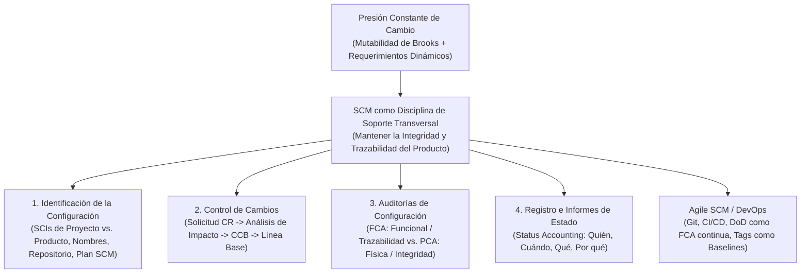
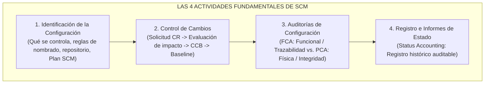
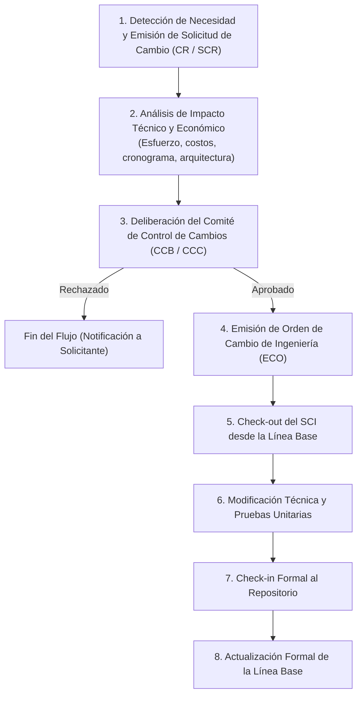
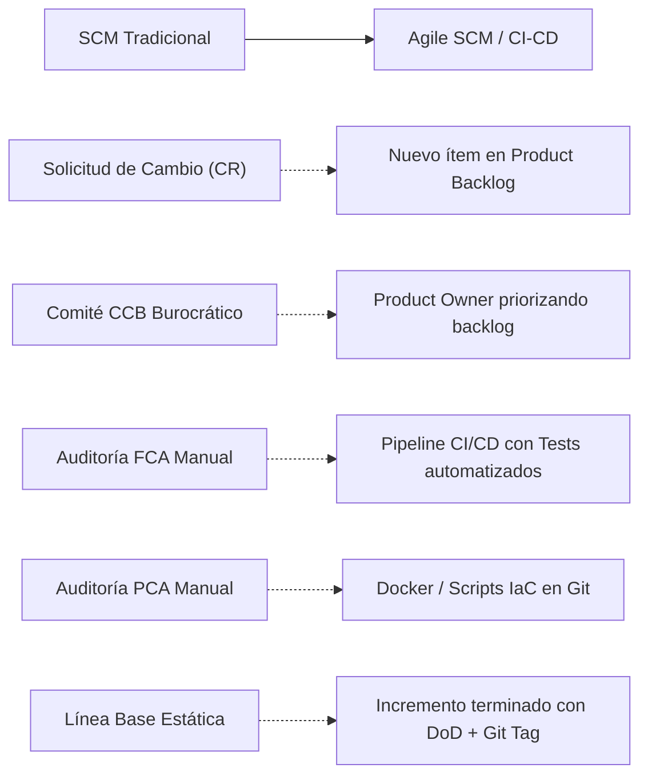
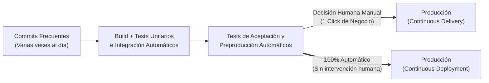

# Resumen Unidad 3: SCM - Gestión de Configuración del Software

> **Materia:** Ingeniería y Calidad de Software (UTN-FRC 4K2)  
> **Cátedra:** Ing. Laura Covara – Ing. Judith Meles  
> **Propósito:** Guía de lectura consciente, retención y comprensión profunda de la Unidad 3. Desarrolla la totalidad de los conceptos teóricos, modelos mentales, filminas oficiales de SCM tradicional vs. ágil y trampas de examen para el 1er Parcial.

---

## 1. El Hilo Conductor: Por qué SCM es la Columna Vertebral de la Integridad

En las Unidades 1 y 2 aprendimos que el software es intangible y está sometido a una presión social constante de cambio (**Mutabilidad esencial de Brooks**). A medida que un proyecto crece, decenas de personas tocan archivos simultáneamente, los clientes piden modificaciones continuas y las versiones se multiplican.

Sin una disciplina formal que gobierne la evolución del software, el sistema cae en el caos: código que se sobreescribe accidentalmente, versiones que nadie sabe cuál es la correcta, componentes incompatibles y entregas que fallan en producción.

---

## 2. La Naturaleza de SCM y los Conceptos Fundamentales

### A. Definición y Propósito Supremo de SCM (Slide 9 a 14 de Presentación 02)
* **Definición Formal:** SCM (*Software Configuration Management*) es una **disciplina de soporte transversal** de la ingeniería de software que aplica procedimientos técnicos y administrativos para identificar los elementos de configuración, controlar sistemáticamente los cambios sobre ellos, auditar su cumplimiento frente a requisitos y registrar el estado de su evolución a lo largo de todo el ciclo de vida.
* **Propósito Central de Cátedra:** **Mantener la integridad y trazabilidad del producto de software** gestionando la evolución del sistema para que el cambio no destruya la calidad ni la consistencia arquitectónica.
* **Por qué es una Disciplina de Soporte Transversal:**
  - No construye código directamente ni define estrategias comerciales.
  - Es **independiente del modelo de ciclo de vida elegido** (aplica exactamente igual en Cascada, RUP o Scrum).
  - Recubre y acompaña a todas las disciplinas técnicas desde la primera sesión de requerimientos hasta el retiro final del producto.

### B. La Integridad del Producto (*Product Integrity*)
Un producto de software posee integridad cuando:
1. **Satisface los requerimientos acordados:** Hace exactamente lo que el cliente y el negocio necesitan.
2. **Posee consistencia interna:** Todos sus componentes son compatibles entre sí (la interfaz gráfica dialoga correctamente con la versión actual de la API y con el esquema de base de datos vigente).
3. **Es trazable:** Se puede rastrear el origen de cada línea de código hasta el requerimiento que la justificó.

---

### C. Ítem de Configuración de Software (SCI / IC - Slide 17 y 18)
* **Definición Formal (IEEE):** Es cualquier unidad de información generada durante el ciclo de vida del software que se coloca bajo control formal de versiones y se trata como una entidad discreta en el proceso de SCM.
* **Axioma de Clase (Notas de SCM):** *"Cualquier elemento que pueda ser guardado en memoria y evolucione en el tiempo es un Ítem de Configuración."*

#### Taxonomía Obligatoria de Cátedra: SCI de Proyecto vs. SCI de Producto
Pregunta típica de parcial: *"Diferencie un ítem de configuración de proyecto de uno de producto y dé dos ejemplos de cada uno."*

| Dimensión | SCI de Proyecto | SCI de Producto |
| :--- | :--- | :--- |
| **Propósito** | Gestionar y gobernar el esfuerzo temporario del proyecto. | Constituir la solución técnica entregable al cliente. |
| **Audiencia** | Líderes de proyecto, Scrum Master, gerencia, docentes. | Desarrolladores, usuarios finales, testers, clientes. |
| **Duración** | Se archiva al finalizar el proyecto. | Evoluciona durante toda la vida útil del producto. |
| **Ejemplos Canónicos** | - **Plan de Proyecto** / Plan de SCM. - **Cronograma** / Minutas de Sprint Planning. - **Presupuesto** y asignación de costos. - **Matriz de Riesgos** y reportes de estado. - **Modalidad Académica** (en el TP de la cátedra). | - **Código Fuente** (archivos `.py`, `.java`, `.ts`). - **Especificación de Requerimientos** (ERS / User Stories). - **Modelos de Arquitectura y Diseño** (diagramas UML). - **Casos y Suites de Prueba** (UAT, tests unitarios). - **Scripts de Base de Datos** (migraciones SQL). - **Manuales de Usuario y Despliegue**. |

---

### D. Versión, Variante y Rama (Slide 19 y 20)
* **Versión:** Estado de un ítem de configuración en un punto temporal específico de su evolución (ej. `v1.0.0`, `v1.0.1`). Refleja una progresión secuencial donde una versión corrige o mejora a la anterior.
* **Variante:** Versión que coexiste de manera paralela con otra versión para satisfacer restricciones operativas distintas, sin reemplazarla (ej. el software bancario compilado para arquitectura Android vs. iOS, o versión en idioma Español vs. Inglés).
* **Rama (*Branch* - Slide 32 a 34):** Línea de desarrollo independiente que se bifurca de la línea principal de desarrollo (*mainline / trunk*) para permitir que los desarrolladores trabajen en paralelo sin afectar el código estable:
  - *Feature Branch:* Rama temporal para construir una historia de usuario aislada.
  - *Release Branch:* Rama de estabilización previa a la salida a producción.
  - *Hotfix Branch:* Rama de emergencia para solucionar un defecto crítico en producción.
  - *Merge / Integración:* Fusión de los cambios de una rama hacia la línea principal, resolviendo conflictos de concurrencia.

---

### E. Línea Base (*Baseline* - Slide 27 a 31)
* **Definición Formal (IEEE / Cátedra):** Una especificación o producto de software que ha sido **formalmente revisada y acordada en un hito del proyecto**, que sirve como base para el desarrollo posterior y que **solo puede modificarse a través de un procedimiento formal de control de cambios**.
* **El Concepto de "Foto Congelada":** Una línea base es una fotografía estable del sistema en un momento determinado. Antes de alcanzar la línea base, los archivos pueden modificarse libremente por los desarrolladores; una vez aprobada la línea base, cualquier modificación exige aprobación formal.

#### Taxonomía de Líneas Base a lo largo del Ciclo de Vida (Slide 30 y 31)
Las líneas base maduran conforme avanza el proceso de desarrollo:
1. **Línea Base Funcional (*Functional Baseline*):** Se establece al cierre de la etapa de requerimientos. Contiene la ERS o el Product Backlog inicial formalmente validado con el cliente.
2. **Línea Base Asignada (*Allocated Baseline*):** Se establece al descomponer los requerimientos funcionales en subsistemas de software y hardware específicos.
3. **Línea Base de Diseño / Desarrollo (*Design Baseline*):** Se establece al aprobar la arquitectura global, modelos de datos y especificaciones de interfaces de componentes.
4. **Línea Base del Producto (*Product Baseline*):** Se establece al finalizar la construcción y testing formal; contiene el código fuente compilado, instaladores, scripts de base de datos y manuales operativos listos para ser desplegados en producción.

---

## 3. Las 4 Actividades Fundamentales de SCM

---

### Actividad 1: Identificación de la Configuración (Slide 37 a 39)
Es la actividad inicial de SCM que establece las reglas del juego antes de comenzar a producir:
1. **Selección de SCIs:** Determinar qué artefactos del proyecto estarán bajo control formal de versiones y cuáles serán temporales o descartables.
2. **Regla de Nombrado Estándar:** Definir una convención algorítmica y estricta para nombrar archivos y carpetas, evitando nombres ambiguos.  
   *Ejemplo de Cátedra (TP4):* `ISW_2026_TP_<MMDD>_<NN>_<DOMINIO_DEL_TP>.<EXT>`
3. **Estructura del Repositorio:** Diseñar el árbol de directorios que separa claramente la bibliografía, los documentos de gestión, los enunciados de TP y los entregables de código.
4. **Creación del Glosario:** Unificar el significado de términos técnicos y del dominio para que todo el equipo utilice el mismo vocabulario.
5. **Elaboración del Plan de SCM (*SCM Plan*):** Documento rector que formaliza los roles responsables, las herramientas de control de versiones a utilizar, los criterios de línea base y los procedimientos de auditoría.

---

### Actividad 2: Control de Cambios (Slide 40 a 43)
El control de cambios es el mecanismo formal para **prevenir cambios no autorizados, descontrolados o con impacto imprevisto**.

#### El Flujo Paso a Paso Tradicional:
1. **Solicitud de Cambio (*Change Request - CR / SCR*):** El cliente, un usuario o un desarrollador detecta una falla o una nueva necesidad y documenta formalmente la solicitud explicando el motivo y beneficio.
2. **Análisis de Impacto:** Los líderes técnicos y de gestión evalúan las consecuencias del cambio: *¿Cuántas horas insume? ¿Qué módulos afecta? ¿Retrasa la fecha de entrega? ¿Qué costo económico tiene?*
3. **Comité de Control de Cambios (*Change Control Board - CCB / CCC*):** Cuerpo colegiado responsable de evaluar y decidir sobre el cambio. Se compone de:
   - Director de Proyecto / Project Manager.
   - Arquitecto de Software / Líder Técnico.
   - Responsable de Aseguramiento de Calidad (PPQA / QA).
   - Representante del Cliente o Product Owner.
   - Encargado de Gestión de Configuración (SCM Manager).
4. **Decisión del CCB:** El comité puede: *Aprobar* el cambio, *Rechazarlo* (justificando motivos) o *Posponerlo* para versiones futuras.
5. **Implementación y Check-in:** Si se aprueba, se genera una Orden de Cambio, se realiza el *check-out* del artefacto de la línea base, se programa la modificación, se prueba exhaustivamente, y se realiza el *check-in* formal, dando nacimiento a una **nueva versión de la Línea Base**.

---

### Actividad 3: Auditorías de Configuración (Slide 44 a 47)
Una auditoría de configuración es una **evaluación independiente, formal y objetiva** que utiliza listas de verificación (*checklists*) para asegurar que el software esté completo y cumpla con las especificaciones antes de una entrega o despliegue.

> [!IMPORTANT]
> **Pregunta Canónica de Examen: FCA vs. PCA**
> Judith Meles y Laura Covara exigen diferenciar con precisión matemática qué valida cada una:
>
> 1. **FCA - Auditoría de Configuración Funcional (*Functional Configuration Audit*):**
>    - **Propósito:** Verificar que el software construido **cumpla efectivamente con todos los requerimientos funcionales y de rendimiento especificados**.
>    - **Pregunta que responde:** *"¿El software hace todo lo que dijimos que iba a hacer y funciona como se esperaba?"*
>    - **Herramienta Fundamental:** La **Matriz de Trazabilidad de Requerimientos** (vincula cada Requerimiento $	o$ Diseño $	o$ Código $	o$ Caso de Prueba ejecutado en verde).
>
> 2. **PCA - Auditoría de Configuración Física (*Physical Configuration Audit*):**
>    - **Propósito:** Verificar la **existencia física, integridad y consistencia** de todos los artefactos declarados en el Plan de Configuración.
>    - **Pregunta que responde:** *"¿Están físicamente presentes todos los archivos, scripts de instalación, manuales de usuario y dependencias en sus versiones correctas?"*
>    - **Herramienta Fundamental:** Lista de verificación (*checklist*) de entregables físicos, dependencias de software, esquemas de base de datos y documentación operativa.

---

### Actividad 4: Registro e Informes de Estado (*Status Accounting* - Slide 48 a 50)
* Es la actividad de SCM que mantiene un **registro histórico permanente, auditable e inmutable** de la evolución de todos los ítems de configuración.
* **Preguntas que responde con certeza matemática:**
  - *¿Qué cambió en el sistema entre la versión 1.2 y la 1.3?*
  - *¿Quién realizó cada modificación y en qué fecha exacta?*
  - *¿Por qué se realizó el cambio (a qué Solicitud de Cambio o ticket de bug corresponde)?*
  - *¿Qué requerimientos están afectados por el cambio en curso?*
  - *¿Cuál es el estado actual de la Línea Base de producción?*

---

## 4. SCM en Entornos Ágiles (Agile SCM - Slide 55 a 57)

Pregunta clásica de integración: *"¿Cómo se implementa SCM en un marco ágil como Scrum sin caer en burocracia que destruya la agilidad?"*

### A. La Transformación Operativa
En Scrum o entornos ágiles no existe un comité burocrático CCB externo que se reúna cada 15 días a sellar papeles, ni se suspende el desarrollo durante semanas para realizar auditorías manuales.

#### Cuadro de Equivalencias Operativas (De Memoria para el Parcial):

| Dimensión Tradicional | Equivalente en Agile SCM / DevOps | Justificación Técnica de Cátedra |
| :--- | :--- | :--- |
| **Solicitud de Cambio (CR)** | **Nuevo ítem en el Product Backlog**. | Los cambios ya no se ven como amenazas; son requerimientos emergentes que entran al backlog para ser priorizados por valor. |
| **Comité CCB / CCC** | **El Product Owner (PO) + Developers**. | El PO evalúa el impacto de negocio y prioriza la historia; los Developers evalúan el impacto técnico y estiman el esfuerzo en Story Points en la Planning/Refinamiento. |
| **Línea Base (Baseline)** | **El Incremento terminado con Git Tag**. | Cada Incremento que cumple al 100% con la Definition of Done (DoD) y es etiquetado con versión semántica en Git constituye una nueva Línea Base operativa. |
| **Auditoría Funcional (FCA)** | **Pipeline de CI/CD con suites de testing automatizadas**. | Cada *push* dispara pruebas unitarias, de integración y regresión. Si las pruebas pasan, el pipeline certifica automáticamente la funcionalidad contra las especificaciones. |
| **Auditoría Física (PCA)** | **Infraestructura como Código (IaC) y Docker**. | Los archivos `Dockerfile`, manifiestos de dependencias (`package.json`, `requirements.txt`) y scripts de compilación garantizan físicamente que todos los artefactos existen y compilan de forma reproducible. |
| **Contabilidad de Estado** | **Historial de commits en Git + Jira/GitHub Issues**. | Cada commit está enlazado al ID de la User Story, proveyendo trazabilidad instantánea de quién modificó qué, cuándo y por qué. |

### B. Políticas de Ramas: Trunk-Based Development vs. GitFlow
* **GitFlow (Tradicional Ágil):** Mantiene ramas de larga duración (`develop`, `release`, `main`) y ramas de feature aisladas. Es robusto para lanzamientos programados por versiones periódicas, pero introduce riesgo de conflictos complejos al integrar ramas que pasaron semanas abiertas.
* **Trunk-Based Development (DevOps Moderno):** Todos los desarrolladores integran sus cambios frecuentemente a la rama principal (*trunk/main*) al menos una vez al día, respaldados por suites de pruebas automatizadas y *Feature Flags* (banderas que ocultan funcionalidades no terminadas en producción). Esto maximiza la integración continua y elimina el "infierno de merges" (*merge hell*).

---

# PARTE II (SEGUNDO PARCIAL): Prácticas Continuas (CI / Continuous Delivery / Continuous Deployment) y Estrategias de Despliegue

---

## 5. Las 3 Prácticas Continuas en el Pipeline de Entrega

| Práctica Continua | Definición Formal de Cátedra | Gatillo Diferenciador para Multiple Choice |
| :--- | :--- | :--- |
| **1. Continuous Integration (Integración Continua - CI)** | Los desarrolladores integran su código en la rama principal (*main/trunk*) **varias veces al día**. Cada integración dispara automáticamente la **compilación (*build*) y la ejecución de pruebas unitarias y de integración** para detectar errores de inmediato. | *"Integrar frecuentemente + Build automático + Pruebas unitarias/integración automáticas"*. |
| **2. Continuous Delivery (Entrega Continua)** | Extiende CI asegurando que el software pase por pruebas automatizadas de aceptación y preproducción, manteniéndose **siempre en estado listo para salir a producción**, pero el despliegue final a producción **requiere una decisión manual humana (de negocio)**. | *"Listo para producción en cualquier momento, pero el pase a producción es MANUAL (decisión humana)"*. |
| **3. Continuous Deployment (Despliegue Continuo)** | Extiende la Entrega Continua automatizando el último paso: **cada cambio que supera todas las etapas automatizadas del pipeline se despliega automáticamente en producción SIN intervención humana**. | *"Pase a producción 100% AUTOMÁTICO sin intervención humana tras pasar los tests del pipeline"*. |

---

## 6. Estrategias de Deployment: Canary Deployment vs. Blue/Green Deployment

| Dimensión | **Canary Deployment** (Despliegue Canario) | **Blue/Green Deployment** (Despliegue Azul/Verde) |
| :--- | :--- | :--- |
| **Funcionamiento** | Se despliega la nueva versión solo para un **pequeño porcentaje inicial de usuarios reales** (ej. 2%–5%). Si no hay fallas, se incrementa gradualmente el tráfico hasta el 100%. | Se mantienen **dos entornos de producción completos e idénticos** (*Blue* activo al 100% y *Green* inactivo). Se instala y prueba la versión nueva en *Green*, y el router **conmuta el 100% del tráfico de golpe** de *Blue* a *Green*. |
| **Ventaja Clave** | **Mitigación de riesgo con bajo costo de infraestructura:** si la versión nueva falla en producción, solo afecta a una fracción mínima de usuarios. | **Cero *downtime* y *rollback* instantáneo:** si algo falla en *Green*, el router vuelve a apuntar a *Blue* en milisegundos. |
| **Desventaja** | Requiere monitoreo fino y convivencia temporal de dos versiones. | **Alto costo de infraestructura** (duplicar el entorno de producción completo). |
