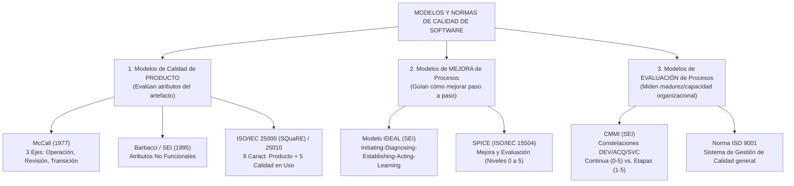
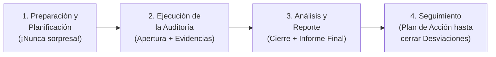
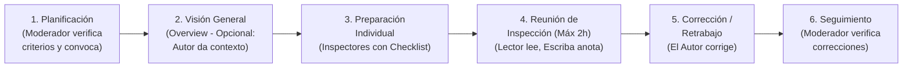
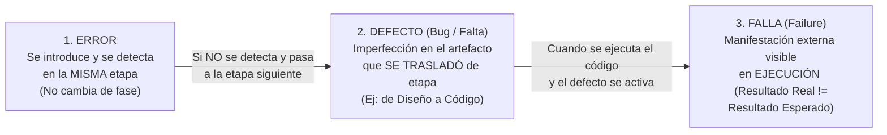
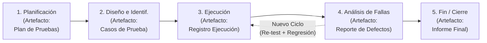
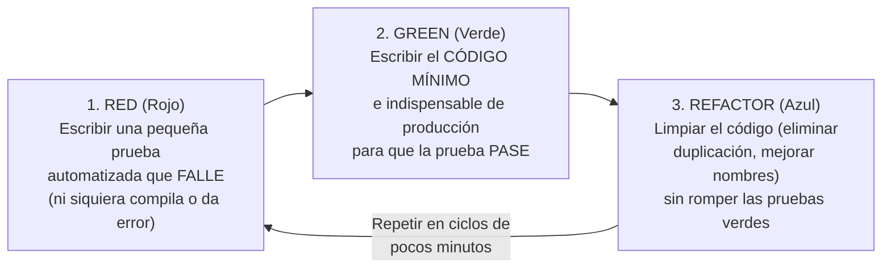

# Masterclass Unidad 4: Aseguramiento de Calidad de Proceso y de Producto (SQA, Modelos, CMMI, Auditorías, Revisiones, Testing y TDD)

> **Materia:** Ingeniería y Calidad de Software (UTN-FRC 4K2)  
> **Cátedra:** Ing. Laura Covara – Ing. Judith Meles  
> **Propósito:** Guía de lectura consciente, retención y comprensión profunda de la Unidad 4 completa (en forma y en criollo). Desarrolla la totalidad de los conceptos teóricos, modelos mentales, filminas oficiales (PRE_09, PRE_12, PRE_13, PRE_14, PRE_16) y trampas de examen para el 2do Parcial.

---

# UNIDAD 4: Aseguramiento de Calidad de Proceso y de Producto

---

> [!IMPORTANT] ACTUALIZACIÓN OFICIAL DE CÁTEDRA (2do Parcial 2026):
> **TEMA EXCLUIDO CONFIRMADO POR LA DOCENTE:** **NO SE EVALÚAN LOS MODELOS DE CALIDAD DE PRODUCTO** (McCall, Barbacci, ISO/IEC 25010 / SQuaRE).
> **SÍ SE EVALÚAN AL 100% LOS MODELOS DE PROCESO:** **CMMI** (Niveles de madurez 1 a 5, representaciones escalonada vs continua, SCAMPI), **SPICE (ISO 15504)** e **ISO 9001**.

## 1. Conceptos Generales sobre Calidad (`PRE_12_PPQAIntro`)

### A. ¿Qué es la Calidad en el Software? (Definición Formal, Implícita y Subjetividad)

* **En Forma (Definición Académica):**
  * Según IEEE / Pressman / Cátedra, la **Calidad del Software** es la **concordancia del software producido con los requerimientos explícitamente establecidos (funcionales y de desempeño), con los estándares de desarrollo prefijados y con los requerimientos implícitos no establecidos formalmente pero que todo usuario desea y espera**.
  * Esta definición encierra **tres pilares clave**:
    1. **Los requerimientos explícitos del software** son la base contra la cual se mide la calidad: si el software no hace lo que se especificó, no tiene calidad.
    2. **Los estándares especificados** definen un conjunto de criterios de desarrollo que guían la forma en que se aplica la ingeniería de software; si no se siguen, casi seguramente habrá falta de calidad.
    3. **Los requerimientos implícitos** (ej. que sea fácil de usar, que no borre datos si se corta internet, que sea mantenible) a menudo no se escriben en el contrato, pero si el software no los satisface, su calidad queda en entredicho.
  * **Carácter Subjetivo y Contextual:** La calidad tiene una componente subjetiva porque **"la calidad está en los ojos de quien la observa"** (depende de quién sea el cliente/usuario y del momento o contexto: un sistema bancario prioriza seguridad e integridad transaccional por encima de animaciones visuales; un videojuego prioriza gráficos y fluidez). Por eso, la ingeniería busca **transformar percepciones subjetivas en atributos y métricas objetivas**.

* **En Criollo:**
  * Cumplir solo lo que dice el papel firmado no alcanza para decir que tu software tiene calidad. Si el cliente te pidió un botón para "Guardar factura" (requerimiento explícito) y tu botón guarda la factura pero tarda 45 minutos o tiene la letra en amarillo fluo ilegible (requerimientos implícitos de performance y usabilidad), el cliente te va a decir que el sistema es una porquería aunque "cumpla el documento".

---

### B. Gestión de la Calidad en los 3 Niveles (Organizacional, Proceso y Proyecto)

1. **Nivel Organizacional:** Establece la cultura de calidad, políticas generales, modelos de referencia (ej. adoptar ISO 9001 o CMMI) y estructura el **Grupo de Aseguramiento de Calidad (GAC / SQA)** independiente de los proyectos.
2. **Nivel de Proceso:** Define los procesos estándar de la organización, guías, plantillas, listas de verificación (*checklists*) y métricas de proceso para asegurar que cualquier proyecto tenga una base repetible.
3. **Nivel de Proyecto:** Instancia y adapta (*tailoring*) el proceso estándar a las necesidades concretas del proyecto mediante un **Plan de Aseguramiento de Calidad del Software (PACS / SQA Plan)** y un **Plan de Pruebas**, ejecutando revisiones técnicas, auditorías y testing sobre los entregables reales.

---

### C. Plan de Calidad según Watts Humphrey y Principios de la Calidad

* **Plan de Calidad (Watts Humphrey):** Todo plan de calidad de un proyecto debe definir explícitamente tres elementos:
  1. **Atributos de Calidad:** Qué características específicas de calidad se requieren para el producto (ej. disponibilidad del 99.9%, mantenibilidad, usabilidad).
  2. **Actividades de Control y Aseguramiento de Calidad:** Qué revisiones técnicas, inspecciones, pruebas y auditorías se realizarán en cada etapa.
  3. **Criterios de Completitud (Entrada y Salida):** Qué condiciones objetivas deben cumplirse para dar por terminada una actividad o fase.
* **Principios Fundamentales de la Calidad:**
  * La calidad **no se agrega al final** ni se "testea" sobre un producto mal hecho; **la calidad se diseña y se construye desde el inicio** en cada actividad del proceso.
  * Un **buen proceso** es condición necesaria (aunque no mágica por sí sola) para obtener de manera predecible un **buen producto**.
  * El costo de prevenir un defecto temprano en requerimientos o diseño es exponencialmente menor que el costo de corregirlo en testing final o en producción (**Regla 1-10-100 de Boehm**).

---

### D. Las 5 Visiones de la Calidad de David Garvin (¡Pregunta Clave de Parcial!)

David Garvin explica que distintas disciplinas y roles entienden la calidad desde **5 perspectivas o visiones diferentes**:

| Visión de Garvin | En Forma (Definición de Cátedra) | En Criollo y Quién piensa así |
| :--- | :--- | :--- |
| **1. Visión Trascendental** | La calidad es algo que **se reconoce inmediatamente cuando se ve o experimenta, pero es imposible de definir de manera precisa y absoluta** (*"excelencia innata"*). | *"No sé explicarte técnicamente por qué, pero usás esta app y se nota que es de primera"*. (Visión filosófica/artística). |
| **2. Visión Basada en el Usuario** | La calidad es la **adecuación al propósito o al uso** (*Fitness for purpose*). Un producto tiene calidad en la medida en que **satisface las necesidades, deseos y expectativas concretas del usuario final**. | Si al usuario le resuelve su problema de forma cómoda y efectiva, tiene calidad. (Visión de **Product Owners, Marketing y UX**). |
| **3. Visión Basada en el Producto** | La calidad está ligada directamente a las **características internas y atributos medibles del propio artefacto** (cantidad de atributos deseables presentes: modularidad, baja complejidad, confiabilidad, cobertura). | Se cree que si la arquitectura interna, el código y las métricas técnicas del producto son excelentes, el usuario estará satisfecho. (Visión de **Desarrolladores y Arquitectos**). |
| **4. Visión Basada en el Proceso (o Manufactura)** | La calidad es la **conformidad con los requerimientos y el apego estricto al proceso y estándares definidos**. Su premisa es que **un proceso de calidad ejecutado sin desvíos producirá un producto de calidad** y reducirá el retrabajo. | *"Si seguimos al pie de la letra el proceso certificado en ISO/CMMI, el software va a salir bien"*. (Visión de **Ingenieros de Procesos y Auditores SQA**). |
| **5. Visión Basada en el Valor (Económica)** | La calidad se define en relación con el **precio y el costo**: un producto de calidad es aquel que **ofrece el máximo desempeño o utilidad a un precio que el cliente está dispuesto a pagar** (y a un costo rentable para quien lo produce). | Un Ferrari es excelente, pero si el cliente necesita un utilitario de \$15.000 para repartir pan, un sistema de \$2 millones no tiene calidad de valor para él. (Visión de **Gerencia General, Finanzas y Sponsors**). |

---

### E. El Equilibrio de las 3 Calidades: Necesaria, Programada y Realizada

```text
         (Lo que el cliente necesita/espera)          (Lo que se especificó y diseñó)
            ┌───────────────────────────┐                ┌───────────────────────────┐
            │   1. CALIDAD NECESARIA    │                │   2. CALIDAD PROGRAMADA   │
            │  (Requerida por Usuario)  │                │   (Planificada en ERS)    │
            └─────────────┬─────────────┘                └─────────────┬─────────────┘
                          │       ┌───────────────────────────┐        │
                          └──────►│     IDEAL: INTERSECCIÓN   │◄───────┘
                                  │     TOTAL DE LAS TRES     │
                                  └─────────────▲─────────────┘
                                                │
                                  ┌─────────────┴─────────────┐
                                  │   3. CALIDAD REALIZADA    │
                                  │ (Construida realmente SW) │
                                  └───────────────────────────┘
```

1. **Calidad Necesaria (o Esperada):** Lo que el cliente/usuario realmente necesita y espera del software (incluyendo requerimientos explícitos e implícitos).
2. **Calidad Programada (o Diseñada):** Lo que el equipo de ingeniería relevó, especificó en los documentos de requerimientos/diseño y planificó construir.
3. **Calidad Realizada (o Lograda):** Lo que el equipo efectivamente construyó y entregó en el código ejecutable real.
* **Desajustes clásicos (Trampas de Examen):**
  * Si **Calidad Necesaria $\neq$ Calidad Programada**: Falló la **Ingeniería de Requerimientos / Validación** (no entendimos lo que quería el cliente).
  * Si **Calidad Programada $\neq$ Calidad Realizada**: Falló la **Construcción / Verificación** (especificamos bien el diseño, pero programamos otra cosa o introdujimos defectos).
  * Si damos **Calidad Realizada $>$ Calidad Necesaria**: Caemos en **Sobrecalidad / *Gold Plating*** (desperdicio Lean #1: encarecemos el proyecto construyendo lujos que el cliente no pidió ni quiere pagar).

---

## 2. Importancia de Trabajar Para y Con Calidad: Ventajas, Desventajas y Problemas

* **Ventajas de implementar Gestión de Calidad:**
  * Disminución drástica de los costos por retrabajo (*rework*) y mantenimiento correctivo.
  * Mayor previsibilidad en tiempos de entrega y presupuestos.
  * Detección temprana de defectos (donde corregirlos cuesta monedas en lugar de fortunas).
  * Mayor satisfacción y confianza del cliente.
  * Menor dependencia de "héroes individuales" gracias a procesos claros y estándares compartidos.
* **Desventajas / Obstáculos percibidos:**
  * Requiere inversión inicial de tiempo, capacitación y dinero (el retorno de inversión —ROI— se ve a mediano/largo plazo, no al día siguiente).
  * Resistencia cultural del equipo técnico (*"la gente de calidad es burocrática, molesta, frena el desarrollo y se mete con mi trabajo"*).
  * Riesgo de burocratización si se llenan formularios por cumplir sin entender el propósito (*Hacer sin Ser*).
* **Problemas de Calidad de PROYECTO vs. Problemas de Calidad de PRODUCTO:**
  * **Problemas de Calidad de Proyecto:** Afectan la gestión y ejecución del esfuerzo (ej. cronogramas irreales, estimaciones erróneas, falta de gestión de riesgos, alta rotación de personal, desvíos de presupuesto, mala comunicación con stakeholders).
  * **Problemas de Calidad de Producto:** Afectan al artefacto de software resultante (ej. alta densidad de bugs, caídas del servidor, lentitud extrema, código espagueti imposible de mantener, brechas de seguridad, interfaz inusable).
  * **Vínculo causal:** Un proyecto mal gestionado (con plazos imposibles y presión extrema) casi siempre deriva en que los desarrolladores recorten pruebas y diseño, generando un **producto de mala calidad**.

---

## 3. Actividades Relacionadas con el Aseguramiento de la Calidad del Software (SQA / PPQA)

### A. SQA (Aseguramiento de Calidad) vs. QC / Testing (Control de Calidad)

> [!CAUTION]
> **CONFUSIÓN MORTAL EN PARCIALES:** **SQA (o PPQA en CMMI) $\neq$ Testing**. En los Multiple Choice siempre ponen una opción trampa que dice *"El grupo de SQA se encarga de diseñar y ejecutar los casos de prueba del software"*. **¡ESO ES FALSO!** Eso lo hace Testing (Control de Calidad).

| Dimensión | **Aseguramiento de Calidad (SQA / QA / PPQA)** | **Control de Calidad (QC / Testing)** |
| :--- | :--- | :--- |
| **Foco Principal** | Enfocado en el **PROCESO** (y en verificar que los estándares de proceso y producto se cumplan). | Enfocado en el **PRODUCTO** (verificar y validar que el software construido funcione sin defectos). |
| **Orientación** | **PREVENCIÓN de defectos** (*Proactivo*): busca mejorar la forma de trabajar para que no se introduzcan errores. | **DETECCIÓN de defectos** (*Reactivo/Correctivo*): busca encontrar los defectos que ya están en el producto antes de entregarlo. |
| **Alcance** | **Transversal a todo el ciclo de vida** y a toda la organización (desde la planificación inicial hasta la entrega). | Se concentra en las actividades de revisión y **ejecución de pruebas sobre los artefactos/código** del proyecto. |
| **Actividades Típicas** | Definir estándares de proceso/producto, realizar **Auditorías de Calidad**, evaluar adherencia al proceso, recolectar métricas de proceso, capacitar. | Diseñar casos de prueba (Caja Negra/Blanca), ejecutar pruebas (unitarias, integración, sistema, regresión), reportar bugs. |
| **Quién lo ejecuta** | El **Grupo de Aseguramiento de Calidad (GAC / SQA)**, que es **independiente del proyecto**. | Los **Testers y Desarrolladores** que forman parte del equipo del proyecto. |

---

### B. El Grupo de Aseguramiento de Calidad (GAC / SQA) y su Independencia Obligatoria

* **Regla de Oro de Cátedra (CMMI PPQA):** El grupo o responsable de SQA **DEBE SER INDEPENDIENTE del Líder de Proyecto (Project Manager) y del equipo de desarrollo**.
* **¿Por qué tiene que ser independiente y tener su propio canal de reporte hacia la Alta Gerencia?**
  * Porque existe un **conflicto de intereses natural**: cuando un proyecto se atrasa y quema las papas por la fecha de entrega, el Líder de Proyecto tiene la tentación de saltar pasos del proceso (ej. *"salteemos las revisiones de diseño y las pruebas de regresión así entregamos el viernes"*).
  * Si el auditor de SQA fuera subordinado del Líder de Proyecto, el Líder le ordenaría callarse y firmar todo como "OK". Al depender de otra rama gerencial (Gerencia de Calidad / Dirección), SQA tiene **objetividad y autoridad para escalar desviaciones a la Alta Gerencia** si no se resuelven dentro del proyecto.

---

### C. Estándares de Producto vs. Estándares de Proceso y Calidad en Procesos Definidos vs. Empíricos

* **Estándares de Producto vs. Estándares de Proceso:**
  * **Estándares de PRODUCTO:** Definen la estructura, formato y características que deben tener los **artefactos o entregables resultantes** (ej. plantilla estándar de Especificación de Requerimientos IEEE 830, estándares de codificación Java/Python, plantilla de Casos de Prueba, estándares de diseño de interfaz UI).
  * **Estándares de PROCESO:** Definen **cómo se deben realizar las actividades** de ingeniería y gestión (ej. procedimiento formal para conducir una Inspección de Fagan, proceso de control de cambios, flujo para gestionar un incidente).
* **La Calidad en Procesos Definidos vs. Procesos Empíricos:**
  * **En Procesos Definidos (Tradicionales / CMMI):** La calidad se asegura definiendo de antemano un proceso detallado y auditando externamente (mediante SQA) que el equipo **siga fielmente el proceso prescripto** (*conformidad con el proceso*).
  * **En Procesos Empíricos (Ágiles / Scrum):** La calidad se asegura mediante la **transparencia, inspección y adaptación continua**, la **Definición de Hecho (*Definition of Done*)**, las prácticas técnicas de **Calidad Embebida** (TDD, Integración Continua, *Pair Programming*, Refactoring) y la autoevaluación del propio equipo en la *Sprint Retrospective*.

---

## 4. Principales Modelos de Calidad Existentes (Producto, Mejora y Evaluación)



---

> [!CAUTION] TEMA EXCLUIDO POR LA CATEDRA (SEGUNDO PARCIAL 2026)
> **CONFIRMADO POR LA DOCENTE EN CLASE:** Los **Modelos de Calidad de PRODUCTO** (Modelo de McCall, Modelo de Barbacci, y Norma ISO/IEC 25010 / SQuaRE) **NO SE EVALUAN EN ESTE PARCIAL**.
> **NO PIERDAS TIEMPO ESTUDIANDO ESTA SECCION.**
> **LO QUE SI ENTRA AL 100% DE MODELOS:** Modelos de **PROCESO** (CMMI Niveles 1 a 5, Representaciones Escalonada vs Continua, SCAMPI, SPICE / ISO 15504 e ISO 9001).

---
### A. Modelos de Calidad de PRODUCTO (Foco en el Artefacto de Software)

#### 1. Modelo de McCall (1977)
Organiza la calidad del producto en **3 ejes o capacidades** vistas desde el usuario y el desarrollador, desglosadas en **11 factores de calidad**:
* **a) Operación del Producto (¿Funciona bien hoy al usarlo?):**
  * *Corrección* (¿hace lo que pedí?), *Confiabilidad* (¿lo hace de forma exacta todo el tiempo?), *Eficiencia* (¿qué tan rápido y con qué recursos corre?), *Integridad / Seguridad* (¿puedo controlar el acceso no autorizado?), *Usabilidad / Facilidad de uso* (¿es fácil operarlo?).
* **b) Revisión del Producto (¿Es fácil cambiarlo y arreglarlo?):**
  * *Mantenibilidad / Facilidad de mantenimiento* (¿puedo localizar y arreglar un error rápido?), *Flexibilidad* (¿puedo modificarlo para agregar cambios?), *Facilidad de prueba / Testabilidad* (¿puedo probarlo fácilmente para validar los cambios?).
* **c) Transición del Producto (¿Se adapta a nuevos ambientes o sistemas?):**
  * *Portabilidad* (¿puedo llevarlo a otro hardware/SO?), *Reusabilidad* (¿puedo reusar partes en otro sistema?), *Interoperabilidad* (¿puede comunicarse e intercambiar datos con otro sistema?).

#### 2. Modelo de Barbacci / SEI (1995)
Se enfoca en los **atributos de calidad de arquitectura (No Funcionales)**: *Performance (Rendimiento)*, *Dependability (Confiabilidad + Disponibilidad + Seguridad operativa/Safety + Seguridad informática/Security)* y *Mantenibilidad / Modificabilidad*.

#### 3. Familia de Normas ISO/IEC 25000 (SQuaRE) e ISO/IEC 25010 (Evolución de ISO 9126)
Es el estándar internacional vigente para evaluar la calidad del producto de software. Divide el modelo en dos grandes partes:
* **1) Modelo de Calidad de Producto (Calidad Interna y Externa — 8 Características):**
  1. **Adecuación Funcional:** Completitud, corrección y pertinencia de las funciones.
  2. **Eficiencia de Desempeño:** Comportamiento temporal (tiempos de respuesta), utilización de recursos (CPU, RAM) y capacidad.
  3. **Compatibilidad:** Coexistencia e **interoperabilidad** con otros sistemas.
  4. **Usabilidad:** Inteligibilidad, facilidad de aprendizaje, operabilidad, protección frente a errores de usuario, estética UI y accesibilidad.
  5. **Fiabilidad (Confiabilidad):** Madurez, **disponibilidad**, **tolerancia a fallos** y **capacidad de recuperación**.
  6. **Seguridad:** Confidencialidad, integridad, no repudio, autenticidad y responsabilidad.
  7. **Mantenibilidad:** Modularidad, reusabilidad, analizabilidad, capacidad de ser modificado y **capacidad de ser probado**.
  8. **Portabilidad:** Adaptabilidad, facilidad de instalación y capacidad de ser reemplazado.
* **2) Modelo de Calidad en Uso (5 Características percibidas por el usuario en su contexto real):** *Efectividad*, *Eficiencia*, *Satisfacción*, *Libertad de riesgo* y *Cobertura de contexto*.

---

### B. Modelos de MEJORA de Procesos

#### 1. Modelo IDEAL del SEI (*Software Engineering Institute*)
Es un ciclo de vida iterativo de **5 fases** diseñado específicamente para guiar un programa de mejora de procesos organizacionales (como implementar CMMI):
* **I — Initiating (Iniciación):** Establecer el estímulo para el cambio, asegurar el patrocinio (*sponsorship*) de la Alta Gerencia, definir objetivos de negocio y asignar recursos.
* **D — Diagnosing (Diagnóstico):** Evaluar el estado actual de los procesos de la organización (*"¿dónde estamos parados hoy?"* mediante un diagnóstico o *gap analysis*) contra el modelo deseado.
* **E — Establishing (Establecimiento):** Planificar las acciones concretas, priorizar qué áreas mejorar primero, formar los grupos de trabajo (SEPG) y fijar metas medibles.
* **A — Acting (Actuación):** Desarrollar, probar en proyectos piloto, refinar y desplegar las mejoras de proceso en toda la organización.
* **L — Learning (Aprendizaje):** Analizar las métricas y lecciones aprendidas para validar si se lograron los objetivos de negocio e iniciar el siguiente ciclo IDEAL.

#### 2. Modelo SPICE (ISO/IEC 15504 — actual serie ISO/IEC 33000)
* *Software Process Improvement and Capability dEtermination*. Es el estándar internacional para evaluar y mejorar la capacidad de los procesos de software en una escala de **6 niveles (del 0 al 5)**:
  * **Nivel 0 (Incompleto)** $\to$ **Nivel 1 (Realizado)** $\to$ **Nivel 2 (Administrado)** $\to$ **Nivel 3 (Establecido)** $\to$ **Nivel 4 (Predecible)** $\to$ **Nivel 5 (Optimizado)**.

---

### C. Modelos de EVALUACIÓN de Procesos: CMMI e ISO 9001

> [!IMPORTANT]
> **CMMI ES TEMA FIJO EN TODOS LOS SEGUNDOS PARCIALES (Apareció en Tema A y Tema B 2025):** Tenés que dominar las 3 constelaciones, las 7 áreas de Nivel 2, Proveedores Tipo A vs. B, el método SCAMPI y la diferencia exacta entre Representación por Etapas y Representación Continua.

#### 1. ¿Qué es CMMI? (*Capability Maturity Model Integration*)
* Desarrollado por el **SEI (*Software Engineering Institute* de la Universidad Carnegie Mellon)**, CMMI es un modelo de referencia de buenas prácticas que evalúa la madurez y capacidad de los procesos de una organización.
* **Premisa fundamental de CMMI:** *"La calidad de un sistema o producto está altamente influenciada por la calidad del proceso empleado para desarrollarlo y mantenerlo"*. CMMI dice **QUÉ** prácticas deben realizarse (metas y prácticas específicas/genéricas), pero **NO impone el CÓMO** (no obliga a usar un ciclo de vida específico).

#### 2. Las 3 Constelaciones de CMMI y las 4 Categorías (22 Áreas de Proceso)
* **Las 3 Constelaciones:**
  1. **CMMI-DEV (*for Development*):** Para organizaciones que **desarrollan y mantienen productos y sistemas de software**. (Consta de **22 Áreas de Proceso**).
  2. **CMMI-ACQ (*for Acquisition*):** Para organizaciones que **compran / adquieren** productos o servicios a terceros y gestionan proveedores.
  3. **CMMI-SVC (*for Services*):** Para organizaciones que **prestan servicios** (ej. mesa de ayuda, operaciones IT, hosting).
* **Las 4 Categorías en que se agrupan las 22 Áreas de Proceso (CMMI-DEV):**
  1. **Gestión de Proyectos** (*Project Management*): PP, PMC, SAM, IPM, RSKM, QPM.
  2. **Gestión de Procesos** (*Process Management*): OPF, OPD, OT, OPP, OID.
  3. **Ingeniería** (*Engineering*): REQM, RD, TS, PI, VER, VAL.
  4. **Soporte** (*Support*): CM (SCM), PPQA, MA, DAR, CAR.

#### 3. Las 7 Áreas de Proceso del Nivel de Madurez 2 (Administrado / Gestionado) y Proveedores Tipo A vs. B

```text
  LAS 7 ÁREAS DE PROCESO DE CMMI NIVEL 2 ("ADMINISTRADO"):
  ┌──────────────────────────────────────────────────────┐
  │ 1. REQM : Gestión de Requerimientos                  │
  │ 2. PP   : Planificación de Proyectos                 │
  │ 3. PMC  : Monitoreo y Control de Proyectos           │
  │ 4. MA   : Medición y Análisis                        │
  │ 5. PPQA : Aseguramiento de Calidad de Proceso y Prod.│
  │ 6. CM   : Gestión de Configuración (SCM)             │
  ├──────────────────────────────────────────────────────┤
  │ 7. SAM  : Gestión de Acuerdos con Proveedores        │ ◄── ¡Solo obligatoria si subcontrata!
  └──────────────────────────────────────────────────────┘
```

* **Diferencia entre Empresas / Proveedores Tipo A y Tipo B (en Nivel 2):**
  * **Tipo A (Con Subcontratación):** Desarrollan software y **subcontratan partes críticas del desarrollo a terceros proveedores** $\to$ Deben acreditar las **7 Áreas de Proceso** de Nivel 2 (incluyendo **SAM - *Supplier Agreement Management***).
  * **Tipo B (Sin Subcontratación):** Desarrollan todo internamente sin subcontratar desarrollo a terceros $\to$ SAM se declara "No Aplicable" y acreditan las **6 Áreas de Proceso** restantes de Nivel 2.

#### 4. Las 2 Representaciones de CMMI: Continua vs. Por Etapas (Escalonada)

| Característica | **Representación CONTINUA** | **Representación POR ETAPAS (Escalonada / *Staged*)** |
| :--- | :--- | :--- |
| **¿Qué evalúa y mejora?** | Evalúa y mejora **Áreas de Proceso individuales** seleccionadas por la organización según sus prioridades de negocio. | Evalúa la **madurez global de toda la organización** mediante conjuntos predefinidos de áreas de proceso en cada escalón. |
| **Métrica que otorga** | **Niveles de CAPACIDAD (*Capability Levels*)**, que van del **Nivel 0 al Nivel 5** para **cada Área de Proceso** por separado (genera un *Perfil de Capacidad*). | **Niveles de MADUREZ (*Maturity Levels*)**, que van del **Nivel 1 al Nivel 5** para **toda la organización**. |
| **Escala de Niveles** | • **Nivel 0:** Incompleto<br>• **Nivel 1:** Realizado (*Performed*)<br>• **Nivel 2:** Administrado (*Managed*)<br>• **Nivel 3:** Definido (*Defined*)<br>• **Nivel 4:** Cuantitativamente Administrado<br>• **Nivel 5:** En Optimización (*Optimizing*) | • **Nivel 1:** Inicial (Caótico, éxito depende de héroes)<br>• **Nivel 2:** Administrado (Proyectos gestionados: 7 áreas)<br>• **Nivel 3:** Definido (Proceso estándar organizacional: +11 áreas)<br>• **Nivel 4:** Cuantitativamente Administrado (Control estadístico: +2 áreas)<br>• **Nivel 5:** En Optimización (Mejora continua e innovación: +2 áreas) |
| **Flexibilidad vs. Comparabilidad** | **Máxima flexibilidad:** la empresa elige qué área mejorar primero (ej. subir solo REQM y PPQA a nivel 3). No da un único número global para marketing. | **Máxima comparabilidad comercial:** permite decir *"Somos una empresa CMMI Nivel 3"*. Para lograr un Nivel $N$, hay que satisfacer **TODAS** las áreas de ese nivel y los anteriores. |

> [!TIP]
> **Detalle clave de los Niveles 2 y 3 (Por Etapas):**
> * En el **Nivel 2 (Administrado)**, cada **proyecto** define y gestiona su propio proceso (puede haber dos proyectos en la misma empresa trabajando distinto, pero ambos planifican, controlan cambios y hacen QA).
> * En el **Nivel 3 (Definido)**, la **organización** tiene un **Proceso Estándar Organizacional único** documentado, y todos los proyectos de la empresa deben **adaptar (*tailor*) su proceso a partir de ese estándar organizacional**.

#### 5. Método de Evaluación Oficial de CMMI: SCAMPI
* **SCAMPI (*Standard CMMI Appraisal Method for Process Improvement*):** Es el método oficial del SEI para evaluar organizaciones contra CMMI. Tiene **3 clases**:
  * **SCAMPI Clase A:** El más riguroso, formal y exhaustivo. Es el **ÚNICO que otorga una calificación oficial de Nivel de Madurez/Capacidad** (válida por 3 años) y requiere un *Lead Appraiser* certificado por el SEI verificando múltiples fuentes de evidencia objetiva (documentos y entrevistas).
  * **SCAMPI Clase B:** Menos costoso; sirve como evaluación intermedia ("simulacro") para ver qué tan cerca está la empresa antes de pagar un Clase A. No otorga certificación oficial.
  * **SCAMPI Clase C:** Evaluación rápida y económica (diagnóstico inicial o *gap analysis*) sobre un área puntual. No otorga calificación.

#### 6. Relación entre CMMI y Metodologías Ágiles (Slides y Apuntes de Clase)
* **¿Pueden convivir CMMI y Ágil?** **Sí**, especialmente en los Niveles 2 y 3, porque CMMI dice *qué* lograr y Ágil puede ser el *cómo* a nivel de ingeniería y gestión de proyecto. Sin embargo, **ambos deben ceder**:
  * **Ágil debe ceder** incorporando trazabilidad explícita de requerimientos (en las User Stories), documentación mínima requerida como evidencia objetiva y **aceptando Auditorías independientes de proceso (PPQA)**.
  * **CMMI (los auditores) debe aceptar** que la evidencia no sean carpetas gigantes de papel firmadas en cascada, sino tableros digitales (Jira/Trello), historias de usuario en el Backlog, tests automatizados y radiadores de información, sin exigir minutas burocráticas de cada Daily Scrum.
* **¿Por qué chocan más al subir a los Niveles 4 y 5?** Porque CMMI Niveles 4 y 5 exigen **estandarización estadística y predicción cuantitativa extrapolando métricas históricas entre distintos proyectos de la organización**, mientras que el enfoque Ágil puro sostiene que los procesos son empíricos y que **la velocidad o experiencia de un equipo no es linealmente extrapolable a otros equipos o proyectos**.

#### 7. Norma ISO 9001 vs. CMMI
* **ISO 9001:** Es una norma internacional certificable de **Sistemas de Gestión de Calidad para cualquier industria** (fábricas, bancos, hospitales o software; para software se complementa con la guía ISO 90003). Es **binaria** (se aprueba o no se aprueba la certificación de cumplimiento de requisitos mínimos de gestión de calidad), mientras que **CMMI es exclusivo de ingeniería/software/servicios y evalúa niveles progresivos de madurez (1 a 5)**.

---

## 5. Auditorías al Software (`PRE_14_AuditoriasDeSw`)

### A. ¿Qué es una Auditoría de Calidad de Software y cuáles son sus Beneficios?

* **En Forma (Definición Académica):**
  * Es una actividad de las disciplinas de soporte que consiste en una **evaluación independiente** (realizada por personal ajeno al equipo del proyecto auditado) de los **productos o procesos de software** con el fin de **asegurar el cumplimiento con los estándares, lineamientos, especificaciones, planes y procedimientos establecidos**, basándose estrictamente en **criterios objetivos y evidencia documental/observable**.
  * Son el instrumento principal del **Aseguramiento de Calidad del Software (SQA / PPQA)**.
* **Beneficios Principales:**
  * Otorgan una opinión **objetiva e independiente** sobre la salud real del proyecto.
  * Dan **visibilidad a la Alta Gerencia** sobre cómo se están ejecutando realmente los procesos de trabajo.
  * Identifican tempranamente **áreas potenciales de insatisfacción del cliente** e incumplimientos antes de que exploten en producción.
  * Permiten identificar tanto **puntos fuertes (buenas prácticas)** para replicar en otros proyectos como **oportunidades de mejora y desviaciones**.

---

### B. Los 4 Tipos de Auditorías en Ingeniería de Software

| Tipo de Auditoría | ¿Qué audita y contra qué contrasta? | ¿Quién la realiza y cuál es su propósito? |
| :--- | :--- | :--- |
| **1. Auditoría de Proyecto (o de Proceso/Calidad)** | Audita un **proyecto en ejecución** contrastando la evidencia real de trabajo contra el **proceso definido y adaptado para ese proyecto** (según el PACS / Plan de Calidad). | Realizada por el **Grupo de SQA (independiente del proyecto)**. Verifica objetivamente que el equipo esté cumpliendo el proceso y manteniendo la consistencia de los artefactos. |
| **2. Auditoría al Grupo de Calidad (Auditoría Externa a SQA)** | Audita **al propio equipo de SQA / Aseguramiento de Calidad** (*"¿Quién audita a los auditores?"*). | Realizada por **personal externo al grupo de QA (o auditores externos a la empresa)** para verificar que los auditores de SQA estén realizando sus auditorías y evaluaciones de manera correcta y objetiva. |
| **3. Auditoría de Configuración Funcional (FCA)** | Compara el **software construido (ejecutable + resultados de pruebas)** contra los **requerimientos especificados en la ERS / Backlog y la matriz de trazabilidad**. | Propia de la disciplina **SCM** antes de liberar una Línea Base de Producto. Su propósito es validar que el software implementa **completa y únicamente** las capacidades funcionales requeridas. |
| **4. Auditoría de Configuración Física (PCA)** | Compara el **código fuente e ítems de configuración por entregar** contra la **documentación técnica, de diseño y manuales de soporte/operación**. | Propia de **SCM** previa a la entrega. Su propósito es asegurar que todos los ítems existen físicamente en la versión correcta y que **la documentación describe fiel y consistentemente al código construido**. |

---

### C. Los 3 Roles en una Auditoría de Software y sus Responsabilidades

> [!IMPORTANT]
> **Pregunta Clásica de Multiple Choice (Apareció en los Parciales 2025):** ¿Quién propone la fecha de la auditoría y quién arma el Plan de Acción para corregir las desviaciones? **¡EL AUDITADO!** (No el auditor).

1. **El Auditado (Generalmente el Líder de Proyecto o referente del equipo auditado):**
   * **Propone la fecha** de realización de la auditoría (dentro de la ventana prevista en el PACS).
   * Participa de las reuniones, **entrega las evidencias** solicitadas y responde las consultas del auditor.
   * Recibe y contesta el reporte de auditoría.
   * **Es el responsable de elaborar y proponer el Plan de Acción Correctivo** para subsanar las **desviaciones** encontradas en el reporte, y de ejecutar dichas correcciones.
2. **El Auditor (o Equipo Auditor / Auditor Líder):**
   * Consta de 1 o 2 personas que **DEBEN ser independientes (externas) al proyecto que se está auditando** (miembros del grupo SQA).
   * **Acuerda la fecha** con el auditado y comunica formalmente el alcance y el *checklist* previo.
   * **Recolecta y analiza la evidencia objetiva** suficiente y relevante.
   * Elabora el **Reporte de Auditoría** clasificando los hallazgos.
   * Realiza el **seguimiento posterior** validando que el Auditado haya cumplido el Plan de Acción y cerrando formalmente las desviaciones.
3. **El Gerente de SQA (Aseguramiento de Calidad):**
   * Gestiona el programa anual de auditorías, asigna a los auditores, aprueba los reportes y **escala a la Alta Gerencia (Dirección)** aquellas desviaciones críticas que el proyecto se niegue a resolver o cuyos planes de acción venzan sin cumplirse.

---

### D. Las 4 Etapas del Proceso de Auditoría y Reglas de Oro



1. **Etapa 1: Preparación y Planificación:**
   * **¡Regla de Oro!** **Las auditorías de software NUNCA son sorpresivas ("caer de sorpresa").** Están planificadas en el PACS.
   * Se acuerda la fecha con el auditado, se define el alcance (qué artefactos y procesos se van a revisar), se prepara la **Lista de Verificación (*Checklist*)** y se estudia la documentación previa del proyecto.
2. **Etapa 2: Ejecución de la Auditoría:**
   * Comienza con una **Reunión de Apertura** breve donde se repasa el objetivo y alcance.
   * Se realizan las entrevistas y la **revisión de evidencias objetivas** guiándose por el *Checklist* (aplicando **muestreo** representativo cuando no es posible revisar el 100% de los artefactos).
3. **Etapa 3: Análisis y Reporte:**
   * El auditor evalúa las evidencias recolectadas y clasifica los hallazgos.
   * Se realiza una **Reunión de Cierre** con el auditado para presentarle preliminarmente los hallazgos (evitando malentendidos o "sorpresas" en el informe escrito).
   * Se emite y distribuye formalmente el **Reporte Final de Auditoría**.
4. **Etapa 4: Seguimiento (*Follow-up*):**
   * Si hubo **Desviaciones**, el **Auditado** presenta su **Plan de Acción** (con tareas responsables y fechas de compromiso).
   * La auditoría **NO termina con la entrega del reporte**: recién se cierra cuando el Auditor verifica en la fecha pactada que las acciones correctivas se ejecutaron efectivamente y las desviaciones quedaron subsanadas. Si no se cumplen, se escala a la Alta Gerencia.

---

### E. Clasificación de los Hallazgos de Auditoría (¡Cazabobos Fijo de Parcial!)

En el Reporte de Auditoría, los hallazgos se clasifican en **3 categorías exactas**:

| Tipo de Hallazgo | Significado (En Forma) | ¿Requiere Plan de Acción Obligatorio? |
| :--- | :--- | :---: |
| **1. Buena Práctica** | Destaca un aspecto sobresaliente donde el proyecto no solo cumplió el estándar, sino que implementó una solución o práctica ejemplar digna de imitarse en toda la organización. | **NO** |
| **2. Desviación (o No Conformidad)** | Incumplimiento objetivo respecto al proceso definido, estándar o plan (basado en evidencia). Se subdivide en dos grados:<br>• **No Adecuado (*Non-compliant*):** El ítem/proceso directamente no existe o incumple gravemente el estándar.<br>• **Necesita Mejora (*Needs Improvement*):** El ítem existe y se aplica parcialmente, pero presenta falencias o incompletitudes respecto al estándar. | **SÍ (OBLIGATORIO)**<br>El auditado debe proponer un Plan de Acción con fecha límite y el auditor debe hacer seguimiento. |
| **3. Observación** | Una advertencia preventiva, sugerencia o debilidad menor detectada que hoy **no constituye un incumplimiento formal del estándar**, pero que podría convertirse en un problema a futuro si no se atiende. | **NO**<br>(Queda a criterio del proyecto implementarla, sin seguimiento obligatorio). |

---

## 6. Técnicas y Herramientas para Revisiones Técnicas del Software (`PRE_13_RevisionesTécnicas`)

### A. Verificación vs. Validación (Barry Boehm)

* **Verificación (*Verification*):**
  * **Pregunta guía:** ***"¿Estamos construyendo el producto CORRECTAMENTE?"*** (*Are we building the product right?*).
  * **Concepto:** Conjunto de actividades que aseguran que el software implementa correctamente una función específica y que los artefactos de una fase **cumplen con las especificaciones y estándares establecidos en la fase previa** (conformidad interna con los requisitos y el diseño).
* **Validación (*Validation*):**
  * **Pregunta guía:** ***"¿Estamos construyendo el producto CORRECTO?"*** (*Are we building the right product?*).
  * **Concepto:** Conjunto de actividades que aseguran que el software construido **es trazable a los requerimientos del cliente y satisface realmente sus necesidades y expectativas operativas en su entorno**.

---

### B. ¿Qué son las Revisiones Técnicas / Revisiones entre Pares (*Peer Reviews*)?

* **En Forma (Definición Académica):**
  * Las **Revisiones Técnicas (o *Peer Reviews*)** son un filtro de **evaluación estática** (no requieren ejecutar código) realizado por **colegas / pares técnicos** del autor durante el desarrollo para detectar errores, ambigüedades, omisiones e inconsistencias en cualquier artefacto de software (especificaciones de requerimientos, historias de usuario, diagramas de arquitectura, código fuente, casos de prueba) **lo más temprano posible**.
* **Reglas Éticas de Oro de toda Revisión Técnica:**
  1. **Se evalúa el ARTEFACTO (el producto de trabajo), NUNCA al autor ni su capacidad personal.** (Los resultados de una revisión jamás se usan para la evaluación de desempeño de RRHH del programador).
  2. El objetivo de la reunión de revisión es **DESCUBRIR y REGISTRAR defectos, NO resolverlos ni rediseñar la solución ahí mismo** (la corrección la hace después el autor en privado).
  3. Mantener un clima de respeto y crítica constructiva.

---

### C. Tipos de Revisiones: Informales (*Walkthrough*) vs. Formales (*Inspección de Fagan*)

```text
  ESPECTRO DE FORMALIDAD DE LAS REVISIONES ENTRE PARES:
  Menor Formalidad ◄────────────────────────────────────────────────────────► Mayor Formalidad
  [ Revisión Ad-hoc / Pair Programming ] ──► [ Walkthrough (Recorrido) ] ──► [ Inspección de Fagan ]
```

#### 1. Revisión Informal / *Walkthrough* (Recorrido o Paseo)
* **Cómo funciona:** Es una reunión de revisión **dirigida y conducida por el propio Autor del artefacto**, quien les "cuenta" o guía paso a paso el documento o código a sus compañeros de equipo para recibir comentarios y detectar errores.
* **Características:** Poca o nula preparación individual previa, no tiene un proceso estricto de entrada/salida, no asigna roles formales fijos ni recolecta métricas estadísticas rigurosas. Es barata y rápida, pero **menos eficaz** porque el autor, sin querer, "guía" a los demás por su propia lógica y puede pasar por alto sus propios puntos ciegos.

#### 2. Revisión Formal / Inspección de Software (Método de Michael Fagan - IBM, 1976)

> [!IMPORTANT]
> **TEMA FIJO DE MULTIPLE CHOICE:** En los exámenes de la cátedra siempre evalúan los **5 Roles de una Inspección Formal** y las **6 Etapas del Proceso de Inspección de Fagan**, especialmente qué hace el **Lector**, qué hace el **Moderador** y la prohibición de corregir en la reunión.

* **Los 5 Roles de una Inspección Formal de Fagan:**
  1. **Autor (Productor):** Es quien creó el artefacto que se va a inspeccionar. Su rol en la reunión es escuchar, responder dudas puntuales si se le consulta y **luego corregir los defectos en la etapa de Retrabajo**. (**¡Nunca puede ser Moderador, Lector ni Anotador de su propio producto!**).
  2. **Moderador (Líder de la Inspección):** Es el responsable de planificar la inspección, verificar que el artefacto cumpla los criterios de entrada, **dirigir la reunión manteniéndola enfocada** (evitando discusiones de solución o ataques personales), controlar el tiempo y realizar el **Seguimiento final** de las correcciones.
  3. **Lector (*Reader*):** Durante la reunión de inspección, es quien **guía al equipo leyendo o parafraseando el artefacto con sus propias palabras** sección por sección. *(Al parafrasearlo un tercero distinto del autor, saltan inmediatamente las ambigüedades entre lo que el autor quiso poner y lo que realmente dice el documento).*
  4. **Anotador / Escriba (*Recorder*):** Registra formalmente en la planilla de inspección cada defecto, inconsistencia o problema detectado durante la reunión (indicando ubicación, descripción y severidad).
  5. **Inspector(es) / Revisor(es):** Su único objetivo es **prepararse individualmente antes de la reunión** usando *Checklists* y **encontrar defectos** en el artefacto. (Todos los participantes, incluido el Moderador y el Lector, actúan también como inspectores).

* **Las 6 Etapas de la Inspección Formal de Fagan:**



  1. **Planificación:** El Autor entrega el artefacto; el **Moderador** verifica que esté listo para inspeccionarse (criterios de entrada), selecciona a los participantes (3 a 6 personas), asigna roles y distribuye el material.
  2. **Visión General (*Overview* — Opcional):** Reunión corta donde el Autor explica el contexto general del artefacto si el equipo no lo conoce.
  3. **Preparación Individual (¡Crítica!):** **Antes de la reunión**, cada inspector examina el artefacto **por su cuenta** ayudándose con **Listas de Comprobación (*Checklists*)** de errores típicos y anota los defectos potenciales que encuentra. *(Si los inspectores no hicieron la preparación individual, el Moderador debe suspender y reprogramar la reunión).*
  4. **Reunión de Inspección:**
     * Duración máxima recomendada: **no más de 2 horas** (después de 2 horas la atención cognitiva cae en picada).
     * El **Lector** va presentando el artefacto, los **Inspectores** exponen los defectos encontrados en su preparación más los que surgen por sinergia grupal, y el **Anotador** los registra.
     * **Regla Inquebrantable:** **En la reunión SOLO se identifican y registran los defectos; NO se debate cómo corregirlos.** Al final, el grupo dictamina el estado del artefacto (*Aceptado tal cual*, *Aceptado condicional a correcciones menores verificadas por el moderador*, o *Rechazado: requiere nueva inspección*).
  5. **Corrección / Retrabajo (*Rework*):** El **Autor** toma la lista de defectos registrada y realiza todas las correcciones sobre el artefacto.
  6. **Seguimiento (*Follow-up*):** El **Moderador** verifica que el Autor haya corregido efectivamente todos los defectos registrados (o convoca a una re-inspección si hubo demasiados cambios) y cierra formalmente la inspección recolectando las métricas (densidad de defectos, horas insumidas).

---

### D. Cómo Verlo de Diversas Formas: Cuadro Comparativo Auditorías vs. Revisiones Técnicas

> [!WARNING]
> **PREGUNTA OBLIGATORIA DE PARCIAL:** ¿En qué se diferencia una **Auditoría de Calidad** de una **Revisión Técnica (Peer Review)**? Estudiate esta tabla fila por fila.

| Criterio de Comparación | **Auditoría de Calidad de Software** | **Revisión Técnica / *Peer Review* (Inspección / Walkthrough)** |
| :--- | :--- | :--- |
| **Propósito Principal** | Evaluar objetivamente la **conformidad / adherencia con procesos, estándares, planes y regulaciones**. | Detectar **defectos técnicos, errores, ambigüedades e inconsistencias en un artefacto de trabajo** para mejorar su calidad técnica. |
| **¿Quién la realiza?** | **Auditores INDEPENDIENTES (externos al proyecto)**, pertenecientes al grupo de SQA o entidad externa. | **PARES / COLEGAS técnicos** (otros desarrolladores, analistas, arquitectos o testers del mismo proyecto o área técnica). |
| **Objeto de Evaluación** | El **Proceso aplicado en el proyecto** y el cumplimiento de estándares en los entregables (usando muestreo). | Un **Artefacto técnico específico en profundidad** (un documento de requerimientos, un diseño, una clase de código, un plan de pruebas). |
| **Herramienta Base** | *Checklist* de cumplimiento de proceso/estándares y recolección de **evidencias objetivas**. | *Checklist* de defectos técnicos por tipo de artefacto y lectura línea por línea / sección por sección. |
| **Salida / Resultado** | **Reporte de Auditoría** con Buenas Prácticas, Observaciones y **Desviaciones** (que exigen un **Plan de Acción** del Auditado). | **Lista de Defectos detectados** en el artefacto (que el **Autor** corrige en la etapa de **Retrabajo**) y dictamen de aceptación del artefacto. |
| **Escalamiento Gerencial** | **Sí:** Si las desviaciones no se corrigen, **se escala a la Alta Gerencia / Dirección**. | **No:** Es una actividad técnica interna de ingeniería; los resultados quedan en el equipo y en métricas despersonalizadas de ingeniería. |


---

## 7. Calidad de Producto: Testing de Software (`PRE_09_TestingdeSoftware` y `CajaNegra`)

### A. ¿Qué es el Testing de Software? Definiciones Clásicas vs. Modernas

* **Definición Clásica (Glenford Myers, 1979):** *"El testing es el proceso de **ejecutar un programa con la intención de encontrar errores**"*.
  * **En Criollo (Cambio de mentalidad de Myers):** Si vos probás tu propio programa "queriendo demostrar que anda bien", inconscientemente vas a elegir los datos fáciles donde sabés que no falla. En cambio, **un buen caso de prueba es aquel que tiene una alta probabilidad de descubrir un error aún no descubierto**, y **una prueba exitosa es aquella que logra hacer saltar un defecto**.
* **Definición Moderna (IEEE / Hetzel / ISTQB):** Proceso de **verificación y validación dinámica** (y también estática al revisar requerimientos/diseño de pruebas) que evalúa un sistema o componente para **determinar si satisface los requerimientos especificados y las necesidades del usuario**, medir su calidad y detectar diferencias entre los resultados esperados y los reales.

---

### B. Los Principios del Testing (Los 10 de Myers + Los 7 de ISTQB)

#### Los 7 Principios Fundamentales del Testing (ISTQB / Cátedra — ¡Fijos en Multiple Choice!)
1. **Las pruebas muestran la presencia de defectos, NO su ausencia:** Probar un software demuestra que hay defectos si saltan, pero aunque pasen 1000 pruebas **nunca se puede demostrar matemáticamente que el software está 100% libre de defectos**.
2. **Las pruebas exhaustivas son imposibles:** Probar absolutamente todas las combinaciones posibles de entradas, estados y precondiciones es inviable salvo en programas triviales. Por eso se usan técnicas de **muestreo inteligente y análisis de riesgo** (Partición de Equivalencias y Valores Límite).
3. **Pruebas tempranas (*Early Testing*):** Las actividades de prueba deben comenzar lo antes posible en el ciclo de vida (desde que se escriben los requerimientos o User Stories) para detectar defectos cuando corregirlos es barato.
4. **Agrupación de defectos (*Defect Clustering* / Principio de Pareto 80-20):** Los defectos no se distribuyen uniformemente; **un pequeño número de módulos concentra la mayoría de los defectos descubiertos** (aprox. el 80% de los bugs están en el 20% de los módulos más complejos o acoplados).
5. **La Paradoja del Pesticida (*Pesticide Paradox*):** Si se repiten una y otra vez exactamente los mismos casos de prueba, llega un punto en que **esos casos dejan de encontrar nuevos defectos** (igual que los insectos se vuelven resistentes al mismo pesticida). Los casos de prueba deben revisarse y actualizarse continuamente.
6. **Las pruebas dependen del contexto:** No se prueba igual una tienda web de ropa que el software del piloto automático de un avión o un marcapasos.
7. **La falacia de la ausencia de errores (*Absence-of-errors fallacy*):** De nada sirve encontrar y corregir el 99% de los bugs técnicos si el sistema construido es inusable o **no cumple con las necesidades y expectativas reales del usuario** (falla de validación).

#### Principios Adicionales de Glenford Myers (Destacados en Filminas)
* **Un programador debe evitar probar su propio programa como única validación:** Porque sufre de "ceguera de autor" (traslada los mismos malentendidos con los que programó al diseñar la prueba y le cuesta "destruir" a su propio hijo). *(Nota: el desarrollador SÍ hace pruebas unitarias/TDD, pero el testing funcional/sistema requiere una mirada independiente o cruzada).*
* **Todo caso de prueba debe definir obligatoriamente su Resultado Esperado ANTES de ejecutarse:** Si ejecutás primero y mirás la pantalla sin haber escrito qué tenía que dar, tu cerebro sufre de sesgo de confirmación y dice *"Ah, dio 142.50, debe estar bien"*.
* **Se deben diseñar casos de prueba tanto para condiciones de entrada VÁLIDAS como para condiciones INVÁLIDAS e inesperadas.**
* **Inspeccionar a fondo el resultado de cada prueba.**
* **Conservar y reutilizar los casos de prueba** para las futuras **Pruebas de Regresión**.

---

### C. Mitos del Testing y "¿Cuánto Testing es Suficiente?" (*Good Enough*)

* **Mitos Comunes Derribados por la Cátedra:**
  * *Mito 1: "El testing es caro y frena el proyecto"* $\to$ **Falso:** Lo que es carísimo es salir a producción con defectos graves.
  * *Mito 2: "El testing solo empieza cuando todo el código está terminado"* $\to$ **Falso:** Diseñar casos de prueba al escribir requerimientos previene los peores errores.
  * *Mito 3: "Si el software fue testeado, tiene cero defectos"* $\to$ **Falso** (Principio 1 de ISTQB).
  * *Mito 4: "Cualquiera puede testear haciendo clicks al azar"* $\to$ **Falso:** El testing requiere metodología ingenieril (Caja Negra/Blanca).
* **¿Cuánto Testing es Suficiente? (Criterios de Salida y *Good Enough Quality*):**
  * Como el testing exhaustivo es infinito, **¿cuándo paramos de probar?**:
    1. Cuando se alcanzan los **Criterios de Aceptación / Salida del Plan de Pruebas** (ej. 100% de casos de prioridad Alta/Media ejecutados, 0 defectos Bloqueantes o Críticos abiertos, cobertura $\ge 85\%$).
    2. Cuando el **riesgo técnico y comercial de liberar el software es aceptable** frente al costo y pérdida de oportunidad de seguir retrasando el lanzamiento (**Enfoque *Good Enough* — Suficientemente Bueno**).
    3. (En la práctica real, lamentablemente muchas veces se frena cuando se acaba el tiempo o el presupuesto del proyecto, por lo cual se debe priorizar siempre probar primero lo más riesgoso).

---

### D. Trilogía Terminológica de la Cátedra: Error vs. Defecto (Bug) vs. Falla

> [!CAUTION]
> **¡ATENCIÓN ESPECIAL AL CRITERIO DE LA CÁTEDRA COVARA-MELES!** Además de la definición ISTQB (Error humano $\to$ Defecto en el código $\to$ Falla en ejecución), en las clases y apuntes de UTN FRC la cátedra define una **diferencia exacta por cambio de etapa** entre **Error** y **Defecto** que toman siempre en los Multiple Choice:



| Concepto | Definición Exacta de Cátedra (UTN FRC) | Ejemplo Claro |
| :--- | :--- | :--- |
| **1. Error** | Equivocación humana al desarrollar un artefacto que **se detecta y corrige dentro de la MISMA etapa en la que fue cometido** (no trasciende a la etapa siguiente). | El analista escribe mal una regla en la Especificación de Requerimientos, pero durante la revisión de requerimientos con su par (en la misma etapa de análisis) lo ven y lo corrigen. |
| **2. Defecto (o *Bug* / Falta)** | Es un error que **NO fue detectado en su etapa de origen y SE TRASLADÓ a una etapa posterior** del desarrollo, quedando alojado estáticamente en un artefacto o en el código fuente. | Aquella regla mal escrita en Requerimientos pasó desapercibida, llegó a Diseño y el programador la codificó en el método `calcularDescuento()`. Está latente en el código aunque nadie ejecute aún el programa. |
| **3. Falla (*Failure*)** | Es la **manifestación externa u observable de un defecto cuando el software SE ESTÁ EJECUTANDO**, provocando que el **Resultado Obtenido difiera del Resultado Esperado**. | Un usuario o tester ejecuta el sistema, compra un producto y el sistema le cobra \$0 o tira un *NullPointerException* en pantalla. *(Nota: Puede haber un defecto en un `if` del código que nunca se ejecute y por ende nunca produzca una falla).* |

---

### E. Severidad vs. Prioridad de un Defecto (¡Pregunta Fija del Parcial 2025!)

Cuando se encuentra y reporta un defecto, se lo clasifica en **dos dimensiones ortogonales (independientes)**:

| Dimensión | **SEVERIDAD (Gravedad Técnica)** | **PRIORIDAD (Urgencia de Negocio)** |
| :--- | :--- | :--- |
| **¿Qué mide?** | Mide el **impacto técnico del defecto sobre el funcionamiento del sistema** (cuánto daño hace al software o a los datos). | Mide la **urgencia comercial/de negocio con la que debe corregirse** (en qué orden debe arreglarlo el equipo). |
| **¿Quién la define?** | La asigna el **Tester / Ingeniero de Pruebas** basándose en criterios técnicos objetivos. | La define el **Product Owner / Cliente / Líder de Proyecto** según el impacto en el negocio y las fechas de entrega. |
| **Escala de Niveles (De mayor a menor)** | 1. **Bloqueante (*Blocker*):** El sistema se cae por completo, corrompe la BD o impide seguir probando el módulo.<br>2. **Crítica (*Critical*):** Una funcionalidad principal del negocio no funciona y no tiene *workaround* (alternativa).<br>3. **Mayor (*Major*):** Una funcionalidad falla o da resultados incorrectos, pero existe un camino alternativo (*workaround*) temporal.<br>4. **Menor (*Minor*):** Falla secundaria o molestia que no impide operar.<br>5. **Cosmética (*Trivial*):** Error de ortografía, color, alineación de un botón o estética UI. | 1. **Urgente / Inmediata:** Dejar todo y arreglar ya (*Hotfix*).<br>2. **Alta:** Debe corregirse obligatoriamente antes de liberar el Sprint / Release actual.<br>3. **Media:** Corregir si da el tiempo en este ciclo o en el próximo.<br>4. **Baja:** Se puede postergar para futuras versiones o cuando sobre tiempo. |
| **¿Cambia con el tiempo?** | Es **relativamente estática** (el daño técnico sobre el código es el mismo hoy que mañana). | Es **dinámica** (puede subir de Baja a Urgente si se acerca la fecha de uso de ese módulo). |

* **Los 2 Ejemplos Cruzados que Toman Siempre en el Examen:**
  * **Caso A: Baja Severidad (Cosmética) + Alta Prioridad:** En la pantalla de inicio de la web del banco, el logo oficial o el nombre del Banco dice *"Banco Nasionall"* con falta de ortografía gigante. Técnicamente el sistema transacciona perfecto (**Severidad Cosmética**), pero por imagen corporativa no puede salir a producción así (**Prioridad Alta/Urgente**).
  * **Caso B: Alta Severidad (Crítica) + Baja Prioridad:** El módulo de "Generación del Balance Anual Impositivo del 31 de Diciembre" crashea por completo al exportar el PDF (**Severidad Crítica**), pero estamos en el mes de **Marzo** y nadie usa esa pantalla hasta fin de año, mientras que mañana hay que entregar el módulo de pagos diarios (**Prioridad Baja/Media hoy**).

---

### F. Ciclos de Prueba y Estrategias de Pruebas de Regresión

* **¿Qué es una Prueba de Regresión (*Regression Testing*)?**
  * Consiste en **volver a ejecutar casos de prueba que ya habían sido ejecutados y habían pasado exitosamente en versiones/ciclos anteriores**, luego de que se introdujeron cambios en el código (corrección de defectos, nuevas funcionalidades o refactorizaciones), con el propósito de **verificar que los cambios recientes NO introdujeron nuevos defectos ni rompieron funcionalidades que antes andaban bien** (*efecto dominó / regresión*).
* **Dinámica de los Ciclos de Prueba (Ciclo 0 a Ciclo $N$):**
  * **Ciclo 0 (Inicial):** Primera ejecución completa de toda la batería de casos de prueba sobre la versión entregada por Desarrollo. Algunos casos pasan (OK) y otros fallan (se reportan defectos y vuelven a Desarrollo para corrección).
  * **Ciclos 1, 2, ..., $N$:** Desarrollo entrega una nueva versión con los defectos corregidos. Acá existen **3 estrategias de ejecución**:
    1. **Estrategia CON Regresión en cada ciclo (Ideal Teórica):** En cada nuevo ciclo se re-ejecutan **los casos que habían fallado (re-testing / confirmación) MÁS todos los casos que habían pasado antes (regresión)**. *Ventaja:* Máxima seguridad inmediata. *Desventaja:* Si las pruebas son manuales, es carísimo y lentísimo (solo es viable si las pruebas están **automatizadas**).
    2. **Estrategia SIN Regresión (Práctica / Riesgosa):** En el Ciclo 1 solo se vuelven a ejecutar los casos que habían fallado en el Ciclo 0; en el Ciclo 2 solo los que fallaron en el Ciclo 1. *Ventaja:* Rápida y barata. *Desventaja:* Altísimo riesgo de que el arreglo del Ciclo 2 haya roto algo que pasó en el Ciclo 0 y nadie se entere antes de salir a producción.
    3. **Estrategia Híbrida (Sin regresión intermedia + Regresión Completa al Final):** Durante los ciclos intermedios (1, 2...) solo se re-prueban los casos fallidos y sus módulos aledaños para avanzar rápido, y en el **último ciclo previo a liberar a producción** se ejecuta una **Prueba de Regresión Completa**.

---

### G. Los 4 Niveles de Prueba, el Modelo en V y los 4 Ambientes

#### 1. Los 4 Niveles de Prueba y el Principio de Granularidad Inversa

```text
  ESPECIFICACIÓN (Izquierda de la V)                     PRUEBAS (Derecha de la V - Granularidad)
  ==================================                     ========================================
  [ Requerimientos de Negocio / Usuario ] ◄────────────► [ 4. Pruebas de ACEPTACIÓN (UAT: Alfa / Beta) ]  (Macro / Sistema entero)
             │                                                                    ▲
             ▼                                                                    │
  [ Especificación del Sistema (ERS)    ] ◄────────────► [ 3. Pruebas de SISTEMA (Funcionales / No Func) ]
             │                                                                    ▲
             ▼                                                                    │
  [ Diseño Arquitectónico / Interfaces  ] ◄────────────► [ 2. Pruebas de INTEGRACIÓN (Top-Down/Bottom-Up)]
             │                                                                    ▲
             ▼                                                                    │
  [ Diseño Detallado / Código de Clases ] ◄────────────► [ 1. Pruebas UNITARIAS (De Componente / Clase)  ]  (Micro / Unidad aislada)
```

> [!NOTE]
> **¿Por qué hablamos de "Granularidad Inversa" en el Modelo en V?** Porque mientras diseñamos (rama izquierda de la V) vamos de lo **General / Macro** ( el negocio entero) hacia lo **Particular / Micro** (un método o función de código); en cambio, cuando ejecutamos las pruebas (rama derecha de la V) vamos en sentido inverso: desde el **grano más fino y pequeño** (**Pruebas Unitarias**) hacia el **grano más grueso y global** (**Pruebas de Aceptación del sistema completo**).

| Nivel de Prueba | ¿Qué prueba exactamente? | ¿Quién la realiza y cómo? | Conceptos Clave de Examen |
| :--- | :--- | :--- | :--- |
| **1. Pruebas Unitarias (o de Componente)** | Verifica el funcionamiento de la **unidad más pequeña de software de forma aislada** del resto (una función, método, procedimiento o clase). | **El Desarrollador** que escribe el código (usando frameworks tipo JUnit/PyTest y *Mocks/Stubs*). | Estratégicamente de Caja Blanca / TDD. Detectan errores algorítmicos y de lógica local al instante. |
| **2. Pruebas de Integración** | Verifica la **interacción, comunicación, pasaje de parámetros y contratos de interfaz entre componentes o subsistemas combinados** (o con la BD / APIs). | **Desarrolladores y/o Testers Técnicos.** | Estrategias:<br>• **Top-Down (Descendente):** Desde el módulo principal hacia abajo, simulando los submódulos aún no hechos con **Stubs**.<br>• **Bottom-Up (Ascendente):** Desde los módulos de bajo nivel hacia arriba, invocándolos mediante **Drivers (Controladores)**.<br>• **Big Bang:** Juntar todo de golpe al final (¡malísima práctica!). |
| **3. Pruebas de Sistema (o de Versión)** | Verifica el **sistema completo y totalmente integrado** contra la Especificación de Requerimientos (tanto requerimientos **Funcionales** como **No Funcionales**). | **Equipo de Testing / QA** en el ambiente de Testing/Staging. | Incluye el **Smoke Test** inicial al instalar la versión, pruebas funcionales de extremo a extremo y pruebas de carga/performance/seguridad. |
| **4. Pruebas de Aceptación (UAT - *User Acceptance Testing*)** | Valida que el sistema cumpla con las necesidades del negocio para que **el cliente/usuario decida formalmente si acepta o no el producto** para desplegarlo. | **El Cliente / Usuarios Finales / Product Owner.** | Se dividen en:<br>• **Pruebas ALFA ($\alpha$):** Realizadas por el cliente/usuario pero **en el entorno controlado del desarrollador** (quien observa y toma nota).<br>• **Pruebas BETA ($\beta$):** Realizadas por los usuarios finales **en su propio entorno real de trabajo / operación**, sin presencia ni control de los desarrolladores. |

#### 2. Los 4 Ambientes (Entornos) de Software
1. **Ambiente de Desarrollo (*Development / Local*):** Donde los programadores codifican y corren sus pruebas unitarias locales. Es inestable y cambia minuto a minuto.
2. **Ambiente de Pruebas (*Testing / QA*):** Entorno controlado y exclusivo para el equipo de Testing donde se instalan versiones cerradas (*builds*) para ejecutar las pruebas funcionales y de integración sin que los programadores toquen el código a mitad de una prueba.
3. **Ambiente de Preproducción (*Staging / UAT*):** Réplica **lo más idéntica posible al ambiente de Producción** (en hardware, configuración y volumen de datos anonimizados). Se usa para pruebas de Aceptación de Usuario (UAT), pruebas de Performance/Carga y simulacros de despliegue.
4. **Ambiente de Producción (*Production*):** El entorno real en vivo donde operan los usuarios finales del negocio.

---

### H. El Proceso de Pruebas en 5 Etapas y sus Artefactos



1. **Planificación:** Definir alcance, riesgos, estrategia, recursos, ambientes, cronograma y criterios de entrada/salida $\to$ Genera el **Plan de Pruebas (*Test Plan*)**.
2. **Diseño e Identificación:** Analizar los requerimientos/historias de usuario, aplicar técnicas de Caja Negra/Blanca para identificar **Condiciones de Prueba** (*qué* probar) y detallar los **Casos de Prueba** (*cómo* probarlo con datos concretos, precondiciones, pasos y resultados esperados) $\to$ Genera la **Especificación / Matriz de Casos de Prueba**.
3. **Ejecución:** Preparar los datos de prueba en el ambiente, correr los casos manuales o automatizados y comparar el *Resultado Real Obtenido* contra el *Resultado Esperado*, marcando cada caso como *Pasa (OK)*, *Falla (Fail)* o *Bloqueado*.
4. **Análisis de Fallas y Seguimiento:** Por cada caso que falló, investigar la causa, aislar los pasos para reproducirla y registrar el incidente asignándole **Severidad** y **Prioridad** $\to$ Genera el **Reporte de Defectos (*Bug Report*)** y alimenta el ciclo de corrección.
5. **Fin / Cierre de Pruebas:** Evaluar si se cumplieron los criterios de salida, calcular métricas finales (cobertura, densidad de defectos, defectos abiertos por severidad) y documentar lecciones aprendidas $\to$ Genera el **Informe Final de Pruebas**.

---

### I. Estrategias de Prueba: Caja Blanca vs. Caja Negra

#### 1. Estrategia de CAJA BLANCA (Estructural / Basada en el Código / *Glass-Box*)
* **Concepto:** El tester/desarrollador **conoce y mira el interior de la caja** (la estructura interna del código fuente, sus sentencias, condicionales `if/else`, bucles `while/for` y caminos lógicos) para diseñar casos de prueba que ejerciten todas las rutas del algoritmo.
* **Grafo de Flujo de Control y Complejidad Ciclomática de McCabe $V(G)$:**
  * Todo procedimiento o método puede representarse como un **Grafo de Flujo** dirigido $G = (N, E)$, donde:
    * **Nodos ($N$):** Instrucciones secuenciales o condiciones de decisión. (Un **Nodo Predicado** es todo nodo del que salen 2 o más aristas por una condición lógica simple).
    * **Aristas ($E$ - *Edges*):** Flechas que indican el flujo de control de un nodo a otro.
    * **Regiones ($R$):** Áreas delimitadas por aristas y nodos, **incluyendo siempre 1 región adicional por el plano exterior abierto**.
  * **Las 3 Fórmulas Equivalentes de la Complejidad Ciclomática de McCabe $V(G)$:**
    $$V(G) = R \quad (\text{Cantidad total de regiones, contando la exterior})$$
    $$V(G) = E - N + 2P \quad (\text{donde } E = \text{Aristas}, N = \text{Nodos}, P = \text{componentes conexos, usualmente } P=1 \implies E - N + 2)$$
    $$V(G) = D + 1 \quad (\text{donde } D = \text{cantidad de nodos predicado / decisiones simples binarias})$$
    *(Atención: Si un `if` tiene una condición compuesta como `if (A > 0 AND B < 5)`, cuenta como **2 decisiones simples** $D=2$, porque internamente son dos ramificaciones booleanas).*
  * **¿Para qué sirve $V(G)$ en Testing?**
    1. Mide cuantitativamente la **complejidad lógica de un módulo** (McCabe recomienda que un módulo no supere **$V(G) \le 10$**; si es mayor, es difícil de entender, mantener y probar, y conviene refactorizarlo).
    2. Determina exactamente el **número de caminos linealmente independientes** del programa (el *Conjunto Básico de Caminos*), lo cual constituye la **cota superior del número de casos de prueba necesarios para garantizar que se ejecuten todas las sentencias y todas las ramas de decisión al menos una vez**.

* **Los 5 Criterios de Cobertura Lógica en Caja Blanca (De más débil a más fuerte):**

| Nivel de Cobertura | ¿Qué exige cubrir como mínimo? | Ejemplo con `if (A > 0 AND B == 1) then X()` |
| :--- | :--- | :--- |
| **1. Cobertura de Sentencias (*Statement Coverage*)** | Que **cada línea o instrucción ejecutable** del código se ejecute al menos una vez. (Es el criterio más débil). | Con un solo caso `(A=5, B=1)` entra al `if`, ejecuta `X()` y cubre el 100% de las sentencias, ¡pero nunca probó qué pasa cuando el `if` da falso! |
| **2. Cobertura de Decisión / Ramas (*Branch Coverage*)** | Que **cada decisión global (`if`, `while`) tome el valor `TRUE` y el valor `FALSE`** al menos una vez (recorriendo tanto la rama verdadera como la falsa). | Con 2 casos: `(A=5, B=1) -> True` y `(A=-1, B=1) -> False` cubrís ambas ramas del `if`, pero nunca probaste que `B == 1` sea falso. |
| **3. Cobertura de Condición (*Condition Coverage*)** | Que **cada condición booleana individual** dentro de una expresión compuesta tome los valores `TRUE` y `FALSE` al menos una vez. | `A > 0` toma T y F, y `B == 1` toma T y F. Ej.: Caso 1 `(A=5 [T], B=0 [F])` y Caso 2 `(A=-1 [F], B=1 [T])`. ¡Ojo: en ambos casos el `AND` global dio `FALSE`, así que no cubrió la rama `TRUE` de la decisión! |
| **4. Cobertura de Decisión / Condición** | Combina las dos anteriores: que cada condición individual tome `T` y `F`, **Y ADEMÁS** que la decisión global tome `T` y `F`. | Caso 1 `(A=5 [T], B=1 [T]) -> Decisión T` y Caso 2 `(A=-1 [F], B=0 [F]) -> Decisión F`. |
| **5. Cobertura de Condición Múltiple** | Exige probar **todas las combinaciones posibles ($2^k$) de valores de verdad** de las $k$ condiciones individuales dentro de cada decisión. | Para 2 condiciones ($2^2 = 4$ casos): `(T,T)`, `(T,F)`, `(F,T)` y `(F,F)`. Es la más exhaustiva pero crece exponencialmente ($2^k$). |

---

#### 2. Estrategia de CAJA NEGRA (Funcional / Basada en Especificaciones / *Behavioral*)
* **Concepto:** El tester ve al software como una **caja negra opaca**: **no conoce ni mira el código fuente interno**, sino que se basa exclusivamente en la **Especificación de Requerimientos / Criterios de Aceptación de la User Story** para suministrar **Entradas** y verificar que las **Salidas** coincidan con el comportamiento esperado.
* **Las 2 Técnicas Fundamentales de Caja Negra de la Cátedra:**
  1. **Partición de Equivalencias (*Equivalence Partitioning*):**
     * Divide el dominio de todos los datos de entrada (y de salida) de una condición externa en un número finito de subconjuntos o **Clases de Equivalencia** (**Clases Válidas** que el sistema debe aceptar y procesar, y **Clases Inválidas** que el sistema debe rechazar con error).
     * **Hipótesis fundamental:** Se asume que **cualquier valor representativo elegido dentro de una misma clase de equivalencia se comporta exactamente igual que cualquier otro valor de esa misma clase** (si uno descubre un defecto, los demás de esa clase también; si uno no lo descubre, los demás tampoco). Así evitamos probar 1 millón de números redundantes.
  2. **Análisis de Valores Límite (*Boundary Value Analysis* - BVA):**
     * Complementa a la Partición de Equivalencias bajo la observación empírica de que **la gran mayoría de los defectos de programación ocurren justo en las fronteras (bordes) de las clases de equivalencia** (porque los programadores se equivocan poniendo `<` en lugar de `<=`, o empezando un arreglo en 1 en vez de 0).
     * **Regla de Aplicación:** En lugar de elegir cualquier número al azar en el medio del rango válido $[a, b]$, se eligen los valores **justo en el límite y a un paso a cada lado de la frontera**:
       * Límite inferior: **$a - 1$** (inválido), **$a$** (válido límite) y opcionalmente $a + 1$.
       * Límite superior: opcionalmente $b - 1$, **$b$** (válido límite) y **$b + 1$** (inválido).

---

### J. Tipos de Pruebas: Smoke Test, Funcionales y No Funcionales

* **Smoke Test (Prueba de Humo / *Build Verification Test*):**
  * Es un subconjunto breve de pruebas básicas y críticas que se ejecuta apenas se compila e instala una nueva versión (*build*) en el ambiente de testing para responder una sola pregunta: ***"¿La versión es lo suficientemente estable como para iniciar el ciclo completo de pruebas, o explota apenas arranca ('sale humo')?"***. Si el *Smoke Test* falla, **se rechaza la versión inmediatamente** y se devuelve a Desarrollo sin gastar tiempo del equipo de QA.
* **Pruebas Funcionales (*"¿Qué hace el sistema?"*):**
  * Evalúan las funciones de negocio especificadas. Pueden diseñarse **Basadas en Requerimientos** (probando cada historia de usuario o caso de uso y sus criterios de aceptación) o **Basadas en Procesos de Negocio** (recorriendo escenarios completos de punta a punta del negocio, ej. desde que un empleado se da de alta hasta que se liquida su sueldo a fin de mes).
* **Pruebas No Funcionales (*"¿Cómo o qué tan bien lo hace el sistema?"* — Cuadrante Q4):**
  * **Pruebas de Performance (Rendimiento):** Miden los tiempos de respuesta, velocidad y consumo de recursos bajo condiciones normales/esperadas de operación.
  * **Pruebas de Carga (*Load Testing*):** Miden el comportamiento del sistema incrementando progresivamente la cantidad de usuarios concurrentes o transacciones hasta llegar al **límite máximo esperado en horas pico** según las especificaciones.
  * **Pruebas de Stress (Estrés):** Someten al sistema a cargas **superiores a su capacidad máxima especificada** (o le restringen memoria/CPU/red al extremo) para descubrir **en qué punto exacto colapsa (*breaking point*) y cómo se recupera** (si pierde datos o se recupera limpiamente cuando baja el pico).
  * **Pruebas de Usabilidad:** Evalúan qué tan fácil de entender, aprender y operar es el sistema para los usuarios reales.
  * **Pruebas de Seguridad:** Evalúan vulnerabilidades, control de accesos, encriptación e inyecciones de código.
  * **Pruebas de Configuración / Portabilidad:** Evalúan que el software funcione en las distintas combinaciones de navegadores (Chrome, Safari, Firefox), sistemas operativos (Android, iOS, Windows) y resoluciones de pantalla.

---

## 8. Testing en Ambientes Ágiles y TDD (`PRE_09_AgileTesting` y `PRE_16_TDD`)

### A. Diferencias entre Testing Tradicional y Testing Ágil

```text
  ENFOQUE TRADICIONAL (Cascada):                           ENFOQUE ÁGIL (Iterativo / Continuo):
  [ Análisis ] ──► [ Diseño ] ──► [ Código ] ──► [TESTING]   Cada Sprint: [ Analizar + Diseñar + Codificar + TESTEAR ]
  (El Testing es una fase al final; si falta tiempo,       (El Testing es una ACTIVIDAD CONTINUA desde el Día 1;
   se recorta y comprime el testing).                       todo el equipo es dueño de la calidad).
```

* En el enfoque tradicional, el testing es una **fase separada al final**, ejecutada por un departamento aislado de "Control de Calidad" que actúa como "policía de la calidad".
* En el enfoque ágil, **el testing NO es una fase, sino una actividad continua transversal** que ocurre desde el primer día del Sprint junto con la programación. **No existe un "equipo de testing separado" dentro del Sprint**: los testers forman parte del equipo de *Developers* multifuncional y **todo el equipo (*Whole Team Approach*) es responsable de la calidad**.

---

### B. El Manifiesto del Testing Ágil (5 Valores) y los 9 Principios del Testing Ágil

#### Los 5 Valores del Manifiesto del Testing Ágil
1. **Probar a lo largo de todo el proceso (Actividad continua)** *sobre* probar al final como una fase.
2. **Prevenir defectos** *sobre* encontrar defectos.
3. **Entender la funcionalidad (Comprensión compartida del negocio)** *sobre* solo comprobar/verificar mecánicamente que cumple el papel.
4. **Construir el mejor sistema (Colaborando juntos)** *sobre* intentar "romper el sistema" enfrentándose a los programadores.
5. **Responsabilidad del equipo por la calidad** *sobre* responsabilidad exclusiva del tester.

#### Los 9 Principios del Testing Ágil (Lisa Crispin & Janet Gregory)
1. El equipo ágil **avanza el proyecto con feedback continuo** provisto por las pruebas.
2. Las pruebas **no son una fase**, son una actividad continua junto al desarrollo.
3. **Todo el equipo** realiza pruebas (desarrolladores, testers, Product Owner).
4. **Acortar el tiempo de respuesta del feedback** (mediante integración continua y pruebas automatizadas).
5. Mantener el **código limpio y simple** (refactorizando defectos y deuda técnica dentro de la misma iteración).
6. **Reducir la documentación de pruebas** al mínimo útil (reemplazar documentos pesados por checklists reutilizables y **pruebas ejecutables automatizadas** como documentación viva).
7. **Guiado por pruebas (*Test-Driven*):** escribir o definir las pruebas **antes** de escribir el código (TDD y ATDD) para prevenir defectos en vez de solo detectarlos después.
8. **Satisfacción del cliente como meta suprema** (*Good Enough Quality* alineada al valor de negocio).
9. **Adaptabilidad** al contexto y aprendizaje continuo en cada retrospectiva.

---

### C. Las 6 Prácticas Concretas del Testing Ágil y el Circuito ATDD Paso a Paso

* **Las 6 Prácticas Concretas del Testing Ágil:**
  1. **Pruebas Unitarias y de Integración Automatizadas** (base de la pirámide e Integración Continua).
  2. **Pruebas de Regresión de Sistema Automatizadas** (para no temer cambiar el código en cada Sprint).
  3. **Pruebas Exploratorias Manuales** (donde un tester humano aplica su creatividad e intuición para descubrir escenarios no previstos).
  4. **TDD (*Test-Driven Development*):** Desarrollo guiado por pruebas unitarias a nivel de código.
  5. **ATDD (*Acceptance Test-Driven Development*) / BDD:** Desarrollo guiado por pruebas de aceptación a nivel de requerimiento de negocio.
  6. **Control de Versiones Conjunto:** Código de producción y código de pruebas automatizadas viven juntos en el mismo repositorio SCM.

* **El Circuito ATDD (*Acceptance Test-Driven Development*) Paso a Paso:**
  1. **Conversación ("Los 3 Amigos": Product Owner + Developer + Tester):** Antes de programar la Historia de Usuario, conversan para destilar los Criterios de Aceptación mediante ejemplos concretos.
  2. **Especificar las Pruebas de Aceptación:** Se escriben las pruebas de aceptación (a menudo en formato *Given-When-Then* / Dado-Cuando-Entonces) **ANTES de escribir el código**.
  3. **Automatizar las Pruebas de Aceptación:** Se conectan a un framework automatizado; al correrlas por primera vez, **fallan** (porque la historia aún no se programó).
  4. **Desarrollar la Funcionalidad (aplicando ciclos cortos de TDD interno):** Los desarrolladores construyen el código hasta que todas las pruebas unitarias y las **pruebas de aceptación automatizadas pasan en verde**.
  5. **Demostración y Regresión:** La prueba de aceptación queda incorporada permanentemente a la batería de regresión continua.

---

### D. El Rol del Tester en el Equipo Ágil

El tester ágil no espera sentado al último día del Sprint a que le "tiren el código por arriba de la pared". Durante todo el Sprint interactúa en **3 frentes**:
1. **Con el Product Owner / Cliente:** Lo ayuda a redactar buenos **Criterios de Aceptación y Pruebas de Usuario (UAT)** sin ambigüedades, pensando en los casos bordes y caminos alternativos/negativos antes del *Sprint Planning*.
2. **Con los Desarrolladores:** Trabaja codo a codo (*pair testing*, *Three Amigos*) definiendo ejemplos ejecutables, ayudando a automatizar pruebas de API/aceptación y probando cada historia apenas se codifica.
3. **Con el Equipo de Sistema (*System Team* / DevOps):** Colabora en mantener el *pipeline* de Integración Continua, los datos de prueba y las pruebas no funcionales/de extremo a extremo.

---

### E. Los 4 Cuadrantes del Testing Ágil (Brian Marick / Crispin & Gregory)

> [!IMPORTANT]
> **PREGUNTA FIJA DEL SEGUNDO PARCIAL 2025 (Apareció en Tema A y Tema B):** Tenés que saber exactamente cómo se cruzan los dos ejes (**Orientado a la Tecnología vs. Orientado al Negocio** y **Apoya al Equipo vs. Critica al Producto**), qué pruebas van en **Q1, Q2, Q3 y Q4**, y **cuáles son manuales vs. automatizadas**.

```text
                                 ORIENTADO AL NEGOCIO (Business-Facing)
                                    (Lenguaje del Dominio / Usuario)
                                                   │
      ┌────────────────────────────────────────────┼────────────────────────────────────────────┐
      │                                            │                                            │
      │   CUADRANTE 2 (Q2)                         │   CUADRANTE 3 (Q3)                         │
      │   • Pruebas Funcionales / Story Tests      │   • Pruebas Exploratorias                  │
      │   • Ejemplos / ATDD / BDD                  │   • Pruebas de Usabilidad                  │
      │   • Prototipos y Simulaciones              │   • Pruebas de Aceptación de Usuario (UAT) │
      │                                            │   • Pruebas Alfa y Beta                    │
      │   👉 [ AUTOMATIZADAS Y MANUALES ]          │   👉 [ 100% MANUALES (Juicio Humano) ]     │
      │                                            │                                            │
APOYA AL EQUIPO ───────────────────────────────────┼─────────────────────────────────── CRITICA AL PRODUCTO
(Guía el desarrollo:                               │                                   (Evalúa el producto terminado
 Prevención / Construcción)                        │                                    para encontrar debilidades)
      │                                            │                                            │
      │   CUADRANTE 1 (Q1)                         │   CUADRANTE 4 (Q4)                         │
      │   • Pruebas Unitarias (TDD)                │   • Pruebas de Performance y Carga         │
      │   • Pruebas de Componentes / Integración   │   • Pruebas de Stress (Estrés)             │
      │   • Calidad interna y arquitectura         │   • Pruebas de Seguridad, Fiabilidad ("-ilities")
      │                                            │                                            │
      │   👉 [ 100% AUTOMATIZADAS ]                │   👉 [ AUTOMATIZADAS CON HERRAMIENTAS ]    │
      │                                            │                                            │
      └────────────────────────────────────────────┼────────────────────────────────────────────┘
                                                   │
                                ORIENTADO A LA TECNOLOGÍA (Technology-Facing)
                                    (Lenguaje de Programación / Infra)
```

* **Nota Clave sobre los Cuadrantes:** Los números Q1, Q2, Q3 y Q4 **NO indican un orden secuencial cronológico obligatorio** (como en cascada), sino una taxonomía para planificar qué pruebas necesita nuestro Sprint.

---

### F. La Pirámide de Automatización de Testing Ágil (Mike Cohn) vs. El Cono de Helado Tradicional

```text
      PIRÁMIDE DE TESTING ÁGIL (Saludable)                CONO DE HELADO / PIRÁMIDE INVERTIDA (Anti-patrón Tradicional)
      ====================================                =============================================================
             ( Testing Exploratorio )                                  \   Pruebas Manuales y de GUI   /  (Lentas, frágiles,
                    /       \                                           \        (80% del esfuerzo)   /    carísimas de mantener)
                   /   GUI   \         ◄── 1% a 5% (Lentas, caras)       \───────────────────────────/
                  /───────────\                                           \   API / Integración     /
                 /  API / Serv \       ◄── 5% a 15% (Reglas negocio)       \───────────────────────/
                /───────────────\                                           \  Unitarias (Pocas)  /
               /    UNITARIAS    \     ◄── 80% a 90% (Rápidas, baratas,      \───────────────────/
              /___________________\        altísimo ROI, corren en segs)      \_________________/
```

1. **Base de la Pirámide — Pruebas Unitarias y de Componentes (80% a 90%):**
   * Son **extremadamente rápidas** (miles corren en pocos segundos), **baratas de escribir y mantener**, indican la línea exacta donde está el error y tienen el **mayor Retorno de Inversión (ROI)** de automatización.
2. **Capa Intermedia — Pruebas de API / Servicios / Aceptación en Capa Lógica (5% a 15%):**
   * Prueban las reglas de negocio e integración de extremo a extremo **evitando pasar por la interfaz gráfica (GUI)**. Son mucho más estables y rápidas que las pruebas de pantalla.
3. **Cima de la Pirámide — Pruebas de GUI / Interfaz de Usuario Automatizadas (1% a 5%):**
   * Simulan clicks en el navegador/app (ej. Selenium, Playwright). Son las **más lentas, costosas y frágiles** (si un diseñador cambia un botón de lugar o renombra un CSS, el test se rompe aunque la lógica de negocio funcione perfecto). Por eso se automatiza en GUI **solo un conjunto mínimo de flujos críticos (*happy paths*)**.
4. **Nube Superior — Testing Exploratorio Manual:**
   * Lo que **NUNCA debe automatizarse**: la exploración creativa, visual y de usabilidad hecha por un ser humano.

---

### G. Desarrollo Guiado por Pruebas: TDD (*Test-Driven Development* - Kent Beck)

> [!IMPORTANT]
> **TDD TIENE SU PROPIA PRESENTACIÓN (`PRE_16_TDD`) Y SU PROPIO PRÁCTICO EVALUABLE (TP6):** La cátedra evalúa en los Multiple Choice qué es TDD (diseño + programación), el ciclo **Red-Green-Refactor**, las **3 Leyes**, el patrón **AAA** y qué son los **Mocks/Stubs**.

#### 1. ¿Qué es TDD realmente?
* Popularizado por **Kent Beck** (como práctica central de *Extreme Programming - XP*), **TDD NO es una técnica de Testing para que los testers encuentren bugs al final; es una técnica de DISEÑO y PROGRAMACIÓN de software** guiada por pruebas unitarias automatizadas.
* **Ecuación de TDD:** $$\text{TDD} = \text{TFD (Test First Development)} + \text{Refactoring}$$
* **¿Por qué decimos que es una técnica de DISEÑO?** Porque al obligarte a escribir primero la prueba que invoca al método antes de que el método exista, te obliga a pensar primero en la interfaz pública de tu clase, a mantener métodos pequeños con una única responsabilidad (**Alta Cohesión**) y desacoplados de bases de datos o servicios externos (**Bajo Acoplamiento**), logrando un **Diseño Emergente** limpio.

#### 2. El Ciclo Mantra de TDD: RED $\to$ GREEN $\to$ REFACTOR



1. **RED (Rojo — Crear una prueba que falle):**
   * Escribís un test unitario pequeñito para un comportamiento puntual que aún no existe. **Lo ejecutás y verificás que FALLE**. *(¿Por qué es obligatorio verlo fallar primero? Para **testear al propio test** y asegurarte de que no escribiste un test mal hecho que da siempre verdadero por accidente).*
2. **GREEN (Verde — Hacer que la prueba pase de la forma más simple):**
   * Escribís **únicamente el código de producción mínimo y más sencillo posible** para que ese test pase en verde, sin agregar lógica extra para requerimientos futuros (*"No adelantar código"*). No importa si en este paso el código no es elegante; el único objetivo es poner la barra en verde rápido.
3. **REFACTOR (Refactorizar — Mejorar el diseño interno):**
   * Con la red de seguridad de todos los tests en verde, **mejorás la estructura interna del código** (eliminás código duplicado, extraés métodos, mejorás nombres, aplicás patrones) **sin alterar su comportamiento externo**, corriendo los tests tras cada toque para confirmar que todo sigue en verde.

#### 3. Las 3 Leyes de TDD (Robert C. Martin - "Uncle Bob")
1. **Primera Ley:** No escribirás código de producción a menos que sea para hacer pasar una prueba unitaria que falla.
2. **Segunda Ley:** No escribirás más de una prueba unitaria de lo estrictamente suficiente para que falle (y no compilar cuenta como fallar).
3. **Tercera Ley:** No escribirás más código de producción del estrictamente suficiente para hacer pasar la única prueba que está fallando actualmente.

#### 4. Anatomía de una Prueba Unitaria: El Patrón AAA (*Arrange - Act - Assert*)
Como viste en el **Práctico 6 de TDD (EcoHarmony Park)** de la guía de la cátedra, todo test unitario se estructura en **3 bloques claramente separados**:
1. **Arrange (Preparar / Precondiciones):** Se instancian los objetos necesarios, se inicializan los diccionarios/variables de entrada y se configuran los *Mocks/Stubs* (ej. `usuario = ...`, `compra = ...`).
2. **Act (Actuar / Secuencia):** Se invoca a la función o método específico que se está probando (ej. `resultado = comprar_entradas(compra, usuario)`).
3. **Assert (Afirmar / Verificar Resultados):** Se compara automáticamente mediante una aserción (`assertEquals(resultado, esperado)`) que la salida o excepción devuelta coincida exactamente con el resultado esperado. *(Una prueba unitaria sin `assert` no prueba absolutamente nada).*

#### 5. Aislamiento en Pruebas Unitarias: *Stubs* y *Mocks* (*Test Doubles*)
Una prueba unitaria debe ser **rápida, determinista y aislada**: no debe conectarse de verdad a la pasarela real de Mercado Pago, ni mandar mails reales por internet, ni depender de una base de datos lenta que puede estar caída. Para aislar la unidad bajo prueba se usan **Dobles de Prueba (*Test Doubles*)**:
* **Stub:** Objeto simulado que **reemplaza a una dependencia real y devuelve respuestas preprogramadas ("enlatadas")** cuando el método bajo prueba lo consulta (ej. un *Stub* de base de datos que siempre devuelve `"Cupo disponible = 5"` sin ir al disco). Verifica **estado**.
* **Mock:** Objeto simulado inteligente que, además de reemplazar a la dependencia, **registra cómo fue invocado y permite verificar el comportamiento / interacción** (ej. un *Mock* del servicio de Email que verifica: *"¿El método `comprar_entradas` llamó exactamente 1 vez a `enviar_mail()` pasándole el correo del cliente?"*).
* **Ventajas y Desventajas de TDD:**
  * *Ventajas:* Altísima cobertura de regresión desde el día 1, código modular y desacoplado, menor tiempo perdido depurando (*debugging*), las pruebas sirven como **documentación viva y ejecutable** de cómo usar cada clase.
  * *Desventajas / Desafíos:* Curva de aprendizaje inicial alta, incrementa el tiempo de codificación inicial entre un 15% y 30% (que se recupera con creces en menor retrabajo y mantenimiento), y si las pruebas están mal diseñadas (muy acopladas a la implementación interna), hay que mantener también el código de pruebas.


---

---

## 4. Diccionario Maestro de Gatillos y Cazabobos de Multiple Choice (Parciales 2025 Tema A y B)

En el Punto 2 del Examen Teórico (32 puntos = 8 preguntas de 4 puntos cada una) las preguntas son de **múltiples opciones correctas**. Acá tenés el desglose forense de las **trampas exactas** tomadas en 2025 para que las reconozcas en 5 segundos:

| Tema de la Pregunta | ✅ Opción VERDADERA (Marcar siempre) | ❌ Opción TRAMPA / FALSA (¡NO marcar jamás!) |
| :--- | :--- | :--- |
| **1. Métricas (Lean, Ágil, Tradicional y Dominios)** | • **Eficiencia de ciclo de proceso** $= \text{Touch Time} / \text{Lead Time}$; cuanto más cercana a **1**, más eficiente es el proceso.<br>• Las métricas de **Proceso** las usa el **Ingeniero de Procesos** y son **públicas y despersonalizadas**.<br>• Las métricas de **Proyecto** las usa el **Líder de Proyecto** y son **privadas**.<br>• **RTF (*Running Tested Features*)** exige que las features estén integradas y pasando todas sus pruebas automatizadas en cada momento. | • *"La eficiencia del ciclo de proceso se calcula como Cycle Time / Touch Time"* (Falso: es al revés, Touch / Lead).<br>• *"Las métricas de proceso permiten evaluar el rendimiento individual de cada desarrollador"* (Falso: nunca se evalúan personas con métricas).<br>• *"La velocidad de un equipo Scrum sirve para compararlo con otro equipo de la empresa"* (Falso: el Story Point es relativo a cada equipo). |
| **2. Prácticas Continuas y Deployment** | • **Continuous Integration (CI):** Integrar código varias veces al día ejecutando build y pruebas unitarias/integración automatizadas.<br>• **Continuous Delivery:** El software está siempre listo para producción, pero el pase a producción requiere **decisión humana manual**.<br>• **Continuous Deployment:** Todo cambio que pasa las pruebas del pipeline se despliega en producción **automáticamente sin intervención humana**.<br>• **Canary Deployment:** Libera la versión nueva a un **pequeño porcentaje de usuarios** y escala gradualmente.<br>• **Blue/Green Deployment:** Mantiene **dos entornos idénticos** y conmuta todo el tráfico del entorno Blue al Green. | • *"En Continuous Delivery cada commit que pasa las pruebas automáticas se instala automáticamente en producción sin intervención humana"* (Falso: eso es Continuous **Deployment**).<br>• *"Canary Deployment requiere duplicar el 100% de los servidores en dos entornos idénticos"* (Falso: eso es Blue/Green).<br>• *"En ambientes ágiles las Auditorías de Configuración son la actividad central de CI"* (Falso). |
| **3. Aseguramiento de Calidad (SQA / PPQA)** | • El grupo de **SQA debe ser independiente** del Líder de Proyecto.<br>• SQA se enfoca en el **proceso** y en la **prevención**, evaluando que el proyecto adhiera al proceso definido.<br>• En la visión de **Garvin basada en el Proceso**, se asume que la calidad del producto es consecuencia de seguir un proceso de calidad. | • *"El grupo de SQA depende jerárquicamente del Líder de Proyecto para agilizar las decisiones"* (Falso: perdería objetividad e independencia).<br>• *"La actividad principal de SQA es diseñar y ejecutar los casos de prueba funcionales del sistema"* (Falso: eso es Testing / Control de Calidad). |
| **4. Modelos de Calidad y CMMI** | • En **CMMI Nivel 2**, las 7 áreas son **REQM, PP, PMC, MA, PPQA, CM y SAM** (los proveedores **Tipo B** que no subcontratan excluyen SAM y aplican 6).<br>• La representación **Continua** mide **Niveles de Capacidad (0 a 5)** por área de proceso; la representación **Por Etapas** mide **Niveles de Madurez (1 a 5)** para la organización.<br>• **SCAMPI Clase A** es el único método que otorga calificación oficial. | • *"La representación por Etapas otorga niveles de madurez del 0 al 5"* (Falso: por Etapas va del **1 al 5**; la que empieza en **0** es la Continua).<br>• *"Para certificar CMMI Nivel 2 es obligatorio tener un Proceso Estándar Único para toda la organización"* (Falso: eso recién es en el **Nivel 3 - Definido**; en Nivel 2 se gestiona a nivel de proyecto). |
| **5. Auditorías vs. Revisiones Técnicas** | • En una **Auditoría**, el **Auditado** propone la fecha, entrega evidencias y **elabora el Plan de Acción** para las **Desviaciones** (*No Adecuado* / *Necesita Mejora*).<br>• Las **Observaciones** y **Buenas Prácticas** **NO** requieren Plan de Acción.<br>• En la **Inspección de Fagan**, el **Lector** parafrasea el artefacto, el **Moderador** dirige y hace el seguimiento, y el **Autor** corrige después en la etapa de **Retrabajo**. | • *"Las auditorías de software deben caer de sorpresa para que el equipo no oculte errores"* (Falso: siempre son planificadas).<br>• *"El Auditor redacta el Plan de Acción que el proyecto debe cumplir"* (Falso: el Plan de Acción lo propone el **Auditado**).<br>• *"Durante la Reunión de Inspección de Fagan el equipo debate y corrige en el acto los defectos encontrados"* (Falso: en la reunión solo se registran; corrige el Autor después). |
| **6. Testing (Error/Defecto/Falla, Severidad/Prioridad, Niveles)** | • **Error:** se detecta en la **misma etapa** en que se introduce.<br>• **Defecto:** error que **se traslada de una etapa a otra**.<br>• **Falla:** manifestación visible del defecto **en ejecución**.<br>• **Severidad** = impacto técnico (lo define el Tester); **Prioridad** = urgencia de negocio (la define el PO/Negocio).<br>• **Pruebas Alfa:** usuario en entorno del desarrollador; **Pruebas Beta:** usuario en su propio entorno real. | • *"Un defecto de severidad Cosmética siempre tiene prioridad Baja"* (Falso: un error ortográfico en el logo principal es Cosmético pero de Prioridad Alta).<br>• *"La Complejidad Ciclomática de McCabe se aplica en pruebas de Caja Negra"* (Falso: McCabe es exclusivo de **Caja Blanca**). |
| **7. Testing Ágil, 4 Cuadrantes y TDD** | • **Q1** (Tecnología + Apoya al equipo): Unitarias/Componentes (**Automatizadas**).<br>• **Q2** (Negocio + Apoya al equipo): Funcionales/Ejemplos (**Auto + Manual**).<br>• **Q3** (Negocio + Critica al producto): Exploratorias/Usabilidad/UAT (**Manuales**).<br>• **Q4** (Tecnología + Critica al producto): Performance/Carga/Seguridad (**Herramientas**).<br>• **Pirámide Ágil:** Base **80-90% Unitarias**, Centro **5-15% API**, Cima **1-5% GUI**.<br>• **TDD:** técnica de **diseño y programación** (*Red $\to$ Green $\to$ Refactor*). | • *"Los Cuadrantes del Testing Ágil deben ejecutarse en orden secuencial estricto Q1 -> Q2 -> Q3 -> Q4"* (Falso: no son fases secuenciales).<br>• *"En la Pirámide de Testing Ágil la mayor inversión de automatización debe hacerse en la interfaz gráfica (GUI)"* (Falso: la GUI es la cima de solo 1-5% por ser lenta y frágil).<br>• *"En el paso Green de TDD se debe escribir el código definitivo optimizado y generalizado para futuros requerimientos"* (Falso: en Green se escribe solo el código **mínimo** para pasar el test; se limpia en **Refactor**). |
| **8. Escalado Ágil (Framework Nexus)** | • Nexus escala de **3 a 9 equipos Scrum** con **UN SOLO Product Backlog** y **UN SOLO Product Owner**.<br>• La **Nexus Daily Scrum** ocurre **ANTES** de las Dailies individuales de cada equipo.<br>• La **Nexus Sprint Review** reemplaza a las Sprint Reviews individuales.<br>• La **Nexus Sprint Retrospective** tiene **3 partes**. | • *"El Nexus Integration Team (NIT) es un equipo aparte que se encarga de integrar manualmente el código de todos los equipos al final del Sprint"* (Falso: los equipos integran continuamente; el NIT asegura, guía y destraba). |
